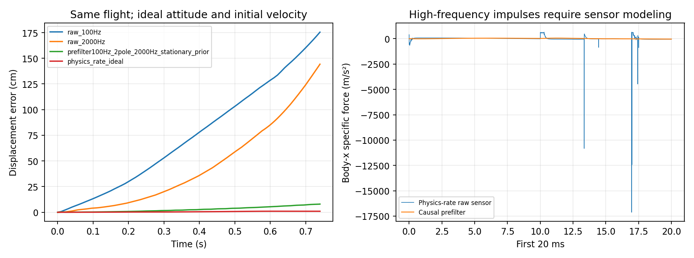

# IMU 历史、NEAT/PPO 与分层控制：文献及可行性试验

日期：2026-10-08。沿用上部 7 g、下部 8 g、base_link IMU、alpha/beta ±0.3 rad、电机围绕原悬停基准 ±10% 的模型。

**结论：加入三轴加速度后，IMU 历史可以支持短时间相对位移估计；历史记忆本身不能消除初速度不确定、传感器偏差和长期漂移。PID 内环＋学习外环有直接的 NEAT 和 PPO 文献依据，值得作为下一轮主方案。**

本次完成了文献核对、九通道 IMU 数据采集与惯性积分诊断，没有训练新的九维 NEAT/PPO 策略，也没有实现或验证新的 PID 内环。以下“下一轮方案”是依据本次结果提出的设计，不是已经完成的悬停结果。此前六维训练报告及其数据保持原样。

## 1. 如何理解上一轮结果

上一轮 NEAT 演示中有局部姿态较好的轨迹，但它在下降；两个 NEAT 训练种子的 128 个最终测试均未满足悬停标准。因此，现在不能把问题简化为“姿态已经稳健解决，只剩位置”。姿态稳定、足够升力和位置反馈都需要改进。

此前输入是 roll/pitch/yaw＋三轴角速度，**没有加速度**。NEAT 已使用循环网络，架构也允许 10–150 ms 的 EMA 记忆节点；不过最终两个导出策略的有效计算图均未使用这些受保护的 EMA 节点。新实验应实际检查历史信息是否进入输出，并做去掉历史的对照，不能只凭网络名称判断它使用了记忆。

## 2. 历史信息能够提供什么

理想加速度计测量的是机体系比力。给定姿态矩阵 R、加速度偏差 b 和重力 g，可以计算：

```text
世界系平移加速度 = R × (加速度计读数 − b) + g
速度估计 = 初始速度 + 加速度的时间积分
相对位移估计 = 速度估计的时间积分
```

所以你的设想在“加入加速度、初始状态已知、测量足够准确”的条件下成立。仅增加原有六维姿态/角速度的历史，并没有直接增加平移加速度测量。网络可能利用气动耦合和动作历史预测运动，但这种模型推断依赖训练分布，不能保证在未知外力下唯一恢复位移。

三个解析例子说明误差为何需要单独处理：恒定加速度偏差 0.02 m/s² 在 8 s 后产生 0.64 m 位移误差；0.5° 固定倾斜估计误差把重力投影成约 0.0856 m/s² 的水平假加速度，对应约 2.74 m；初速度误差 0.05 m/s 对应 0.4 m。这是理想静态条件下的误差传播计算，不是本机器人实测指标。惯性导航的积分和误差机制可参见 [Woodman 的剑桥技术报告](https://www.cl.cam.ac.uk/techreports/UCAM-CL-TR-696.html)。

短窗口也有边界：仅保存最近 0.5 s 原始数据，通常不足以记住更早累计的位移。需要跨窗口保持状态的循环网络，或明确维护速度、位置和偏差估计。复位时应定义“当前位置就是原点”，并区分真正静止和机架因扑翼发生的瞬时振动速度。

## 3. 最相关的文献及可借鉴之处

以下是针对本项目的定向检索，不是穷尽式系统综述。检索覆盖 NEAT/quadrotor、PPO/flapping-wing、PID/outer-loop、IMU history/inertial odometry；核对算法、观测、动作和仿真/实机证据。游戏 Flappy Bird、泛指进化算法却未使用 NEAT 的工作不作为 NEAT 扑翼证据。

| 文献 | 核对到的架构和结果 | 本项目应如何借鉴 |
|---|---|---|
| Przychodzki & Niewiadomski (2023), *Application of artificial neural networks and NEAT algorithm to control a quadcopter*, DOI 10.34739/si.2023.29.03 | 六输入是原始三轴加速度＋三轴陀螺仪；NEAT 输出 throttle/yaw/pitch/roll 遥控通道；Betaflight SITL 内部 PID 生成电机信号。作者报告仿真悬停训练结果，未展示实机验证。 | 这是直接的“NEAT 上层＋PID 内层”例子，其六维输入与我们旧实验的六维不同。可借鉴控制分工，不能把它视为纯 IMU 长期高精度定位的证明。[论文原文](https://czasopisma.uph.edu.pl/studiainformatica/article/download/3616/3407/8080) |
| Fei et al. (2019), *Flappy Hummingbird*, ICRA | 12 g 扑翼机器人；外层位置/速度 PD、内层姿态 PID。DDPG 在反馈控制器之上输出附加控制量，实现机动的仿真到实机迁移；使用 IMU/Vicon 状态。 | 先建立可用反馈基线，再学习残差。这里是 **DDPG**，不应误写成 PPO，也不是不需要位置信息。[论文](https://arxiv.org/abs/1902.09628) · [作者代码](https://github.com/purdue-biorobotics/flappy) |
| Hsiao et al. (2025), *Hovering Flight of Soft-Actuated Insect-Scale Micro Aerial Vehicles using Deep Reinforcement Learning*, RoboSoft | 专家示范行为克隆初始化，补偿延迟、随机化参数，再用 PPO 微调。720/850 mg 扑翼实机，最长悬停 50 s。状态包括位置、速度、姿态、角速度，实机使用 Vicon；动作是总推力和两个轴的力矩。 | 学习其初始化、延迟建模和动作平滑方式。它支持 PPO 控制扑翼悬停的可行性，但不是 IMU-only 实验。[论文全文](https://arxiv.org/html/2502.12355v1) |
| Saj et al. (2026), *Adaptive Outer-Loop Control of Quadrotors via Reinforcement Learning*, arXiv 预印本 | PPO 外环输出总推力及机体角速度目标，机上 PID 跟踪角速度；历史窗口和循环网络用于处理部分可观测性及估计扰动。Crazyflie 的状态估计融合 IMU、光流、ToF，观测明确包括位置误差和速度。 | 最接近“PPO 外环＋PID 内环＋历史”的方案；没有外部动捕并不等于只有 IMU。[全文 v2](https://arxiv.org/html/2605.16015v2) |
| Liu et al. (2020), *TLIO: Tight Learned Inertial Odometry*, IEEE RA-L, DOI 10.1109/LRA.2020.3007421 | 用 IMU 时间片段预测三维位移及不确定度，并与 EKF 紧耦合。数据来自佩戴头显的行人。 | 支持“学习 IMU 历史＋状态估计器”的思路；行人运动先验不能直接移植到扑翼振动和自由飞行。[论文](https://arxiv.org/abs/2007.01867) |
| Eschmann, Albani & Loianno (2024 version), *Learning to Fly in Seconds*, RA-L | 使用 TD3、动作历史、不对称 actor/critic 和课程训练，实现直接转速控制。actor 仍观测位置与速度；动作历史主要弥补电机动态不可直接观测的问题。 | 加入自己过去的电机/舵机指令，而不只加入传感器历史；不要把此文误归为 PPO 或无位置观测。[全文](https://arxiv.org/html/2311.13081v2) |
| Yu, Lu & Zhang (2025), *Reinforcement learning based recovery flight control for flapping-wing micro-aerial vehicles under extreme attitudes*, IJARS | PPO 与 PD 结合，解决大姿态恢复后的稳定问题；证据是简化纵向动力学仿真。 | 可以借鉴恢复与稳态控制分工，但它不是完整三维定点悬停的实机证明。[论文](https://journals.sagepub.com/doi/full/10.1177/17298806241303290) |

2023 年 NEAT 论文比较了 steepened sigmoid、普通 sigmoid 和 Gaussian。其首组采用 population=40、五次运行、每次 100 generations；作者报告 steepened sigmoid 的表现更好。这个结论局限于其输入缩放、遥控输出映射和任务。我们的零中心 alpha/beta 仍应保留有符号输出；sigmoid 需映射为 `2*sigmoid(x)-1`。当前代码中的 bipolar sigmoid 与 NEAT 默认缩放后的 tanh 数学等价，不能把这两个选项当作两种独立的表达能力。

本次未找到足以直接复现“NEAT＋完整扑翼动力学＋仅 IMU＋稳健三维定点悬停”的已核对案例；这表示本次检索存在证据空缺，不表示此类工作一定不存在。

## 4. 已完成的本机试验

在模型副本的 base_link 原点安装无质量 accelerometer/gyro site，采集姿态、角速度、加速度共九通道。保留原 NEAT seed836 策略，使用八个新声明的测试种子 2060810000–2060810007，未根据结果挑选演示案例。位置真值只用于误差评估；“oracle v0”条件额外使用初速度真值，明确作为乐观诊断上限。

第一例在 0.74 s 因倾角超限结束，真实末端相对位移约 17.96 cm。对**同一条轨迹**改变采样与滤波，结果如下：

| 加速度获取方式 | 位移估计 RMSE | 末端位移估计误差 |
|---|---:|---:|
| 100 Hz 直接抽取瞬时值 | 90.89 cm | 175.45 cm |
| 2 kHz 直接抽取瞬时值 | 59.92 cm | 144.27 cm |
| 物理步级先经过两个 100 Hz 一阶低通，再采样 2 kHz；静止重力先验初始化滤波器 | 3.71 cm | 7.97 cm |
| 200 kHz 每个物理步读数积分，理想诊断上限 | 0.62 cm | 0.98 cm |

表中均使用理想姿态和已知初速度；200 kHz 是仿真诊断手段，**不是硬件采样率建议**。滤波器也是假设的传感器前端，尚未用真实 IMU 带宽、量程、饱和及噪声验证。先滤波再抽样必须发生在低速读数产生之前；已经混叠的 100 Hz 数据，事后增加历史无法补回被漏掉的信息。

滤波初始化也很关键：若用该次复位后的第一帧瞬时加速度初始化同一滤波器，末端误差是 93.62 cm，而不是 7.97 cm。它会把一次启动瞬态当作持续的初始滤波状态。真实系统应在启动前持续运行传感器/估计器，并妥善处理起飞阶段；不能每次复位随意清零或重复一帧数据后宣称已经收敛。

原始虚拟加速度含非常尖锐的机械/数值脉冲。全部八例的 2 kHz 原始抽样结果也很差，平均末端误差约 6.39 m（oracle v0），见 [全部数据](results.json)。这不能解释成真实 IMU 必然有同样误差，更不能用来否定惯性导航；它说明当前高刚性多体仿真不能直接拿瞬时加速度当作已经建模完成的 IMU。需要分辨机构真实振动、约束/限位产生的脉冲及离散积分效应，再建立传感器带宽和抗混叠模型。



另做了水平平移对照：初始位置平移 `[0.10, -0.08, 0] m`，在 0.2 s 内六维 IMU 观测差为零，轨迹平移残差小于 7e-12 m。九维中的加速度差约 1.4e-4 m/s²，属于该仿真计算的微小数值差异，不能当成位置传感器。这个对照说明**绝对位置原点不由 IMU 决定**；它并不反驳从已知初始位置进行相对位移积分。

验证：重力符号、自由落体比力、旋转坐标转换、恒加速度积分、因果前缀一致性检查通过（3 项测试）。第一例新增传感器/分段采样与原模型回放的观测及位置完全一致。原实验 85 个冻结源文件哈希未变。见 [验证记录](verification.json)、[采样审计](sampling_audit.json)、[预声明协议](protocol.json)。

## 5. 下一轮训练设计

建议把信息来源、估计器和控制器分别做对照，以确定改善来自哪里：

1. **先验证传感器与 PID 内环。** 给加速度建立启动、带宽、量程和延迟模型；在相同 7 g/8 g 机构上辨识 alpha/beta 对姿态的作用、耦合与延迟。先使 PID 姿态/角速度内环在已知悬停推力附近可用，并检查是否持续饱和。上一轮改变质量后 beta 的作用方向已变化，不能照搬四旋翼混控或旧质量分布下的增益。
2. **再比较九维当前值和九维历史。** NEAT 使用真正参与输出的循环记忆，PPO 使用相同时间跨度的循环策略或历史堆叠；都能访问自己过去的三维动作。可从 0.3–1.0 s 历史尝试，用消融检验记忆是否有效。传感器仍为九维，历史/内部状态会增加网络处理的维度，不能称作九个独立瞬时输入的等价比较。
3. **主方案采用估计器＋PID 内环＋学习外环。** 原始输入只来自九维 IMU；滤波与状态估计器维护相对速度/位移及偏差状态，NEAT/PPO 外环输出期望 roll、pitch 和悬停电机基准的增减量。PID 将姿态误差转成实际 alpha/beta。最终执行器仍是 alpha、beta、电机转速三个；学习器输出的角度现在是机体目标姿态，不能与直接输出云台 alpha/beta 混用。
4. **同条件评估。** 保持两算法相同传感器、估计器、内环、动作范围、奖励和环境步预算；至少多个训练种子、独立验证与测试。加入偏差、倾斜估计误差、时间延迟、初速度误差和外力扰动；先测 8 s，再单独评估 20/60 s 的漂移。设置全状态可见的诊断基线以区分控制能力与感知限制，但不能把其成绩算成 IMU-only 成绩。

保留 15 gf 标定附近的电机基准是合理的。对“回到出发点”的测试，应明确将起飞/初始化位置定义为估计器原点，避免像上一轮那样随机初始位置后，要求没有位置输入的策略回到另一个未告知的世界坐标目标。若最终要求长期、受扰动后仍精确回到原点，光流＋测距或其他外部位置/速度参考比单纯增加 population 更直接；这属于后续可选硬件路线，本次没有把它加入 IMU-only 试验。

## 复现

从仓库根目录运行，使用与原实验相同 Python 环境；输出应指向新的目录：

```bash
OMP_NUM_THREADS=1 OPENBLAS_NUM_THREADS=1 python -m experiments.algorithms.neat_imu.imu_history_probe \
  --source artifacts/neat_ppo_7g8g_20261008 --output runs/imu_history_probe
OMP_NUM_THREADS=1 OPENBLAS_NUM_THREADS=1 python -m experiments.algorithms.neat_imu.imu_sampling_audit \
  --root runs/imu_history_probe
python -m pytest -q tests/test_imu_history_probe.py
```

本报告把文献事实、当前模拟诊断和建议的后续设计分开记录；未对 NEAT 与 PPO 的普遍优劣作结论。
