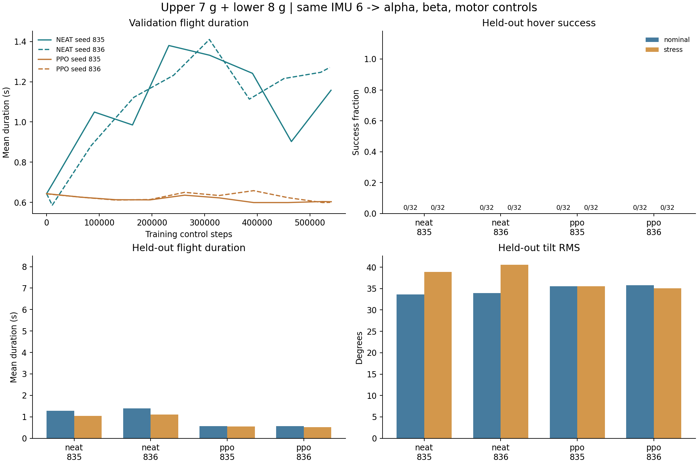
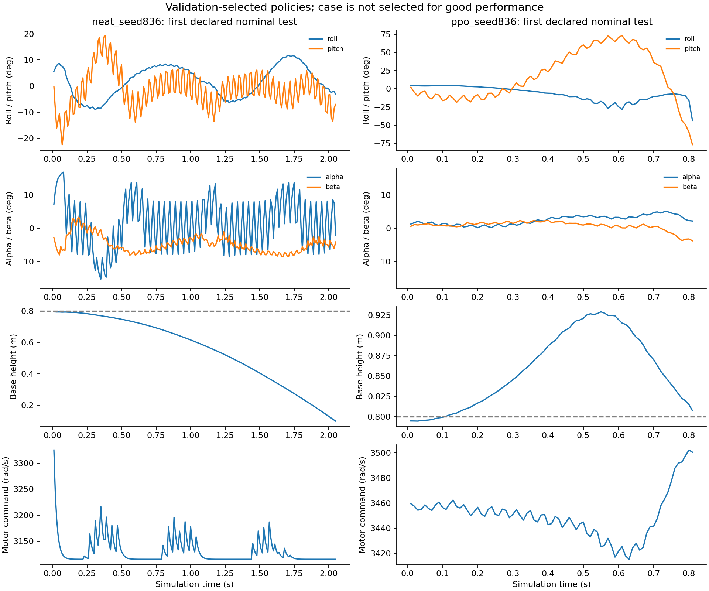

## Material Passport

- Origin Skill: academic-research-suite / experiment-agent
- Origin Mode: run
- Origin Date: 2026-10-08
- Verification Status: ANALYZED; deterministic first test trajectories replayed exactly; full training not re-run
- Version Label: neat_ppo_7g8g_v1

# 上 7 g＋下 8 g：六维 IMU 的 NEAT / PPO 对照实验

**实验执行已完成。两种方法都没有达到预注册的可用悬停门槛。**

“训练程序完成”与“学到了可用策略”分别报告。以下所有策略先按验证集选择并冻结，再进入未见过的最终测试。没有使用最终测试结果调参或挑选演示种子。

## 实验条件

| 项目 | 两种方法共用的配置 |
|---|---|
| 质量 | 完整上部 7 g；下部 8 g；整机 15 g |
| 观测 | base_link 的 roll/pitch/yaw＋三轴角速度，只有 6 维 |
| 归一化 | 姿态除以 0.35 rad；角速度除以 10 rad/s |
| 输出 | α、β 各 ±0.3 rad（±17.19°）；电机基准上下 10% |
| 电机基准 | 3461.360 rad/s 指令；标定扑翼 26.748 Hz |
| 标定平均升力 | 固定机架标定 15.0043 gf；不是自由飞行稳定性的保证 |
| 动力学 | 9.81 m/s² 重力、完整自由飞行、5 µs 物理步长、100 Hz 控制、20 ms 动作平滑 |
| 初态 | 8 个带电扑翼相位随机释放；只在重置时补偿机构初始动量 |
| 奖励 | 相同姿态、位置、速度、动作变化和失败奖励；位置/速度只用于评分，不进入网络 |
| 课程 | 随交互预算逐步从 2 s、±2°发展到 4/8 s 与常规/扰动初态 |
| 随机种子 | 每种算法两个独立训练种子：835、836 |
| 最终测试 | 每个策略 32 个常规＋32 个扰动案例，同一组配对测试种子 |

常规测试姿态初扰动为各轴 ±5°；扰动测试为 ±10°，另有各轴 ±0.25 rad/s 角速度扰动、0.25° / 0.03 rad/s 的 IMU 噪声、一个控制步延迟和 ±3% 电机指令增益误差。重置时还共同叠加各轴标准差 1 cm 的位置噪声和 0.01 m/s 的平移速度噪声，再执行已说明的相位动量补偿。

最终单例成功要求：完整飞行 8 s、位置 RMSE＜10 cm、倾角 RMS＜10°。预注册可用仿真门槛：常规至少 30/32、扰动至少 28/32。

回合提前终止条件：base_link 高度＜0.1 m（ground，非接触检测）、位置误差＞1 m、倾角＞1.4 rad（约 80.2°）或数值异常。文中的飞行时长指到这些终止条件或 8 s 时限为止的仿真时间。

整机质心相对 base_link 原点为 [-0.1516, 0.0002, 0.9524] mm。上下部分按用户给定总质量设置，移动部件质量不变，通过调整固定结构质量实现 7 g / 8 g。

CAD 质心位置、固定结构惯量按质量缩放仍是模型假设。配平标定的严格力矩容差没有完全收敛，使用的是近似配平种子。初态的动量补偿抵消内部运动对整机动量的贡献，并不保证 base_link 在每个扑翼相位的瞬时速度为零，也不等于已求得周期悬停轨道。这里不声称完成了实物验证。

## 算法配置与公平性边界

NEAT：neat-python 2.0.0，种群 128，初始新增 8 个隐藏节点，演化连接、节点、响应和激活函数；保留九个 IMU 滤波记忆节点，时间常数 10–150 ms。初始群体包含近似配平、随机小网络与不同符号/增益的 IMU 反馈图，未使用旧质量模型的赢家或教师策略。

隐藏激活候选为 tanh、sigmoid、softsign、clamped、sin、gauss；输出限定 tanh、clamped、中心化 sigmoid、softsign，确保覆盖正负控制。此库的中心化 sigmoid 与 tanh 在当前缩放下数学等价，所以不会单独增加表达能力。

NEAT 基础变异概率：新增/删除节点 0.10/0.01，新增/删除连接 0.25/0.015，隐藏/输出激活 0.20/0.15，权重/偏置 0.80/0.50。权重和偏置扰动尺度分别为 0.18、0.05，训练预算超过 70% 后减半；记忆节点仍受稳定性修复约束。

PPO：Stable-Baselines3 2.6.0，actor/critic 均为 64×64 tanh MLP，actor 均值经 tanh 限制；学习率 3e−4、gamma 0.995、GAE 0.95、clip 0.2、10 epochs、熵系数 0.003、初始 log_std −1.8。初始输出偏置设在同一个近似配平角附近；没有行为克隆。

**这不是只替换优化器的比较：** NEAT 能演化循环记忆，PPO 基线是前馈网络；网络大小、结构先验和探索方式不同。两者的物理环境、当前输入、动作范围、奖励和测试条件相同，比较的是两套具体方法配置。不能据此概括所有低维问题中的 NEAT/PPO 优劣。

配置依据：[PPO 2.6 官方说明](https://stable-baselines3.readthedocs.io/en/v2.6.0/modules/ppo.html)、[NEAT 激活函数说明](https://neat-python.readthedocs.io/en/latest/activation.html)，并核对本机安装源码。

## 预算与运行结果

NEAT 完成跨过 524288 步的整代；对应 PPO 匹配该实际交互数并向上补齐至 2048 步 rollout。验证额外消耗单独列出，不并入训练预算。

| 方法/种子 | 实际训练控制步 | 验证控制步 | 运行秒数 | NEAT 代数 |
|---|---:|---:|---:|---:|
| neat_seed835 | 540190 | 11278 | 3087.3 | 30 |
| neat_seed836 | 537752 | 12867 | 3093.0 | 32 |
| ppo_seed835 | 540672 | 7391 | 3152.0 | — |
| ppo_seed836 | 538624 | 7511 | 3140.1 | — |

### 最终选定网络

| 策略 | 选中时训练步数 | 导出网络结构 | 激活函数 |
|---|---:|---|---|
| neat_seed835 | 309598 | 12 个执行节点（其中 EMA 记忆节点 0 个），55 条连接 | gauss: 2, sigmoid: 2, sin: 1, softsign: 2, tanh: 5 |
| neat_seed836 | 309204 | 11 个执行节点（其中 EMA 记忆节点 0 个），50 条连接 | clamped: 2, gauss: 2, sin: 1, softsign: 3, tanh: 3 |
| ppo_seed835 | 262144 | 6 → 64 → 64 → 3，均值网络共 4803 个参数 | 隐藏层和输出均值均为 tanh |
| ppo_seed836 | 393216 | 6 → 64 → 64 → 3，均值网络共 4803 个参数 | 隐藏层和输出均值均为 tanh |

## 冻结后的独立测试

| 策略 | 组别 | 成功/32 | 平均飞行 s | 位置 RMSE m | 倾角 RMS ° | 动作饱和占比 |
|---|---|---:|---:|---:|---:|---:|
| neat_seed835 | nominal | 0/32 | 1.287 | 0.245 | 33.59 | 99.9% |
| neat_seed835 | stress | 0/32 | 1.043 | 0.196 | 38.87 | 99.8% |
| neat_seed836 | nominal | 0/32 | 1.387 | 0.283 | 33.95 | 96.6% |
| neat_seed836 | stress | 0/32 | 1.108 | 0.212 | 40.59 | 97.3% |
| ppo_seed835 | nominal | 0/32 | 0.568 | 0.173 | 35.55 | 0.0% |
| ppo_seed835 | stress | 0/32 | 0.544 | 0.166 | 35.50 | 0.0% |
| ppo_seed836 | nominal | 0/32 | 0.567 | 0.175 | 35.74 | 0.0% |
| ppo_seed836 | stress | 0/32 | 0.525 | 0.159 | 35.09 | 0.0% |
| constant_trim | nominal | 0/32 | 0.562 | 0.167 | 36.01 | 0.0% |
| constant_trim | stress | 0/32 | 0.531 | 0.154 | 35.96 | 0.0% |

### 失效原因

| 策略 | 组别 | 回合终止统计 |
|---|---|---|
| neat_seed835 | nominal | ground: 18, tilt: 14 |
| neat_seed835 | stress | ground: 13, tilt: 19 |
| neat_seed836 | nominal | ground: 17, tilt: 15 |
| neat_seed836 | stress | ground: 9, tilt: 23 |
| ppo_seed835 | nominal | tilt: 32 |
| ppo_seed835 | stress | tilt: 32 |
| ppo_seed836 | nominal | tilt: 32 |
| ppo_seed836 | stress | tilt: 32 |
| constant_trim | nominal | tilt: 32 |
| constant_trim | stress | tilt: 32 |

RMSE 计算至该回合结束；提早坠落/翻转的回合持续时间更短，因此不能只看更小的 RMSE 判断更好。主要判断依据是完整 8 s 的成功率，同时报告持续时间和失效原因。两个训练种子仅支持描述性结论，没有做“算法普遍优越”的显著性声明。

六维 IMU 不直接观测高度、水平位置或平移速度。网络可能稳定姿态，但对持续升力偏差引起的高度漂移缺少直接反馈；本实验没有擅自增加观测维度，也没有偷偷按测试场景调整电机基准。

本轮没有分别消融质心位置、种群规模或激活函数，因此不能将训练结果归因于其中某一个因素。结论限定为这份 7 g / 8 g 模型、六维观测和已记录的训练预算。

后续诊断应先核对自由飞行中 α/β 到机体力矩的符号、幅值和时延，以及周期配平状态的稳定性；再在同样六维输入下比较明确使用滤波记忆的 NEAT 与循环 PPO。这些是尚未验证的后续实验建议，不是本轮结果。若目标包含长期定点与定高，还需要单独处理平移状态的估计或观测问题；增加高度信息本身也不能保证解决姿态失稳。

## 保存的策略与视频

每个运行目录保存最佳 JSON 策略；PPO 另保存 SB3 `.zip`，NEAT 另有种群检查点。两个演示策略按验证集选取，视频均使用最终测试预先声明的第一个常规/扰动种子，4 倍慢放。

- NEAT 演示策略：`neat_seed836`；[常规测试视频](videos/neat_seed836_nominal.mp4)、[扰动测试视频](videos/neat_seed836_stress.mp4)。
  常规示例实际飞行 2.05 s，倾角 RMS 9.57°，位置 RMSE 38.24 cm；电机指令中位数 3117.0 rad/s，终止原因为 `ground`。
- PPO 演示策略：`ppo_seed836`；[常规测试视频](videos/ppo_seed836_nominal.mp4)、[扰动测试视频](videos/ppo_seed836_stress.mp4)。
  常规示例实际飞行 0.81 s，倾角 RMS 39.94°，位置 RMSE 18.61 cm；电机指令中位数 3450.4 rad/s，终止原因为 `tilt`。

这些视频是预先指定案例的回放，不能替代上面的全部测试统计；局部姿态较稳也不代表维持了高度或位置。

## 完整性与复现

- 正式训练源文件及模型哈希校验通过，见 `training_source_manifest.json` 和 `training_source_snapshot.zip`。
- 19 项相关预检测试通过；两种算法的冒烟训练、相同种子环境轨迹、物理动作范围与六维观测检查通过。
- 首次冒烟运行出现 `root` 与继承环境关节编号重名，已改为 `experiment_root` 后重新验证；失败日志保留。正式训练前冻结了修复后的源码。
- PPO 导出的 NumPy actor 与 SB3 确定性输出按 2e−6 容差核对；所有最终策略第一例常规测试轨迹都进行完全一致的重复回放。
- 训练种子范围与验证/最终测试种子范围分开；最终测试在全部四个策略冻结后才运行。
- `protocol.json` 是正式训练前的配置；`campaign_status.json` 记录进程、退出码及时间。单次训练硬超时 4 小时。

[实验协议](protocol.json) · [最终测试汇总](final_test/results.json) · [逐回合轨迹](final_test/) · [冻结源码归档](training_source_snapshot.zip) · [复现说明](../../experiments/algorithms/neat_imu/COMPARE_README.md)

总训练控制步：2157238；验证控制步：39047；最终测试控制步：25989。不含标定、预热、冒烟、重复回放和视频渲染。

运行入口：

```bash
OMP_NUM_THREADS=1 OPENBLAS_NUM_THREADS=1 python -m experiments.algorithms.neat_imu.compare_campaign --root artifacts/neat_ppo_7g8g_20261008
python -m experiments.algorithms.neat_imu.compare_results --root artifacts/neat_ppo_7g8g_20261008
```

以上入口防止覆盖已有结果；复现实验需复制配置与模型到新的输出目录。




