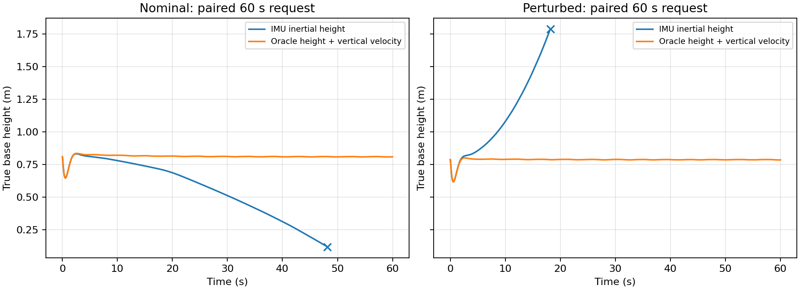
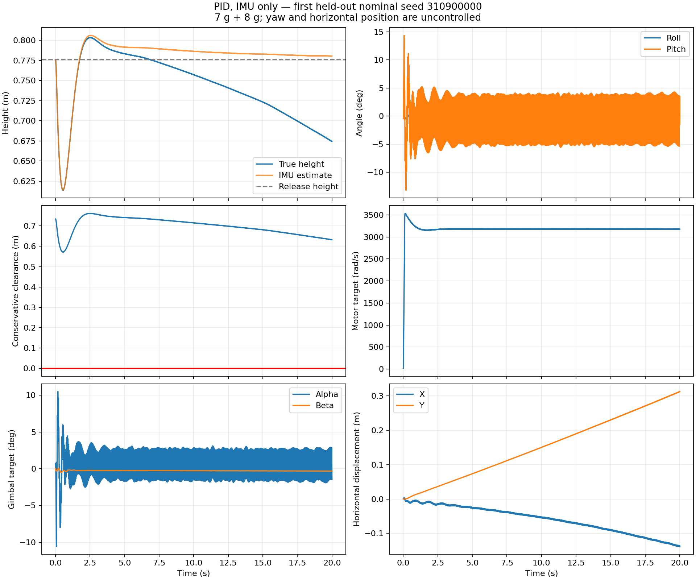

# PID 离地与悬停实验：上 7 g / 下 8 g

2026-10-08。目标是支撑整机离地、稳定 roll/pitch；yaw 与水平位置不控制。

**已得到满足本轮 20 秒常规仿真门槛的 PID：16/16 成功。仅 IMU 的长期保高仍未解决。**
常规高度 RMS 误差 6.17 cm，稳定阶段倾角 RMS 3.26°，最小整机保守几何离地间隙 57.1 cm。
60 秒追加检查中，仅 IMU 在 48.164 秒触发低高度保护；同一组 PID 使用真值高度与垂向速度反馈，常规和扰动两个案例均完成 60 秒，高度 RMS 误差约 2 cm。

这是一份仿真实验结果，不是实机飞行验证。真值 z/vz 只作为单独标注的诊断，没有混入 IMU 策略，也没有作为可直接部署的 ToF 模型。

## 正式 20 秒测试

| 条件 | 完成时长 | 达到保高门槛 | 2 秒后倾角 RMS | 全程高度 RMS | 最小整机间隙 |
|---|---:|---:|---:|---:|---:|
| IMU：常规 | 16/16 | 16/16 | 3.26° | 6.17 cm | 57.1 cm |
| IMU：扰动 | 3/8 | 1/8 | 3.33° | 28.47 cm | 7.8 cm |
| 真值 z/vz：诊断 | 8/8 | 8/8 | 3.51° | 3.35 cm | 57.1 cm |

常规：初始姿态 ±2°、静止机构释放、无额外传感器偏置。16 个独立测试种子覆盖 8 个相位中的 7 个；常规测试不应被解释为每个相位均已单独验证。
扰动：初始姿态 ±5°，各轴固定加速度偏置在 ±0.01 m/s² 内随机，电机命令倍率 ±1%，姿态读数噪声标准差 0.02°。IMU 扰动组的 4 次低高度保护、1 次高度越界说明高度漂移问题仍在；8 次的平均稳定阶段倾角仍约 3.33°。
真值诊断与常规测试前 8 个种子配对，输入差异只有高度环改用真实 z、vz。

预注册的稳定标准：完成时长；整机间隙 >3 cm；2 秒后倾角 RMS <10°；最后 5 秒高度跨度 <20 cm、拟合高度变化率绝对值 <3 cm/s。保高标准另要求全程相对释放高度 RMS <15 cm。
因此 20 秒通过不代表长期无漂移：常规组 20 秒时高度估计平均误差已约 12.7 cm，追加长时测试揭示了后续下降。

低高度保护在 base_link 低于 0.12 m 时终止；这些失败没有被描述为已经发生地面碰撞。原 CAD 模型的机器人碰撞掩码关闭，本轮每 2 ms 计算所有机器人几何的旋转局部包围盒下界。正间隙保守地覆盖整个机器人，但不是连续接触力仿真或实机碰撞证明。

## 60 秒追加检查

| 条件 | 实际持续 | 达到门槛 | 2 秒后倾角 RMS | 高度 RMS | 结束原因 |
|---|---:|---:|---:|---:|---|
| imu_nominal_60s | 48.164 s | 0/1 | 3.21° | 32.24 cm | low_height |
| truth_nominal_60s | 60.000 s | 1/1 | 3.31° | 1.94 cm | time_limit |
| imu_stress_60s | 18.180 s | 0/1 | 3.31° | 44.40 cm | height_escape |
| truth_stress_60s | 60.000 s | 1/1 | 3.25° | 1.96 cm | time_limit |

每个条件只有一个案例；使用新的种子，先写入追加协议，再执行，不用于重新调参。名义/扰动分别在 IMU 与真值反馈间配对。
即使姿态稳定，纯惯性积分也会使真实高度逐渐偏离估计。真值反馈下的 60 秒结果证明此模型中的控制器具有持续支撑整机的能力；实际高度传感器的噪声、延迟、测距范围和垂向速度估计仍须单独建模。
水平位置没有闭环：20 秒常规组最大水平偏移 0.364 m，60 秒真值常规案例偏移 1.443 m。这不是三维定点悬停。

## 有效的改动

1. **启动方式。** 原先直接释放已扑翼的固定机架相位，PID 对相位很敏感。最终在每次初始复位时，让机构全部速度为零、alpha/beta 对齐旧标定角，保留其余关节的相位位置；电机目标用 100 ms 升起。释放高度约 0.8 m，不是地面自主起飞。飞行中没有姿态、位置或速度重置。
2. **分开稳定姿态和保高。** roll/pitch 使用滤波 PID；高度 PID 控制电机。去掉 yaw 和水平位置追踪目标。最终高度工作点为电机目标 3190 rad/s，而非直接套用旧的固定机架 3461.36 rad/s。这里都是电机目标，不是实际平均轴速或扑翼频率。
3. **一起调控制时序和舵机。** 更新率从旧实验的 100 Hz 提高到 500 Hz，物理步长仍为 5 μs。IMU 姿态先高频低通，D 项由滤波姿态差分再低通得到；现有 gimbal 位置伺服的 P、D 也参与调节，扭矩上限仍为 0.02 Nm。

质量、质心位置、惯性模型、重力 9.81 m/s² 与气动力实现沿用上一轮，没有额外升力或稳定力矩。alpha/beta 保持 ±0.3 rad（±17.19°）。升速完成后电机目标仍限制在旧 ±10% 绝对区间 3115.224079–3807.496097 rad/s 内；启动阶段由零升起。

## 最终参数与输入

| 参数 | Roll | Pitch |
|---|---:|---:|
| Kp | 0.186145196 | 0.147329543 |
| Ki | 0.053217779 | -0.010427300 |
| Kd | 0.115218633 | 0.127372368 |

- 高度 Kp/Kd/Ki：[900.0, 500.0, 80.0]；电机前馈：3190.0 rad/s。
- alpha/beta 配平目标：[0.009403938176356088, -0.0038897827014125488] rad；参考 roll/pitch 为零。
- 姿态滤波时间常数：130.457 ms；差分滤波：4.482 ms；目标平滑：8.214 ms。
- 舵机位置环 Kp=1.045258121、Kd=0.002235453，限幅与积分限幅见代码和 [selected_pid.json](selected_pid.json)。

IMU 仍安装在 base_link。前端提供姿态、角速度、加速度；最终 PID 的 D 项使用姿态差分，保高使用加速度经重力补偿后积分得到的相对 z/vz。IMU 策略不读取模拟器真实位置/速度。
与上一轮相同，这个前端每个 5 μs 物理步读取理想虚拟姿态与比力，不等于已验证的实际 IMU 带宽；量程饱和、温漂等未纳入。扰动中的姿态读数噪声也没有被偷偷当成已经覆盖了惯性解算全部姿态误差。

## 调参与验证记录

采用 PID 参数搜索，没有训练新 NEAT/PPO。已记录 713 次参数评估、2678 段轨迹、1,788,977 个 500 Hz 控制步；其中包含重复精英评估和长时开发诊断。
另有已提交的一轮进化搜索在父进程中主动中断，最多 72 组 / 288 段未落盘结果没有纳入此计数或选择策略；原因是转向已经奏效的软启动与保高调整。已保存 7 代的完整结果。详见 [run_accounting.json](run_accounting.json)。
保高候选先在 8 个新种子、±5°、15 秒条件下验证，3 个候选均为 8/8，按预设排序选择高度误差较小者。之后冻结参数及 125 个源/配置文件，再执行 16 常规 +8 扰动 +8 真值诊断。开发、选择验证与正式/长时测试种子不重叠。
29 项测试通过；上一轮已冻结的源文件哈希保持一致。两个正式首例视频均逐点重放验证到 1e-12，并在临时 XML 中重定位 mesh 路径，确认克隆目录变化不会破坏视频复现。

本轮和旧 NEAT/PPO 的初始状态、控制频率、目标、观测历史及舵机参数不同，不能据此声称 PID 在公平算法对比中胜出。现在可以把这组仿真 PID 当作后续外环学习的基线；长期保高与位置控制仍需明确传感器条件。

## 文件与复现

- [IMU 常规首例视频](videos/imu_nominal.mp4) · [真值 z/vz 诊断视频](videos/truth_height_diagnostic.mp4)
- [正式测试全部数据](test_results.json) · [60 秒追加数据](duration_probe_results.json) · [原始轨迹 CSV](nominal_first_trace.csv)
- [测试协议](audit_protocol.json) · [验证与哈希记录](verification.json) · [源快照](source_snapshot_test.zip)
- [运行说明](../../experiments/algorithms/pid_airborne/README.md)

视频使用预先指定的第一个常规种子 310900000，没有挑最好的一段；1 倍速，末帧停留 1 秒。镜头跟随水平移动、保持垂向参考；旁边显示真实高度、IMU 估计和水平偏移。25 fps 会对扑翼运动欠采样，不应用视频数翼拍来判断频率。

## Material Passport

- Origin Skill: academic-research-suite / experiment-agent（在主任务内执行，未委派子代理）。
- Origin Mode: experiment execution / parameter tuning / validation。
- Origin Date: 2026-10-08。
- Verification Status: ANALYZED; held-out results recorded; two portable video replays checked; 29 tests passed。
- Version Label: pid_airborne_7g8g_v1。所有结论来自本地仿真；没有实机数据或新文献综述。
