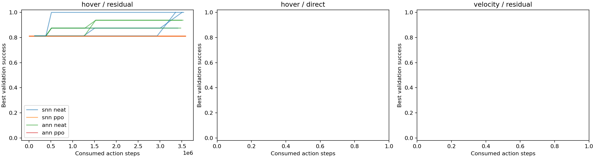

# PID 内环、神经网络残差与速度控制研究

当前阶段：`training`。训练完成 12/65。

**只有下面存在的记录才代表已经执行；队列、预算和测试计划不代表完成。**

[协议与技术说明](technical_details.md) · [v2.1 失败原因](../snn_pid_compare_20261010/failure_analysis.md)

所有训练沿用逐时间步 Python/PyTorch float64；不使用自定义神经网络加速内核。

## 已完成训练的验证结果

以下为选模验证，不能代替最终独立测试。零残差初始化也参与选择；若仍选中初始化，不声称学习改善。

| 运行 | 实际训练步数 | 分配步数 | 验证成功/例数 | 选中阶段 |
|---|---:|---:|---:|---:|
| hover_residual_snn_neat_seed6201 | 3504915 | 3584000 | 16/16 | 12 |
| hover_residual_snn_ppo_seed6201 | 3584000 | 3584000 | 13/16 | 128 |
| hover_residual_ann_neat_seed6201 | 3526424 | 3584000 | 15/16 | 8 |
| hover_residual_ann_ppo_seed6201 | 3584000 | 3584000 | 13/16 | 896 |
| hover_residual_snn_neat_seed6202 | 3407293 | 3584000 | 14/16 | 12 |
| hover_residual_snn_ppo_seed6202 | 3584000 | 3584000 | 13/16 | 896 |
| hover_residual_ann_neat_seed6202 | 3495425 | 3584000 | 15/16 | 8 |
| hover_residual_ann_ppo_seed6202 | 3584000 | 3584000 | 13/16 | 384 |
| hover_residual_snn_neat_seed6203 | 3354644 | 3584000 | 16/16 | 12 |
| hover_residual_snn_ppo_seed6203 | 3584000 | 3584000 | 13/16 | 384 |
| hover_residual_ann_neat_seed6203 | 3474764 | 3584000 | 14/16 | 8 |
| hover_residual_snn_neat_seed6204 | 3542014 | 3584000 | 16/16 | 4 |

## 独立测试

另行提前执行的阶段独立评估见 [SNN＋NEAT 阶段报告](interim_20261012/report.md)。它使用独立的新案例，下面仍仅记录原协议的最终测试。

原协议的最终独立测试尚未运行。选模验证不能代替独立测试或判定某种训练方法获胜。

## 可复核记录

完整训练日志、检查点、NEAT 每代个体及父代、场景和失败记录保留在运行目录。
运行目录：`/home/hemingshan/FlapSim/runs/robust_control/20261010_v3`。代码快照与哈希见 `protocol.json`；本地保存，不推送 GitHub。

