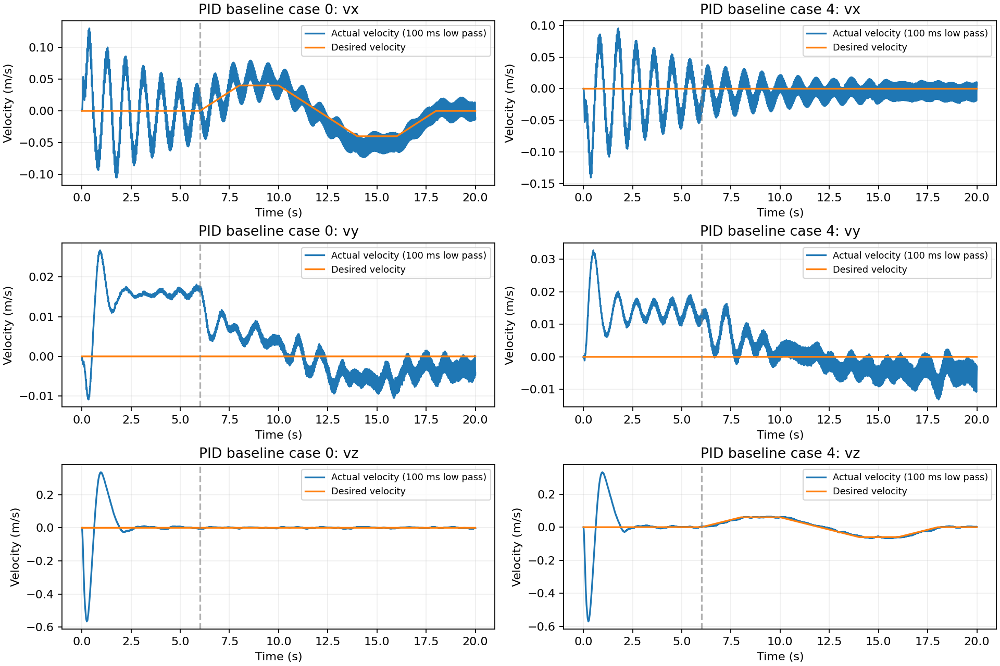

# 速度任务的开发检查

这部分仅为新任务的开发证据，控制器是固定 PID 内环和已辨识的速度外环，没有神经网络。八例全部飞满 20 s，四例达到预定严格速度门槛。水平轴向场景仍未通过，不能称为已经获得稳健速度策略。

| 场景 | 指令峰值 vx, vy, vz（m/s） | 速度向量 RMSE（m/s） | 归一化误差 | 严格通过 |
|---|---|---:|---:|---|
| 0 | [0.04, 0, 0] | 0.0170 | 0.616 | 否 |
| 1 | [0, -0.04, 0] | 0.0174 | 0.632 | 否 |
| 2 | [0.028, 0.028, 0.04] | 0.0173 | 0.446 | 是 |
| 3 | [-0.04, 0, 0] | 0.0182 | 0.659 | 否 |
| 4 | [0, 0, 0.06] | 0.0163 | 0.393 | 是 |
| 5 | [-0.028, -0.028, -0.04] | 0.0161 | 0.413 | 是 |
| 6 | [0, 0.04, 0] | 0.0190 | 0.689 | 否 |
| 7 | [0, 0, -0.06] | 0.0178 | 0.430 | 是 |

归一化误差门槛是 0.60。场景 0、3 的响应略有过冲，场景 1、6 的横向反向/停止仍有迟滞。零修正策略保留为后续学习对照，不能把基础运动归功于尚未完成的训练。

下图固定展示第一个前向指令场景（失败）与第一个上升场景（通过），不是按最佳飞行效果挑选。最初 6 s 是起飞稳定段；所有回合都计入起飞安全/姿态/高度检查。

既有同维残差研究支持保留 PID。新增方向控制首先需要正确的执行器/参考到运动的关系、可观测的速度与目标，以及避免放大起飞摆动的外层反馈；不能仅凭网络规模或训练时间替代这些条件。

完整场景结果在 `records/velocity_confirmation/results.json`；回放文件校验值和两个示例 NPZ 在 `velocity_development/`。
