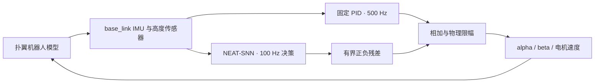

# Research proposal：用 NEAT 联合进化脉冲网络的结构、权重与时间常数

**面向具有实测校准依据的 15 g 扑翼机器人：PID 残差悬停控制及与 ANN-NEAT、PPO 的比较**

版本：审阅稿 v1.1 · 2026-10-09。**本轮仅完成文献调研与方案设计，尚未启动 SNN 训练、仿真评估或新增验证实验。以下配置和成功门槛均为拟议方案，待审阅后冻结。** v1.1 根据审阅意见加入大角度恢复测试，详见第 11.1 节。

## 1. 推荐研究方向

建议研究的问题是：**在同一物理模型、相同传感器与执行器接口、相同 PID 内环和交互预算下，NEAT 能否进化出具有不同记忆时间尺度的稀疏 SNN，使机器人在延迟、周期载荷和外界扰动下，以较小网络保持稳定离地与保高？**

关键不是把普通神经元替换成脉冲神经元后展示一次飞行。需要分别检验三件事：时间常数是否有用、拓扑搜索是否有用、脉冲机制本身是否有用。若收益全部来自可学习的低通记忆，而连续值网络同样有效，就应把贡献归于时间动力学，而不能归于 SNN。

推荐主架构为 **固定 PID＋NEAT-SNN 残差控制器**。PID 提供已验证的基础支撑；NEAT 搜索稀疏连接、正负权重，以及膜电位和突触电流的时间常数。先完成与上一轮相同的姿态／保高任务，yaw 暂不控制，水平定点保持另立问题。

预期可形成的论文贡献是：**在有实验约束的扑翼模型中，量化“拓扑—时间尺度共同演化”对控制性能和网络规模的作用，并用匹配对照解释它何时有效、何时无效。** NEAT 与 SNN 的组合已有先例，不能把组合本身写成首次创新。

## 2. 与上一轮实验的衔接

以下是已经完成的历史结果，不是本轮 SNN 的结果。来源为 [上一轮完整报告](artifacts/topology_hover_20261008/report.md)，代码与结果基线为 Git 提交 `3711664acf1e9660e304a6c8a473bb55e0eb102f`。

| 已有事实 | 对本方案的影响 |
|---|---|
| 上部完整机构 7 g、下部 8 g；35 次训练，5 个训练种子 | 保留质量配置和独立多种子比较 |
| 主实验实际使用 11 维：9 维 IMU＋高度误差＋估计垂向速度 | SNN 主比较也使用 11 维，避免新增或移除传感器造成混淆 |
| NEAT 常规 20 s 严格通过 40/40；扰动严格通过 15/40 | 常规任务接近饱和，主要检验扰动下的改善 |
| 固定拓扑进化扰动通过 17/40，循环 PPO 6/40，前馈 PPO 9/40 | NEAT 尚无独立拓扑优势证据，必须保留固定拓扑对照 |
| NEAT 代表策略 8 次 60 s 均保持离地，但扰动严格通过 0/4 | “飞得久”与“姿态、高度全部达标”分开统计 |
| 移除过去状态通路未出现明确性能下降 | 新方案必须验证记忆是否被使用，不能只画循环连接 |
| 每个 NEAT 种子只有 9 代，均仅 1 个物种 | 需要更完整的预算曲线、实际物种记录和停止规则 |
| 60 s 水平漂移仍明显；移除高度辅助的诊断失败 | SNN 的内部记忆不自动等于无外部参考的定位能力 |

历史策略、训练轨迹、视频和测试结果全部冻结保留。新实验另建目录；旧测试场景已经被观察过，只作历史复现，不作为新假设的独立确认集。

## 3. 物理依据：已有证据与外推边界

项目确实具有实测和几何／动力学依据，应当作为本研究的基础。但应区分三个层次：

1. **实测支持的局部校准。** 旧资料包含曲面翼、矩形翼各 18 次实测；单翼固定基座、10–15 Hz。在 10–12 Hz 拟合各翼型平均升力系数后，13–15 Hz 留出频率的平均绝对相对误差分别为 2.64% 和 3.57%。这支持对应工况的平均升力校准，不等于周期力、力矩或自由飞行动态全部准确。[原报告文本](docs/research/snn_neat_20261009/evidence/00_coefficient_validation_report.md.txt)
2. **仍有未辨识部分。** 周期载荷残差明显，力矩原点与传感器力臂尚未闭合；真实羽化时序、部分材料／安装参数仍有假设。0720 电机采用候选厂家绕组参考，不能由约 4 V／15 gf 单点唯一辨识电气参数。[固定基座验证](docs/research/snn_neat_20261009/evidence/03_rect_validation_validation_report.md.txt) · [电机核对](docs/research/snn_neat_20261009/evidence/06_IST_robot-V2_motor_reference.md.txt)
3. **当前控制模型的仿真配平。** 7 g＋8 g 双翼模型在约 26.748 Hz、指令约 3461.36 rad/s 时获得约 15.004 gf 平均升力；这是另一工况的仿真结果。其记录中 `converged=false`，未满足全部既定力矩容差。自由飞行 PID 的 3190 rad/s 前馈又是闭环调优值，不能与固定基座配平频率混为一谈。[配平记录](artifacts/neat_ppo_7g8g_20261008/calibration/trim.json) · [PID 参数](artifacts/pid_airborne_20261008/selected_pid.json)

因此建议采用表述：**“基于 CAD、多体／叶素动力学，并由有限工况实测校准约束的扑翼仿真系统。”** 暂不采用“完整实机系统辨识已闭合”或“全飞行包线已验证”。旧升力修正系数也不直接移植到当前双翼 26.7 Hz 模型。

物理依据使时间尺度选择与扰动设计更有根据；它并不单独说明 SNN 优于 ANN。神经元时间常数是控制器的可优化记忆参数，不是对真实电机或气动时间常数的直接测量。

## 4. 文献依据及可借鉴之处

本次是针对方案的定向检索，不是穷尽式系统综述。检索截至 2026-10-09；主要核对作者论文、出版社和机构存档，区分预印本版本与会议年份。

| 原始研究 | 已展示什么 | 对本研究的启发与限制 |
|---|---|---|
| [Qiu 等，SSCI 2018](https://arxiv.org/abs/1903.01180)，*Evolving Spiking Neural Networks for Nonlinear Control Problems* | 用 NEAT 进化循环脉冲控制器，在倒立摆任务比较；讨论背景电流和连续输出解码 | 支持路线可行性；不是扑翼悬停证据，NEAT＋SNN 本身已有先例 |
| [Fang 等，ICCV 2021](https://arxiv.org/abs/2007.05785)，*Incorporating Learnable Membrane Time Constant to Enhance Learning of Spiking Neural Networks* | 在分类任务中联合学习权重与膜时间常数 | 支持将时间常数视为学习参数；不证明闭环飞行收益，也不是 NEAT 研究 |
| [Burgers、Stroobants、de Croon，IMAV 2024](https://pure.tudelft.nl/ws/portalfiles/portal/226969121/8.pdf)，*Evolving Spiking Neural Networks to Mimic PID Control for Autonomous Blimps* | 使用 CMA-ES 优化脉冲网络参数，模仿 PID 并实现飞艇高度控制 | 可借鉴连续控制与时间参数编码；算法是 CMA-ES，不是拓扑演化 NEAT；飞艇动态也不同 |
| [Stroobants、De Wagter、de Croon，2025 修订版](https://arxiv.org/html/2411.13945v2)，*Neuromorphic Attitude Estimation and Control* | 模块化 SNN 通过模仿学习实现 Crazyflie 500 Hz 姿态控制；分析时间延迟问题 | 支持电流输入、泄漏状态与连续解码；位置实验使用外部定位，不能引用为纯 IMU 定点悬停 |
| [van Breukelen Castillo 等，IMAV 2025](https://www.imavs.org/papers/2025/17.pdf)，*Spiking Neural Networks for High-Speed Continuous Quadcopter Control Using Proximal Policy Optimization* | PPO 训练 SNN，在四旋翼穿门任务比较 ANN，并研究内部积分次数 | PPO 也能训练 SNN，不能预设只有 NEAT 适用；任务、观测与计算预算和本系统不同 |
| [El Filali 等，2026，v3 预印本](https://arxiv.org/html/2605.19430v3)，*Spiking Neural Network Control of a Flapping-Wing Robot on Resource-Constrained Hardware* | 26 g 级扑翼机器人上部署估计／控制 SNN，以模仿学习调节 CPG，实现无系留 pitch／heading 跟踪 | 直接支持扑翼应用可行性；不是 NEAT、不是完整三维定点悬停；其 ESP32 延迟／功耗结果不能移用到本机 |
| [Loyola-Jara、Fernández-Rodríguez、Baladron，2026](https://www.frontiersin.org/journals/neuroscience/articles/10.3389/fnins.2026.1697163/full)，*Evolving spiking neural networks: the role of neuron models and encoding schemes in neuromorphic learning* | 比较 NEAT 下的 LIF／Izhikevich 及编码方案，包含分类与控制基准 | 神经元和编码选择会改变结果；简单 LIF 的失败不能推广为所有 SNN 失败 |

综合判断：SNN 值得加入，但更合理的预期是**可调时间动力学带来某些扰动条件下的优势**。额外积分、脉冲稀疏性和输出延迟也可能使性能下降。文献并不保证在本系统上取胜。

## 5. 可检验假设与创新边界

| 假设 | 主要配对比较 | 什么结果支持它 |
|---|---|---|
| H1：可进化时间尺度有助于稳健控制 | 联合进化 SNN vs 固定时间常数 SNN | 相同初始图、预算及场景下，独立测试表现改善；固定／打乱时间常数的干预与此一致 |
| H2：拓扑搜索改善性能或达到相同性能所需规模 | 联合进化 SNN vs 固定初始拓扑 SNN | 性能有可信改善，或满足预设非劣标准同时减少有效连接／状态；不能只比不同初始容量 |
| H3：收益包含脉冲机制的贡献 | 联合进化 SNN vs 带可进化泄漏时间常数的连续值网络 | 在记忆能力、图搜索和预算受控后仍有优势；否则只支持时间动力学作用 |
| H4：方法对实际控制有价值 | SNN vs ANN-NEAT、循环 PPO、前馈 PPO、固定 PID | 在相同接口和预算下改善扰动表现或性能—规模折中，同时保持离地和保高 |

主要问题为 H1、H2；H3、H4 用于解释结果。若加入 SNN-PPO，可进一步区分神经元类型与优化器，但建议作为第二阶段扩展，不把所有可能组合一次展开。

潜在创新点不是“首个 NEAT-SNN”或“首个 SNN 扑翼飞行”，而是以下证据链：**实验约束的扑翼模型 → 拓扑／权重／时间尺度联合搜索 → 同初始结构消融 → 独立延迟与载荷扰动验证 → 可追踪的演化机制。** 是否足以构成论文创新，需要最终结果与更完整的投稿前文献核查支持。

## 6. 控制架构与输入输出

| 项目 | 主实验拟保留的设置 |
|---|---|
| 模型 | 完整上部 7 g、下部 8 g；既有多体机构与气动模型 |
| IMU | base_link；姿态 3、角速度 3、加速度 3 |
| 主输入 | 上述 9 维＋测距高度误差＋估计垂向速度，共 11 维 |
| 学习器输出 | 3 个归一化值，均在 [−1, 1] |
| 残差尺度 | alpha、beta 各 ±0.035 rad，电机速度 ±100 rad/s |
| 最终物理范围 | alpha、beta 各 ±0.3 rad；电机约 3115.224–3807.496 rad/s |
| 时钟 | 物理步长 5 µs；PID 500 Hz；所有学习器对外动作 100 Hz |
| SNN 内部 | 拟用 1 ms 神经步长，每次动作计算 10 个内部步；保留跨动作状态 |
| 初态 | 沿用约 0.8 m 释放、短时电机渐升；不是地面起飞 |
| 目标 | 保持离地、控制 roll／pitch 与高度；yaw、水平位置不作为控制目标 |

SNN 的十个内部步只使用当前已获得的观测及历史神经状态，不额外读取十次传感器，也不提前访问未来物理状态。所有方法看到同样的传感器噪声、饱和、延迟和归一化。

原系统的姿态通道使用真值姿态加噪声／偏差及滤波近似，并不是已验证的完整实机姿态融合链；主实验沿用它以保证可比性，并在报告中说明。新增真值量只允许用于离线评分，不进入策略。

9 维纯 IMU 可以作为后续独立训练的传感器消融。届时必须同时比较相同观测条件下的其他方法，不能只从已训练的 11 维策略删掉两维后宣称完成了纯 IMU 比较。惯性积分的偏置漂移仍存在，不能预先承诺长期水平定点保持。

## 7. SNN 与 NEAT 如何结合

### 7.1 神经动力学

第一版建议采用电流型 LIF 隐藏神经元，加三个非脉冲、连续值的泄漏读出节点。这样既保留脉冲时序，也能直接输出以零为中心的正负动作。它应准确称为**电流编码、脉冲隐藏层、连续读出的混合 SNN**。

隐藏神经元的建议离散模型为：

\[
I_i^{k+1}=a_{s,i}I_i^k+(1-a_{s,i})\left(\sum_j w_{ij}q_j^k+b_i+I_{0,i}\right),\quad
\tilde V_i^{k+1}=a_{m,i}V_i^k+(1-a_{m,i})I_i^{k+1},
\]

\[
z_i^{k+1}=\mathbf{1}[\tilde V_i^{k+1}\ge 1],\quad
V_i^{k+1}=\tilde V_i^{k+1}-z_i^{k+1},\quad
a_{s,i}=e^{-\Delta t/\tau_{s,i}},\quad a_{m,i}=e^{-\Delta t/\tau_{m,i}}.
\]

其中输入源传递归一化观测，隐藏源传递按固定尺度转换的脉冲；所有连接权重允许正负。读出节点接收隐藏脉冲形成连续状态，最后通过 `tanh` 映射至 [−1,1]。alpha／beta 的负值由读出权重和偏置产生，不需要“负脉冲”。

主 SNN 不设输入直接到输出的旁路，避免最优解绕过全部脉冲节点。允许隐藏节点自连接和隐藏间循环，读出不向隐藏回馈。连续时间网络对照采用相同连接约束。该限制是一项明确的架构先验，不宣称搜索了任意神经结构。

小背景电流用于降低整群不放电的风险；其数值、阈值、脉冲尺度在开发阶段确定并冻结。需要报告静默节点、饱和放电和动作分辨率，不能靠增加背景放电后仍宣称“极低事件率”。

### 7.2 基因与搜索空间

| 基因类别 | 可改变的量 | 拟议约束 |
|---|---|---|
| 拓扑 | 添加／删除隐藏节点、添加／删除／启停连接 | 保持三输出接口；新节点分裂已有连接；限制最大 32 个隐藏节点以控制预算 |
| 权重 | 正负突触／读出权重 | 统一有限范围，记录变异前后值 |
| 偏置 | 神经元输入电流偏置、读出偏置 | 有界，避免数值发散 |
| 时间常数 | 每节点膜时间常数 `tau_m`、突触滤波时间常数 `tau_s` | 用 `log(tau)` 交叉／变异，保证正值 |
| 固定项 | 放电阈值、编码尺度、内部步长、读出 `tanh` | 第一版固定，减少不可辨识的参数互相补偿 |

建议初始 `tau_m=20 ms`、`tau_s=10 ms`；搜索范围暂定 `tau_m∈[5,200] ms`、`tau_s∈[2,100] ms`。范围覆盖已用约 8.2 ms 动作平滑、约 37.4 ms 仿真扑翼周期和约 130 ms 姿态滤波尺度。这些是**有模型依据的搜索先验**，不是已辨识神经参数；真实最佳范围仍待检验。

物种距离加入归一化后的 `log(tau)` 差异。交叉应继承对应节点的时间基因，结构新增节点应有明确初值；不能只进化权重、另在仿真外手工调时间常数，却称为联合进化。

各进化组建议从同一组初始图开始：4 个隐藏节点＋3 个读出节点，11 个输入接各隐藏节点，隐藏自连接，隐藏接三个读出，共 60 条启用边。联合时间进化时初始有 60 权重＋7 偏置＋14 时间参数＝81 个可优化标量；固定时间组有 67 个可优化标量、仍存储时间常数。最终还要单独报告通向输出的有效节点／边、神经状态量和实际计算成本。

## 8. 比较组：每个对照回答一个问题

| 组别 | 拓扑 | 权重／偏置 | 时间常数 | 用途 |
|---|---|---|---|---|
| PID | 固定 | 固定 | 固定 | 确认基础飞行能力和残差增益 |
| ANN-NEAT＋PID | 进化 | 进化 | 无显式泄漏时间基因 | 与普通 NEAT 比较，并衔接历史结果 |
| **NEAT-SNN＋PID** | **进化** | **进化** | **进化** | **主方法** |
| SNN 固定时间＋PID | 进化 | 进化 | 固定初值 | 隔离时间常数搜索的贡献 |
| SNN 固定拓扑＋PID | 固定同一初始图 | 进化 | 进化 | 隔离拓扑搜索的贡献 |
| 连续泄漏网络＋PID | 进化 | 进化 | 进化 | 检查收益能否由连续值时间记忆解释 |
| 循环 PPO＋PID | 固定 | PPO 更新 | 沿用原循环结构 | 学习算法和历史记忆基线 |
| 前馈 PPO＋PID | 固定 | PPO 更新 | 无循环状态 | 无跨拍神经状态基线 |

固定拓扑组不能一开始就给更多隐藏节点；固定时间组与主 SNN 使用相同初值、权重分布及初始种群。普通 ANN-NEAT 新训练使用相同初始连接约束，同时保留上一轮原始 ANN-NEAT 作为历史比较，避免把“新初始图”与“旧算法”混淆。

连续泄漏对照保留电流／状态滤波，把阈值和重置替换为平滑连续激活；它是动力学对照，不假定其恰好等于 LIF 的生物放电率。其单次计算也使用十个内部步，并统计额外成本。

PPO 沿用既有实现与残差范围。主比较不改奖励、不另给 SNN 动作示范，也不让某组获得真值状态。模型容量不同之处应透明报告；“相同输入输出”不等于“完全相同参数量”。SNN-PPO、直接无 PID 控制、Izhikevich 模型和群体编码作为后续扩展，首轮不自动加入。

## 9. 分阶段执行与预算

**阶段 0：本次审阅。** 完成 proposal 和证据核查；没有新实验。后续根据审阅意见冻结模型、配置、拆分种子、奖励和报告口径。

**阶段 1：实现与独立开发检查。** 使用不属于正式训练／验证／测试集的开发种子，检查时间更新解析一致性、状态重置、正负输出、脉冲活动、节点继承、禁用连接和各算法的观测一致性。开发支出单独记账。只允许依据这些检查解决实现问题；如需筛选编码／背景电流等超参数，应预先列出候选与统一搜索上限，不在最终测试后反复调参。

**阶段 2：与上一轮预算衔接。** 每个学习组 5 个独立训练种子，保留每次约 **262,144 次 actor 交互**的检查点，与上一轮同预算的冻结策略比较。新训练组使用同一课程、传感器与场景分布；验证评估频次、场景数和计入方式统一。历史策略额外在新场景复测，但历史与新训练结果分栏报告。

**阶段 3：收敛与稳健性研究。** 建议所有 7 个学习组共同延长到预设上限 **1,048,576 次 actor 交互／种子**，同时保存中间预算曲线。不能只把 SNN 训练更久，再与短预算 PPO 直接宣称优越。NEAT 初步建议 population=64，以在既定预算下获得更多代；population=128 可列为开发阶段的有限敏感性比较，所有进化组采用同一最终规则。增加 population 会提升每代多样性，但固定总交互下也会减少代数。

训练课程从 2 s 逐步增加到 4 s、8 s，并轮换扑翼初始相位、常规及扰动场景。全部个体共享当代场景以便排序，跨代更换场景避免只适应一个释放条件；验证使用固定多场景长回合。预算末尾不足完整训练回合时，保存最近完整可比检查点并报告实际用量，避免用极短尾代的高得分选出最终策略。确切课程边界与检查点对齐规则应在运行前写入协议。

以上规模为 35 次正式学习运行：在最高预算约 **3,670 万次训练交互**，另计验证、最终测试与开发开销。上一轮示例运行在约 26 万交互下耗时约 14–18 分钟；按其吞吐量粗估，本方案满预算训练是数十小时量级，SNN 内部积分可能更慢。这只是规划估计，不是新 benchmark 或完成时长承诺。

**阶段 4：冻结与最终测试。** 所有选模结束后保存模型和源文件哈希，再运行未使用的配对测试集。测试后不再据其成绩调整本轮策略。若发现实现缺陷，记录协议修订，重新定义独立测试轮次。

## 10. 什么叫“收敛”和“可用”

需要分开三个结论：

| 层次 | 拟采用的判断 | 不能推出什么 |
|---|---|---|
| 训练完成 | 完成预设预算并保存全部运行、失败和检查点 | 不代表策略有效 |
| 经验平台期 | 至少 6 次等间隔验证；最近 4 次最佳验证严格成功率无提升，回报改善 <0.2%，倾角 RMS 改善 <1% | 不代表数学最优或闭环稳定性证明；差策略也会平台 |
| 可用仿真候选 | 达到下述独立长时与扰动门槛 | 不代表实机可靠或水平定点悬停 |

平台期只用于诊断，主比较仍保留共同预算检查点。预算耗尽但没有平台，就报告“预算内未观察到平台”；停在低成功率平台则报告“收敛到不足以使用的策略”。不以期望结果为理由无限追加训练。

建议逐回合沿用旧严格标准：跑满规定时间、整机保守几何间隙 >3 cm；第 2 秒后倾角 RMS <10°；全程高度 RMS <15 cm；最后 5 s 高度峰峰值 <20 cm、漂移斜率绝对值 <3 cm/s。

建议方法层面的工程门槛为：在 5 个训练种子中至少 4 个，分别达到 20 s 常规严格成功率 ≥95%、扰动 ≥80%；同一验证选中的代表策略还需通过至少 7/8 个常规和 7/8 个扰动的 60 s 测试。代表测试也同时报告全部训练种子的长时结果，避免仅展示最佳种子。上述是拟议的项目验收线，不是统计显著性标准或已达到结果。

## 11. 验证场景与统计分析

建议新测试采用 16 个共同场景种子／条件，每个已冻结策略均测试 20 s。核心条件为常规、既有强度的扰动、上一轮组合 OOD；再增加独立因素诊断，分别改变延迟、电机增益、下部质量和脉冲扰动强度。组合 OOD 用于看整体失效，单因素测试用于解释原因，两者不混用。

60 s 测试建议每种子、每个常规／扰动条件各 8 段。报告完整持续时间、所有终止原因、严格成功率、倾角、高度、最小几何间隙、动作抖动和水平漂移。几何间隙是当前模型的检测口径，不能写成已完成接触力或地面碰撞验证。

主要终点为扰动严格成功率，主要对比为联合 SNN 对固定时间、固定拓扑两组。先以训练种子为独立单位计算方法差异，再报告配对区间；测试片段和数百万仿真步不能充当独立训练重复。5 个种子只能提供探索性证据，正式强结论建议增至 10 个种子并另行预先批准预算。

报告两项主要比较的多重性控制和完整效应量；小样本情况下优先呈现全部种子点与配对差异，不依赖单一 p 值。支持“明确改善”的拟议条件是：差值区间排除零，且绝对成功率改善至少 10 个百分点。支持“更小且性能相当”的条件需使用预先定义的非劣判断（成功率下界差不低于 −5 个百分点），同时有效连接至少减少 20%；区间包含零本身不是等效或非劣证据。

SNN 相对连续泄漏网络、ANN-NEAT、PPO 的比较作为完整次要结果报告，不只挑最高分对手或最好条件。失败回合的 RMS 可能因为提前终止而偏低，因此首先比较成功／持续时间，再解释误差指标。计算开销包括训练、验证、模型选择，以及 SNN 内部十步更新；脉冲数只能作为事件活动代理，不能直接换算成节能结论。

### 11.1 新增：大角度偏离后的恢复能力

**建议加入，但单列为次要稳健性测试，保留原来的常规悬停与扰动主测试。** 小角度平衡测试回答“能否维持”，大角度测试回答“偏离以后能否回来”。后者可能更容易暴露状态记忆、响应延迟、非线性控制和执行器饱和的差异；它也可能只暴露共同 PID 或推力余量的极限，不能预设一定有利于 NEAT 或 SNN。

| 场景 | 拟议设置 | 目的与公平性 |
|---|---|---|
| 初始大角度释放 | 实际机体倾角 5°、10°、15°、20°、30°；45°另作极限探索 | 所有策略使用相同物理初态、初始高度、扑翼相位与传感器初始化；神经记忆从规定的重置状态开始 |
| 已飞行后受扰 | 在固定时刻（拟第 5 s）施加固定时长的外部力矩脉冲，设置低／中／高三档 | 保留原神经与 PID 状态；所有方法受到相同方向、强度和时程的扰动，不按各方法表现反向调节脉冲 |
| 初始角速度 | 首轮初始大角度测试不额外添加整体角速度；随后另设角速度因素 | 避免把角度、角动量和高度同时改变后无法解释失败 |

角度用机体竖直轴与世界竖直轴的夹角计算，`theta = acos(R[2,2])`；它不是 alpha／beta 执行器角度，也不是直接把 roll 和 pitch 各设为同一个数。相同幅度应覆盖正负 roll、正负 pitch，以及四个斜向倾斜方向；斜向情形用水平旋转轴生成相同总倾角，防止耦合方向实际上接受更大扰动。yaw 不作为本轮恢复目标。

初始倾斜围绕整机一致的刚体姿态设置，保留机构约束及预定内部相位。飞行中受扰则通过外力矩自然形成偏离，**不瞬间改写姿态或清空角速度／神经状态**。三档脉冲只在开发场景按固定基线确定，正式测试前冻结；实际达到的峰值倾角作为结果记录。若某方法在第 5 s 前已经失败，仍计失败，不从统计中删除。

初始角度曲线拟每角度采用 16 个配对场景（8 个方向×2 个预定相位／噪声实现），对全部冻结策略测试 20 s。脉冲测试拟每强度 16 个共同场景。连同 45°探索档，这将额外增加每个策略 144 个回合；35 个学习策略及固定 PID 共 5,184 个回合、最多 28.8 小时仿真时长。仿真时长不等于实际耗时，需单独计入测试预算；若缩减，必须在运行前统一缩减所有方法，不能只保留胜出策略或容易角度。

**独立恢复指标。** 同时保存原严格悬停得分和新增恢复得分，不能用新标准覆盖旧失败。建议恢复判据为：初始释放／力矩脉冲结束后 5 s 内，进入“过去 0.5 s 倾角 RMS <10°”的状态，并连续保持该条件至少 1 s；随后完成 20 s 回合，且满足原离地间隙、全程高度 RMS、末段高度波动及斜率标准。窗口用于减小扑翼周期振动对判定的影响，不修改控制器输入。另报告单纯姿态回正的时间和恢复后的高度误差，不能因姿态回正便忽略保高失败。

每个场景记录恢复成功率、恢复时间、最大倾角、最大高度损失、最小离地间隙、角速度和动作变化，以及电机与两个角度执行器的饱和时间比例。没有恢复的回合按失败保留；不能只对恢复者计算一个很短的平均恢复时间而省略失败率。

**物理可达性检查。** 简化为平均合力沿倾斜轴、暂不考虑矢量偏转时，维持高度需要 `T ≈ mg / cos(theta)`：30°约需增加 15.5% 的合力，45°约需增加 41.4%。这只是解释推力余量的近似，不是当前扑翼机构的可恢复角度定理；alpha／beta 会改变合力方向，机构动态也会改变实际载荷。大角度期间短时下降后恢复仍可能成功，但当前释放高度有限。正式执行时应先在开发场景检查可用推力、控制力矩和饱和，不能为让某个算法通过而在测试时提高电机上限、加大残差或增加初始高度。

本研究测得的是给定高度、相位、速度、传感器和执行器约束下的**经验恢复范围**，不是完整状态空间的吸引域证明。大角度姿态稳定本身有专门的几何控制研究，例如 [Lee、Leok、McClamroch 的四旋翼研究](https://arxiv.org/abs/1003.2005)；其模型与控制假设不直接适用于当前欠驱动扑翼机构，也不自动为既有 PID 提供大角度稳定性保证。

**训练与测试的分界。** 首轮把这些角度作为冻结策略后的恢复／泛化检查，不能看完 30°或 45°成绩再回头为某一组调参。若后续要明确追求大角度鲁棒训练，应另设所有方法共用的课程，例如从 5°逐步到 10°、15°、20°；30°、45°及独立脉冲场景继续留作外推测试。新的验证、测试种子和预算需预先冻结。若所有 PID 残差组都在同一角度附近失败，先检查共同控制权限和物理极限，再解释网络差异。

## 12. 如何证明网络真的用了时间与结构

训练对照之外，冻结策略后还计划执行以下诊断，使用单独预留场景；诊断不重新选模：

| 诊断 | 可以检验什么 | 解释限制 |
|---|---|---|
| 把演化时间常数统一回初值 | 选中策略是否依赖其时间配置 | 会破坏参数共同适应，不能单独证明重新训练的固定时间网络较差 |
| 在同类节点内打乱时间常数，保留分布 | 节点与时间尺度的对应关系是否有用 | 同样属于干预敏感性证据 |
| 每个 actor tick 清零神经状态 | 跨拍记忆是否被实际使用 | 严重改变动态，需结合重训对照；不是纯粹的记忆因果估计 |
| 删循环连接，并做等数量随机删边 | 循环路径是否较其他连接更关键 | 删除也改变容量 |
| 记录传感器—膜电位—脉冲—动作相位关系 | 展示网络如何响应周期载荷／扰动 | 相关或相位锁定本身不能证明因果作用 |

若时间常数集中在边界，先报告边界行为及饱和，不能直接称为发现了物理共振。若关键节点不放电或无路径到输出，必须标出。若删除记忆后几乎不变，应接受“当前任务主要由 PID 承担，SNN 记忆收益有限”的解释。

## 13. 可视化与最终交付

延续上一轮的结构与权重浏览器，并增加 SNN 专属视图：

- **演化过程：** 每代全部个体、真实父代、物种、增删节点／边、权重和时间常数变异；冠军序列与真实祖先链分开展示。
- **时间基因：** 每节点 `tau_m／tau_s` 沿祖先链变化、全种群分布、节点新增时的初值、边界占比；节点位置固定以便逐代比较。
- **飞行回放：** 同屏显示机体／翅膀、IMU、高度、三个有符号动作、脉冲 raster、膜电位、突触电流和阈值；明确飞行中权重不在线更新。
- **比较结果：** 共同交互预算曲线、所有种子点、严格通过与撑满时长、单因素退化曲线、性能—有效参数／推理时间折中；新增“初始倾角—恢复成功率”及各方向恢复图，同时标注高度损失和执行器饱和。
- **审计资料：** 拆分清单、原始回合数据、失败片段、完整参数／模型哈希、源代码快照和运行命令；视频使用验证集选定策略与预先指定测试片段。

最终结果写入新的实验 `report.md`，从根目录报告链接过去；本 proposal 保留为实验前版本，再单独记录协议修订。当前只交付本审阅稿和既有证据索引。

## 14. 建议审阅重点

建议先确认这三个研究取舍：主任务继续采用高度辅助的 11 维观测；第一版以 PID 残差控制研究时间与结构收益；SNN-PPO、纯 IMU 定位和实机节能分别留作后续扩展。这样可以围绕一个可证伪的问题完成比较，而不是把网络、传感器、控制结构和任务同时换掉。

预期结果可以是 SNN 更好，也可以是连续时间记忆更重要，或者固定 PID 已使剩余学习空间过小。三类结论都能指导下一步；本方案不把“必须证明 NEAT-SNN 胜出”作为成功条件。

## Material Passport 与资料核查

- Origin Skill：academic-research-suite；定向文献调研与实验设计，角色流程在当前任务内执行。
- Verification Status：**PROPOSAL_ONLY；未运行新训练或验证实验。**
- 文献：已核对上述 7 篇原始来源的题名、方法和任务范围；2026 扑翼论文采用 9 月 23 日 v3 题名，避免沿用 v1 旧题名。
- Semantic Scholar 辅助核查：Qiu 论文 ID `904d0006fd6918f626f519cf53bf924efc9292af`；Loyola-Jara 论文 ID `c14cfa0ba835bf3f389798b2c9b83edb403c2fe9`。其余核查主要依据已打开的原文；部分 API 返回 429，未将其当作文献不存在。
- 本地证据：只读取旧资料；[存档与哈希索引](docs/research/snn_neat_20261009/evidence/manifest.json)保存来源及摘要。摘用的历史报告不等于本轮独立重算原始测量。
- 结论边界：没有新 SNN 性能、收敛、硬件功耗或实机飞行结果；所有实验设计仍待用户审阅。
