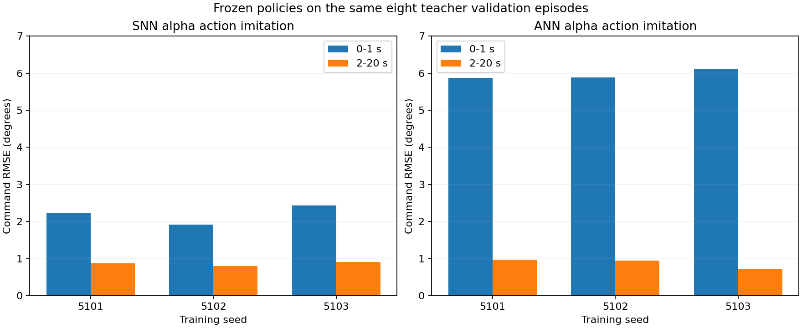
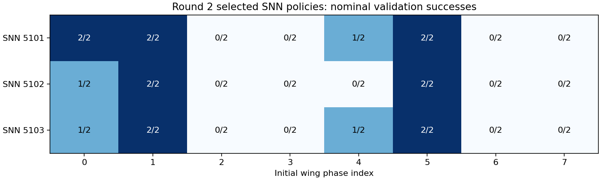

# PID 替代失败：原因与证据

本次已定位到闭环反馈与数据覆盖问题；没有发现导出精度损失。结论是 **v2.1 的网络、数据与训练预算不能可靠替代 PID**，不是“ANN/SNN 在原理上无法替代 PID”。下面使用既有训练记录、冻结策略推理和十段诊断回放；没有把诊断场景当成新增独立测试。

## 1. 失败首先表现为姿态失控

最终 ANN 三个种子常规验证均为 0/16，平均在 1.22–1.30 s 结束，48 段中 47 段因倾角超限终止。SNN 为 7/16、5/16、6/16，通过了一部分场景，但仍远低于同场景 PID 的 16/16。误差只统计到失败时刻，提前结束的较小 RMS 不代表表现更好。

相同八条教师验证轨迹上的 α 执行器角度模仿误差：

| 模型 | 起飞 0–1 s RMSE | 2–20 s RMSE |
|---|---:|---:|
| SNN，三个种子范围 | 1.92–2.44° | 0.80–0.91° |
| ANN，三个种子范围 | 5.87–6.11° | 0.72–0.97° |

全程平均会掩盖起飞误差。更直接的反例是 SNN 5101 第二轮：第 10 轮检查点通过 7/16；第 20、30 轮均为 0/16，尽管训练损失继续下降。因此“动作拟合更好”不能直接作为“闭环更稳”的依据。

## 2. 起飞干预区分了 SNN 与 ANN 的问题

保持已有 seed5101 网络权重不变，在相同两个验证场景中让 PID 控制前 1 s；网络从 t=0 接收观测并更新自身状态，1 s 后接管。诊断最长 5 s。

| 网络/初始扑翼相位 | 直接接管 | PID 起飞 1 s 后接管 |
|---|---:|---:|
| SNN / 0 | 前 3 s 未终止 | 到 5 s 诊断上限未终止 |
| SNN / 2 | 2.296 s 倾角失控 | 到 5 s 诊断上限未终止 |
| ANN / 0 | 1.066 s 倾角失控 | 2.378 s 倾角失控 |
| ANN / 2 | 1.044 s 倾角失控 | 2.012 s 倾角失控 |

这支持“起飞过程是 SNN 失败的重要贡献因素”。但干预同时改变机器人轨迹和网络内部状态，尚不能区分二者；飞到 5 s 也不等于通过 20 s/60 s 标准。ANN 在预热后仍失败，说明它还存在持续闭环反馈问题，不能仅归因于冷启动。

最终三个 SNN 在相位 2、3、6、7 的常规验证中全部未通过；其他四个相位合计通过 18/24。这里每个相位使用的扰动随机种子不同，故这是相位相关性，尚不是只改变相位的因果试验。

## 3. 学生偏离教师后，恢复状态覆盖不足

初始 320,000 帧示范中 95% 在起飞 1 s 之后。两轮 DAgger 分别新增 9,968 和 37,764 帧；学生状态只占最终数据 12.98%。按实际分批与窗口平均方式重建，学生数据占第二轮 MSE 平均权重约 11.4–11.9%；这不是梯度贡献比例。

每轮仅十二条学生轨迹，每个模型两条。第二轮两条已经成功的轨迹贡献了新增样本的 53%，失败模型/相位的恢复过程仍很稀疏。示范中 roll 绝对值的 90% 分位约 0.67°，学生轨迹可达约 16–19°，学生实际遇到的状态明显不同。

这与模仿学习的已知分布变化问题一致：策略动作会改变后续输入，教师轨迹上的拟合误差不能独立保证学生闭环表现。[DAgger 原论文](https://proceedings.mlr.press/v15/ross11a.html)。文献解释机制，不能替代本实验的因果验证。

也不能简单地说“多给起飞样本权重就能解决”：前 1 s 已占 ANN 离线总平方误差的 52–63%。优化器已经看到了大量起飞误差，仍未学到正确动态。下一版必须结合闭环训练与恢复场景，而不是只增加同分布训练轮数。

## 4. 结构事实与尚未证实的解释

- 当前 ANN 同步更新全部节点，输出读的是上一步隐藏状态，当前输入至少下一控制步才影响动作（2 ms）。这是原结构语义，不是导出错误。仅使用上一时刻教师动作的诊断误差远小于 ANN 起飞误差，因此这 2 ms 延迟本身不足以解释全部失败。
- PID 有独立积分、滤波后的姿态变化率、限幅与抗积分饱和；网络必须从相同 11 维输入的历史中近似这些动态。当前训练没有保证其局部增益和恢复行为与 PID 一致。
- β 通道在教师稳定轨迹上的 R² 为负，但目标本身方差很小；不能仅据此断言反馈方向写反。ANN 局部响应的主要反馈符号正确。SNN 对 DAgger 大偏差 β 标签的拟合已经改善，说明它并非完全没学到控制。
- 神经网络内部时间常数、相位敏感性与误差之间存在合理联系，但目前不能给出唯一的参数级根因，也不能从循环矩阵的谱半径直接推出闭环稳定性。

## 5. 已排查的替代解释

六个最终模型在同一完整 20 s、10,000 步连续输入序列上，PyTorch float64 与部署策略最大输出差异小于 6×10⁻¹⁶；没有发现导出数值精度问题。训练使用原来的逐时间步 Python/自动求导，未启用自定义序列加速内核。PID 在同环境通过全部常规验证，说明这些场景具有可行的控制解。

## 6. 下一步的研究判断

保留 PID 内环的有界残差是有历史依据的工程路线。旧同输入五种子研究常规测试通过，但扰动成功率远低于稳健门槛，因此不能将其写成已经解决 robust 控制。新版本应单独冻结协议，让 ANN/SNN × PPO/NEAT 在相同观察量、种子、控制频率和分配交互预算下比较；零残差 PID 必须始终作为候选和基线。

直接替代路线需要闭环优化的有限复核，不能因为模仿失败就跳过后续优化，也不能要求它先成功才允许残差路线开展。正式独立测试之后若仍不达标，明确写出适用结构、训练预算和失败工况，不写普遍不可能的结论。速度指令应另立任务，提供可观测的水平速度和目标指令，不能让原来没有水平速度反馈的 11 维策略凭空完成三维速度闭环。

## 记录入口

[数据分布](diagnostics/data_distribution.json) · [逐模型诊断](diagnostics/offline_model_diagnostics.json) · [关键数值](diagnostics/key_findings.json) · [失败原因统计](diagnostics/failure_modes.json) · [数值一致性](diagnostics/export_parity.json) · [原策略短回放](diagnostics/replays/results.json) · [起飞干预](diagnostics/replays/warmstart_results.json)。

回放 NPZ、场景、策略及轨迹校验值位于 `diagnostics/replays/`。这些是事后诊断记录，不增加正式训练种子或独立测试样本数。
