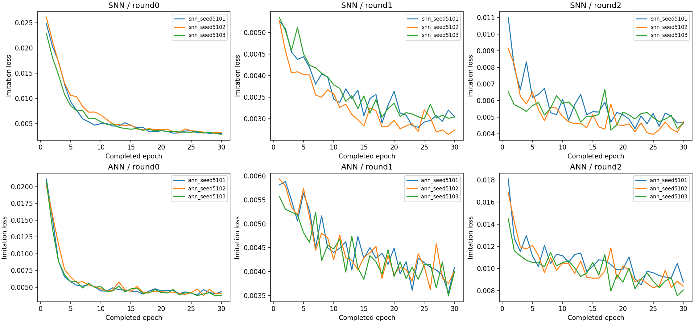

# PID 模仿与 SNN ANN 控制实验报告

更新：2026-10-10T20:34:13+09:00。

**模仿阶段及限定的 DAgger 已结束，但六个开发模型未全部达到闭环门槛。正式 PPO/NEAT 比较没有启动。**

这说明当前网络、数据和训练预算还不足以稳定复现 PID；不能据此判断 PPO 与 NEAT、或 SNN 与 ANN 谁更好。

计算采用原来的逐时间步 Python 与 PyTorch 自动求导、float64 和 5 µs 物理步长。只增加独立任务并行，不使用自定义加速内核。

[详细技术说明](technical_details.md) · [原始指标](records/) · [文件校验索引](record_manifest.json)

**事后原因分析：** [失败分析与起飞干预证据](failure_analysis.md)。已定位起飞动作拟合、闭环恢复与数据覆盖问题；未发现导出精度损失。ANN 在 PID 接管起飞 1 s 后仍失控，SNN 的部分失败则明显改善。该诊断不改变本轮失败结论，也不是新增正式测试。

## PID 模仿结果

固定 PID 在共同常规验证中通过 16/16；倾角 RMS 3.497°，高度 RMS 3.781 cm。

以下是参与选模的验证结果，不是独立测试。第 0 轮为初始 PID 模仿，后续轮为共享 DAgger 数据聚合。

| 轮次 | 模型 | 选中轮数 | 常规成功 | 长期成功 | 扰动成功 | 倾角 RMS ° | 高度 RMS cm | 门槛 |
|---|---|---:|---:|---:|---:|---:|---:|---|
| round0 | ann_seed5101 | policy_epoch030.json | 0/16 | 0/4 | 0/16 | 40.414 | 19.908 | 未通过 |
| round0 | ann_seed5102 | policy_epoch030.json | 0/16 | 0/4 | 0/16 | 40.101 | 18.858 | 未通过 |
| round0 | ann_seed5103 | policy_epoch030.json | 0/16 | 0/4 | 0/16 | 40.818 | 19.366 | 未通过 |
| round0 | snn_seed5101 | policy_epoch030.json | 0/16 | 0/4 | 0/16 | 42.627 | 16.551 | 未通过 |
| round0 | snn_seed5102 | policy_epoch030.json | 0/16 | 0/4 | 0/16 | 38.489 | 13.786 | 未通过 |
| round0 | snn_seed5103 | policy_epoch030.json | 0/16 | 0/4 | 0/16 | 38.440 | 14.040 | 未通过 |
| round1 | ann_seed5101 | policy_epoch000.json | 0/16 | 0/4 | 0/16 | 40.414 | 19.908 | 未通过 |
| round1 | ann_seed5102 | policy_epoch000.json | 0/16 | 0/4 | 0/16 | 40.101 | 18.858 | 未通过 |
| round1 | ann_seed5103 | policy_epoch000.json | 0/16 | 0/4 | 0/16 | 40.818 | 19.366 | 未通过 |
| round1 | snn_seed5101 | policy_epoch030.json | 4/16 | 1/4 | 0/16 | 28.068 | 9.679 | 未通过 |
| round1 | snn_seed5102 | policy_epoch030.json | 0/16 | 0/4 | 0/16 | 28.463 | 9.097 | 未通过 |
| round1 | snn_seed5103 | policy_epoch020.json | 0/16 | 0/4 | 0/16 | 39.249 | 24.122 | 未通过 |
| round2 | ann_seed5101 | policy_epoch010.json | 0/16 | 0/4 | 0/16 | 39.241 | 20.634 | 未通过 |
| round2 | ann_seed5102 | policy_epoch010.json | 0/16 | 0/4 | 0/16 | 39.519 | 20.597 | 未通过 |
| round2 | ann_seed5103 | policy_epoch000.json | 0/16 | 0/4 | 0/16 | 40.818 | 19.366 | 未通过 |
| round2 | snn_seed5101 | policy_epoch010.json | 7/16 | 3/4 | 0/16 | 21.874 | 8.622 | 未通过 |
| round2 | snn_seed5102 | policy_epoch020.json | 5/16 | 2/4 | 0/16 | 20.970 | 7.444 | 未通过 |
| round2 | snn_seed5103 | policy_epoch020.json | 6/16 | 0/4 | 0/16 | 21.193 | 7.165 | 未通过 |

离线动作误差、各项门槛和每回合终止原因见 `records/development/`。离线损失下降不等于闭环稳定；早期失败的 RMS 只覆盖失败前的短片段。

## 并行效率与执行状态

同一批 32 个 2 s PID 场景：8 进程用时 64.22 s，16 进程 40.78 s，本次吞吐提高 1.57 倍。这是含启动开销的单批运行基准，不是整场训练的加速倍数或算法优势。

开发阶段六个模型并行；物理评估最多十六进程；正式训练最多两个运行并行。保持每个训练进程一条计算线程，避免线程争抢。实际占用随任务阶段变化。

运行目录：`/home/hemingshan/FlapSim/runs/snn_pid_compare/20261010_v21`。状态、日志、模型和数据分别保存；当前生成本报告时完成正式运行 0/40。

## 同输入历史证据

[旧 2201 阶段报告](../snn_hover_20261009/interim_2201/report.md)：11 维输入、PID 小幅残差、100 Hz 策略与 8 s 验证。五个演化组通过 8/8，两个 PPO 组为 5/8，且 PPO 选中的是训练前初始化。只有一个比较种子，不能据此认定算法普遍优劣。

[旧五种子 topology_hover 正式报告](../topology_hover_20261008/report.md)：同为 11 维输入；其独立 20 s 扰动严格成功率为 NEAT 37.5%、循环 PPO 15.0%、前馈 PPO 22.5%。这是旧残差权限与训练协议下的结果，只作背景，不能与新实验合并统计。

`ppo_v2` 因输入不匹配未使用。旧实验仍保留 8/35 次完成结果，剩余 27 次未恢复。

## 如何理解本轮结论

先判断网络能否独立维持飞行，再比较训练路线。残差组包含一个持续工作的 PID，直接组没有，因此残差获胜并不单独证明其网络更强。

所有结果仅适用于当前仿真、预算和场景。yaw 与水平位置未闭环控制；没有实机能耗或实机悬停结论。
