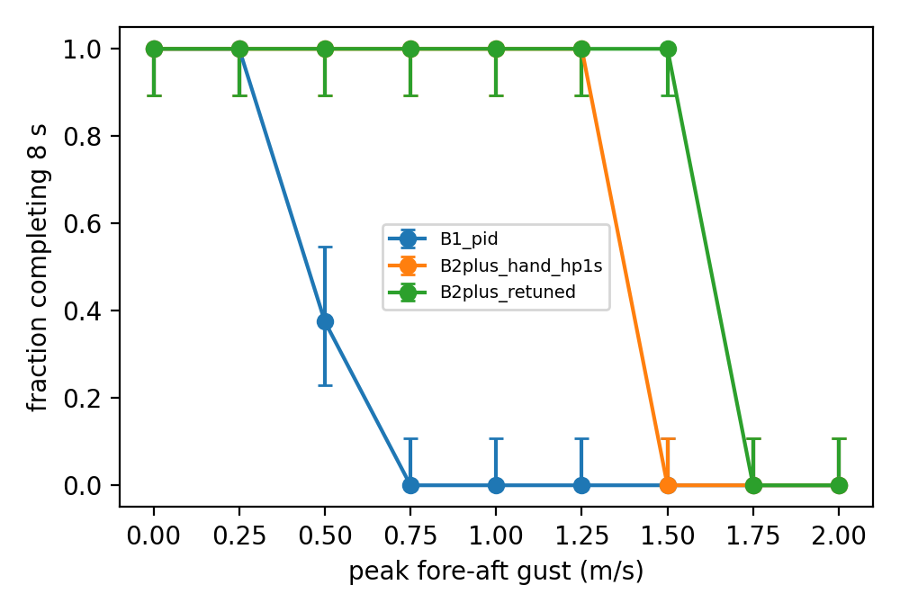

# Wingbeat-synchronous control: campaign tables

Survival = episodes completing 8 s; [Wilson 95 % interval]. Paired Δ = mean over cases flown by both, [bootstrap 95 %], (cases where the first is lower).

## E1 open-loop authority (0.1 s burst, gimbal frozen)

paired cases: 16; wrapper equivalence max |Δqpos| = 0.0

| input | Δ pitch rate (rad/s) | ratio to gimbal | Δ forward velocity (m/s) | ratio | peak current (A) |
|---|---:|---:|---:|---:|---:|
| gimbal_pitch_0.035 | +0.24 | 1.0 | +0.014 | 1.0 | 2.90 |
| split_A150_psi270 | +1.84 | 7.7 | +0.065 | 4.7 | 3.03 |
| split_A150_psi90 | -1.41 | 5.9 | -0.065 | 4.7 | 3.04 |
| split_A300_psi270 | +3.06 | 12.9 | +0.127 | 9.3 | 3.18 |
| split_A300_psi90 | -3.27 | 13.8 | -0.127 | 9.3 | 3.18 |
| split_A450_psi270 | +4.39 | 18.5 | +0.174 | 12.8 | 3.23 |
| split_A450_psi90 | -4.17 | 17.6 | -0.173 | 12.7 | 3.23 |

## E2 gust tolerance

### survival

| controller | 0.0 m/s | 0.25 m/s | 0.5 m/s | 0.75 m/s | 1.0 m/s | 1.25 m/s | 1.5 m/s | 1.75 m/s | 2.0 m/s |
|---|---|---|---|---|---|---|---|---|---|
| B1_pid | 32/32 [0.89, 1.00] | 32/32 [0.89, 1.00] | 12/32 [0.23, 0.55] | 0/32 [0.00, 0.11] | 0/32 [0.00, 0.11] | 0/32 [0.00, 0.11] | 0/32 [0.00, 0.11] | 0/32 [0.00, 0.11] | 0/32 [0.00, 0.11] |
| B2plus_hand_hp1s | 32/32 [0.89, 1.00] | 32/32 [0.89, 1.00] | 32/32 [0.89, 1.00] | 32/32 [0.89, 1.00] | 32/32 [0.89, 1.00] | 32/32 [0.89, 1.00] | 0/32 [0.00, 0.11] | 0/32 [0.00, 0.11] | 0/32 [0.00, 0.11] |
| B2plus_retuned | 32/32 [0.89, 1.00] | 32/32 [0.89, 1.00] | 32/32 [0.89, 1.00] | 32/32 [0.89, 1.00] | 32/32 [0.89, 1.00] | 32/32 [0.89, 1.00] | 32/32 [0.89, 1.00] | 0/32 [0.00, 0.11] | 0/32 [0.00, 0.11] |

### pitch peak (deg), paired

| comparison | 0.0 m/s | 0.25 m/s | 0.5 m/s | 0.75 m/s | 1.0 m/s | 1.25 m/s | 1.5 m/s | 1.75 m/s | 2.0 m/s |
|---|---|---|---|---|---|---|---|---|---|
| B2plus_retuned − B1_pid | -5.23 [-6.12, -4.24] (32/32 lower) | -15.34 [-16.17, -14.50] (32/32 lower) | -26.65 [-26.94, -26.29] (12/12 lower) | - | - | - | - | - | - |
| B2plus_retuned − B2plus_hand_hp1s | +0.05 [+0.03, +0.07] (4/32 lower) | -2.18 [-2.21, -2.15] (32/32 lower) | -4.33 [-4.37, -4.28] (32/32 lower) | -5.38 [-5.46, -5.31] (32/32 lower) | -3.85 [-3.91, -3.79] (32/32 lower) | -8.20 [-8.32, -8.08] (32/32 lower) | - | - | - |

### height RMSE (cm), paired

| comparison | 0.0 m/s | 0.25 m/s | 0.5 m/s | 0.75 m/s | 1.0 m/s | 1.25 m/s | 1.5 m/s | 1.75 m/s | 2.0 m/s |
|---|---|---|---|---|---|---|---|---|---|
| B2plus_retuned − B1_pid | +0.04 [+0.03, +0.04] (0/32 lower) | +0.08 [+0.08, +0.09] (0/32 lower) | -0.01 [-0.02, +0.01] (8/12 lower) | - | - | - | - | - | - |

## E3 unknown actuator lag

| controller | lag (deg) | 1.0 m/s | 1.25 m/s |
|---|---:|---|---|
| B2plus_hand_hp1s | -90 | 0/16 | 0/16 |
| B2plus_hand_hp1s | -75 | 0/16 | 0/16 |
| B2plus_hand_hp1s | -60 | 0/16 | 0/16 |
| B2plus_hand_hp1s | -45 | 0/16 | 0/16 |
| B2plus_hand_hp1s | -30 | 16/16 | 0/16 |
| B2plus_hand_hp1s | -15 | 16/16 | 16/16 |
| B2plus_hand_hp1s | +0 | 16/16 | 16/16 |
| B2plus_hand_hp1s | +15 | 16/16 | 16/16 |
| B2plus_hand_hp1s | +30 | 16/16 | 16/16 |
| B2plus_hand_hp1s | +45 | 16/16 | 16/16 |
| B2plus_hand_hp1s | +60 | 16/16 | 0/16 |
| B2plus_hand_hp1s | +75 | 4/16 | 0/16 |
| B2plus_hand_hp1s | +90 | 0/16 | 0/16 |
| B2plus_retuned | -90 | 0/16 | 0/16 |
| B2plus_retuned | -75 | 0/16 | 0/16 |
| B2plus_retuned | -60 | 9/16 | 0/16 |
| B2plus_retuned | -45 | 16/16 | 16/16 |
| B2plus_retuned | -30 | 16/16 | 16/16 |
| B2plus_retuned | -15 | 16/16 | 16/16 |
| B2plus_retuned | +0 | 16/16 | 16/16 |
| B2plus_retuned | +15 | 16/16 | 16/16 |
| B2plus_retuned | +30 | 16/16 | 16/16 |
| B2plus_retuned | +45 | 16/16 | 16/16 |
| B2plus_retuned | +60 | 16/16 | 0/16 |
| B2plus_retuned | +75 | 0/16 | 0/16 |
| B2plus_retuned | +90 | 0/16 | 0/16 |
| B2plus_robust | -90 | 0/16 | 0/16 |
| B2plus_robust | -75 | 0/16 | 0/16 |
| B2plus_robust | -60 | 16/16 | 0/16 |
| B2plus_robust | -45 | 16/16 | 16/16 |
| B2plus_robust | -30 | 16/16 | 16/16 |
| B2plus_robust | -15 | 16/16 | 16/16 |
| B2plus_robust | +0 | 16/16 | 16/16 |
| B2plus_robust | +15 | 16/16 | 16/16 |
| B2plus_robust | +30 | 16/16 | 16/16 |
| B2plus_robust | +45 | 16/16 | 15/16 |
| B2plus_robust | +60 | 15/16 | 0/16 |
| B2plus_robust | +75 | 0/16 | 0/16 |
| B2plus_robust | +90 | 0/16 | 0/16 |

## E4 one-factor robustness (survival)

| factor | B1_pid @ 1.0 | B1_pid @ 1.25 | B2plus_retuned @ 1.0 | B2plus_retuned @ 1.25 |
|---|---|---|---|---|
| nominal | 0/16 | 0/16 | 16/16 | 16/16 |
| density_x0.9 | 0/16 | 0/16 | 16/16 | 16/16 |
| density_x1.1 | 0/16 | 0/16 | 0/16 | 0/16 |
| chord_drag_x0.5 | 0/16 | 0/16 | 16/16 | 16/16 |
| chord_drag_x1.5 | 0/16 | 0/16 | 16/16 | 16/16 |
| rot_drag_x0.5 | 0/16 | 0/16 | 16/16 | 16/16 |
| rot_drag_x1.5 | 0/16 | 0/16 | 16/16 | 16/16 |
| lower_mass_x1.1 | 0/16 | 0/16 | 16/16 | 16/16 |
| motor_uncertainty_0.04 | 0/16 | 0/16 | 11/16 | 12/16 |
| imu_delay_2_steps | 0/16 | 0/16 | 16/16 | 16/16 |
| gyro_noise_x10 | 0/16 | 0/16 | 16/16 | 16/16 |
| accel_noise_x10 | 0/16 | 0/16 | 16/16 | 16/16 |
| lateral_gust | 16/16 | 16/16 | 16/16 | 16/16 |

## E5 ablation

### survival

| controller | 0.0 m/s | 1.0 m/s | 1.25 m/s | 1.5 m/s |
|---|---|---|---|---|
| full | 16/16 [0.81, 1.00] | 16/16 [0.81, 1.00] | 16/16 [0.81, 1.00] | 16/16 [0.81, 1.00] |
| no_highpass | 16/16 [0.81, 1.00] | 16/16 [0.81, 1.00] | 16/16 [0.81, 1.00] | 16/16 [0.81, 1.00] |
| no_notch | 16/16 [0.81, 1.00] | 16/16 [0.81, 1.00] | 0/16 [0.00, 0.19] | 0/16 [0.00, 0.19] |
| pll_tuned | 16/16 [0.81, 1.00] | 16/16 [0.81, 1.00] | 16/16 [0.81, 1.00] | 16/16 [0.81, 1.00] |
| truth_phase | 16/16 [0.81, 1.00] | 16/16 [0.81, 1.00] | 16/16 [0.81, 1.00] | 16/16 [0.81, 1.00] |

### pitch_peak_deg, paired vs full

| comparison | 0.0 m/s | 1.0 m/s | 1.25 m/s | 1.5 m/s |
|---|---|---|---|---|
| no_highpass − full | -0.08 [-0.10, -0.07] (16/16 lower) | +0.05 [-0.03, +0.13] (7/16 lower) | -0.04 [-0.09, +0.02] (10/16 lower) | +0.55 [+0.32, +0.82] (4/16 lower) |
| no_notch − full | +1.31 [+1.04, +1.57] (0/16 lower) | +19.32 [+19.02, +19.61] (0/16 lower) | - | - |
| pll_tuned − full | -0.02 [-0.05, +0.01] (9/16 lower) | +2.16 [+2.01, +2.29] (0/16 lower) | +1.70 [+1.57, +1.86] (0/16 lower) | -0.65 [-1.04, -0.20] (13/16 lower) |
| truth_phase − full | +0.02 [-0.01, +0.05] (8/16 lower) | -0.24 [-0.35, -0.14] (13/16 lower) | -0.56 [-0.63, -0.48] (16/16 lower) | -5.51 [-5.79, -5.19] (16/16 lower) |

### height_rmse_m, paired vs full (cm)

| comparison | 0.0 m/s | 1.0 m/s | 1.25 m/s | 1.5 m/s |
|---|---|---|---|---|
| no_highpass − full | -0.00 [-0.00, -0.00] (11/16 lower) | +0.00 [-0.00, +0.00] (7/16 lower) | +0.04 [+0.04, +0.05] (0/16 lower) | +0.18 [+0.11, +0.26] (0/16 lower) |
| no_notch − full | +0.22 [+0.19, +0.25] (0/16 lower) | +0.77 [+0.74, +0.81] (0/16 lower) | - | - |
| pll_tuned − full | -0.11 [-0.11, -0.10] (16/16 lower) | -0.09 [-0.09, -0.08] (16/16 lower) | -0.19 [-0.20, -0.17] (16/16 lower) | -0.06 [-0.15, +0.04] (10/16 lower) |
| truth_phase − full | -0.04 [-0.04, -0.03] (16/16 lower) | -0.05 [-0.05, -0.04] (16/16 lower) | -0.18 [-0.20, -0.17] (16/16 lower) | -0.40 [-0.48, -0.33] (16/16 lower) |

### foreaft_max_m, paired vs full (cm)

| comparison | 0.0 m/s | 1.0 m/s | 1.25 m/s | 1.5 m/s |
|---|---|---|---|---|
| no_highpass − full | +9.91 [+9.62, +10.21] (0/16 lower) | +3.14 [+2.58, +3.71] (0/16 lower) | +0.94 [+0.34, +1.52] (4/16 lower) | +1.07 [+0.58, +1.57] (4/16 lower) |
| no_notch − full | +0.62 [+0.05, +1.16] (5/16 lower) | -2.61 [-3.31, -1.89] (16/16 lower) | - | - |
| pll_tuned − full | +0.17 [+0.09, +0.25] (4/16 lower) | -0.67 [-0.81, -0.52] (16/16 lower) | -0.10 [-0.24, +0.04] (9/16 lower) | -0.03 [-0.31, +0.24] (8/16 lower) |
| truth_phase − full | -0.02 [-0.13, +0.06] (7/16 lower) | +0.31 [+0.21, +0.40] (1/16 lower) | +1.02 [+0.87, +1.16] (0/16 lower) | +0.53 [+0.40, +0.66] (0/16 lower) |

## E8 phase estimation

