# 算法方法说明（Method）

本文完整说明 FlapSim 扑翼微型飞行器上的**仿昆虫分层控制器**，以及它的训练和评估方法。

**版本**：本文描述当前方法 **plan v6**，即多方向机动：点头 4 个方向、冲刺 8 个方向。它的前一版本是第 5 轮控制器，只做俯仰平面的机动，其确认性检验 M1 已完成（5 个种子中 3 个通过）。两版的差别见附录 A。

**状态**（2026-10-19）：plan v6 的经典对手、基准、模仿起点和预注册都已完成并推送；5 个种子的 ES 正在运行，选中心、盲测和判定 M2 还没有结果。本文中标"第 5 轮"的图和数字来自俯仰版本，plan v6 出结果后会补上对应的图。

实验过程、各轮结果与排错记录见 [FlapSim_full_report.md](FlapSim_full_report.md)。代码位置默认在 `experiments/algorithms/spike_steer/` 下；图由 `docs/figs/make_algorithm_figs.py` 生成。

---

## 0. 一段话概述

控制器分三层，结构仿照昆虫飞行控制：

1. **反射层**：PID 姿态/高度回路，每 2 ms 运行，负责稳定，并跟踪上层给出的横滚、俯仰设定值。
2. **转向肌层**：在某一拍发出 6 ms 的满转速电机脉冲。脉冲落在翅拍的哪个相位，决定它产生抬头还是低头力矩。单电机脉冲**只能产生俯仰力矩**。
3. **下行指令层**：一个 2564 个参数的 LIF 脉冲神经网络（SNN）。它只读 IMU 和任务指令（做哪个机动、朝哪个方向），输出：
   - 何时发脉冲（脉冲的"定时"）；
   - 交给反射层的**横滚和俯仰两个设定值**（"设定值权限"）。

指令门控让学习层只在执行机动指令期间（及其后 1 s）接管，其余时间与经典控制器逐拍相同。

训练分两步：
1. 用替代梯度模仿最强的经典控制器，得到会飞、相位正确的起点；
2. 用 OpenAI 进化策略（ES）直接优化各方向上的机动得分，并加倾角安全惩罚。

评估的对象是"同预算重新调参的最强经典方案"，按方向类分别调参。在全新的盲测集上逐例配对，判据事先公开。

---

## 1. 问题设定

### 1.1 平台
- **机器人**：IST_robot-V2，15 g，单电机驱动双翼，翅拍约 26.7 Hz（周期约 37 ms），IMU 装在下体。
- **仿真**：MuJoCo 3.8.0 多体加叶素气动，升力按台架数据校准；控制步与仿真步都是 2 ms（DT）。
- **环境**：`topology_hover/environment.py: HoverEnv`。

### 1.2 接口（不改）
| | 内容 |
|---|---|
| 传感 | IMU 11 维 `[roll, pitch, yaw, gx, gy, gz, ax, ay, az, z, vz]`，500 Hz，含噪声；`z` 来自 ToF 测距（50 Hz、20 ms 延迟），`vz` 由 α-β 观测器估计 |
| 执行 | 云台 α、β ∈ ±0.3 rad；电机转速 ω ∈ [3115, 3807] rad/s；每 2 ms 更新，经 8.2 ms 一阶平滑 |

所有用例都是"应力用例"，包含以下扰动：
- 初始姿态 ±5°；
- 电机增益 ±1.5%；
- 传感器偏置；
- 1 步延迟；
- 周期性力与力矩脉冲。

悬停转速约 3140 rad/s，离电机下限只有约 25 rad/s，所以向下的权限很小。

### 1.3 任务、方向与指令（`bench8.py`）

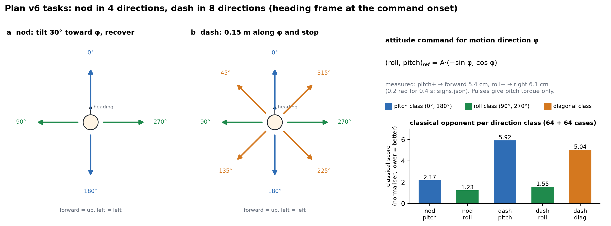

*图 10：plan v6 的任务方向。*
- (a) 点头的 4 个方向：前后为俯仰类，左右为横滚类。
- (b) 冲刺的 8 个方向：另加 4 个对角方向，即对角类。
- 右侧：方向到姿态指令的映射，以及经典对手在每个方向类上的平均得分（即归一化分母）。

**方向约定**：方向 φ 定义在指令开始时刻的航向坐标系里，0° 为前、90° 为左、180° 为后、270° 为右。

**方向与姿态的对应**：要让机体沿 φ 方向加速，姿态指令取
```
(roll, pitch)_ref = A · (−sin φ, cos φ)
```
符号是实测得到的（`artifacts/spike_steer/plan_v6/signs.json`）：俯仰设定值 +0.2 rad 保持 0.4 s，机体前移 5.4 cm；横滚 +0.2 rad，机体右移 6.1 cm。横滚方向用设定值驱动的权限和俯仰相当。

**机动从 T0 = 2.4 s 开始**。指令在 t ≥ T0 且目标未达成时有效。目标是否达成由真值判定，这属于导航层职责，不在控制器接口内。

| 任务 | 方向 | 目标 | 得分 J（越低越好） |
|---|---|---|---|
| 点头 nod | 0°/90°/180°/270° | 向 φ 方向倾斜 ≥ 30° 并保持 0.1 s，再回到总倾角 < 5° | t30 + t_recover + 0.03·掉高(cm) + 0.5·水平漂移(m) + 坠落罚 |
| 冲刺 dash | 每 45° 一个，共 8 个 | 沿 φ 方向前进 0.15 m 并停住（沿 φ 速度 < 0.1 m/s 持续 0.3 s；窗口 4 s） | t_reach + t_settle + 2·超调 + 0.03·掉高 + 0.5·横向偏差 + 坠落罚 |

几点说明：
- **点头角度的算法**：取去除翅拍晃动后的（横滚, 俯仰）在方向 φ 上的投影。它是**带符号的**，必须朝指定方向倾斜。第 5 轮只要求 \|pitch\| ≥ 30°，不分前后。
- **方向分三类**：俯仰类（0°、180°）、横滚类（90°、270°）、对角类（其余 4 个，只有冲刺有）。
- **悬停和大扰动恢复两项不变**。门控下学习层在这两项里从不接管，所以没有重新测试（§4.3）。

---

## 2. 控制器

### 2.1 总览

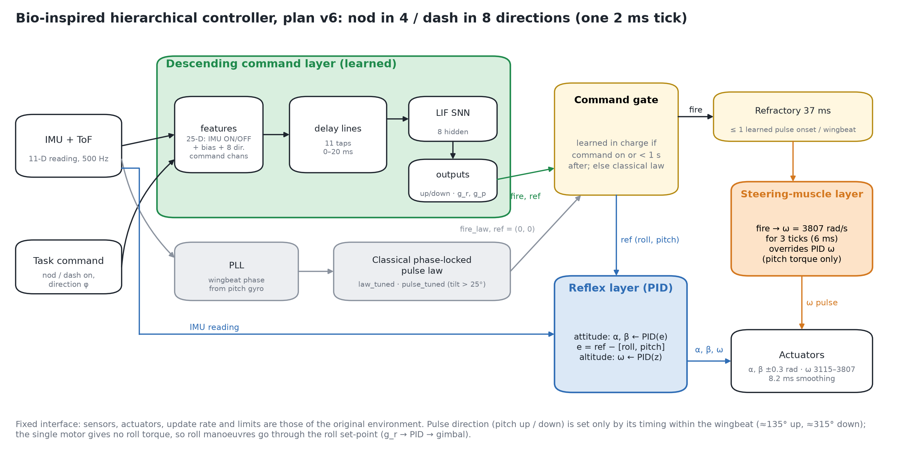

*图 1：一拍（2 ms）之内的控制器。*
- 绿色：学习得到的下行指令层（SNN）。
- 灰色：经典锁相脉冲律。门控不让学习层负责时用它；网络和锁相环每拍都在运行。
- 蓝色：PID 反射层，跟踪横滚、俯仰设定值。
- 橙色：转向肌层，6 ms 满转速脉冲，覆盖 PID 给出的转速；只产生俯仰力矩。

传感器与执行器接口不变。

```
                ┌──────────────────── 下行指令层（学习，SNN）────────────────────────┐
IMU 读数 ──► 特征 x[25] ──► 延迟线 ──► 8 LIF 隐层 ──► 2 LIF 输出(up/down) ──► fire ──┐
任务指令 ─┘ (含方向)                          └──► 分级单元 g_r, g_p ──► ref = 0.7·tanh(g) │
                                                                       │              │
                ┌────────── 反射层（PID）◄── 设定值 ref = (roll, pitch) ◄┘              │
IMU 读数 ──────►│ α, β, ω = PID(reading; ref)                                         │
                └──────────────┬────────────────────────────────────────────────────── │
                               ▼                                                       ▼
                      转向肌层：若 fire → 之后 3 拍 ω = 3807 rad/s（覆盖 PID 的 ω）
                               ▼
                        执行器（限幅、8.2 ms 平滑）
```

外层还有两样东西：
- **指令门控**（§2.6）：决定当前拍由学习层还是经典脉冲律提供 `fire` 和 `ref`。
- **翅拍不应期**（§2.7）：限制学习层的放电起始间隔。

### 2.2 一拍（2 ms）完整伪代码

```
输入：reading[11]（IMU+测距）, cmd4 = [nod·cos φ, nod·sin φ, dash·cos φ, dash·sin φ], 时刻 t
x              = features8(reading, cmd4)                          # §2.4
(fire_n, g)    = SNN.step(x)                                       # §2.5，网络每拍都运行；g = (g_r, g_p)
fire_c         = law(reading, PLL.crank(t))                        # 经典锁相脉冲律，每拍都运行（§2.6）
on             = (cmd4 非零) 或 (距指令结束 < 1.0 s)                 # 门控
if on:  fire, ref = fire_n, 0.7·tanh(g)                            # ref = (roll, pitch) 设定值
        if fire 为新起始 且 距上次被接受的起始 < 37 ms: fire = 0     # 不应期
else:   fire, ref = fire_c, (0, 0)
        if 倾角(AHRS) > 25°: 本回合起 law ← pulse_tuned             # 翻正反射
α, β, ω = ReferencePID(reading, rpy_reference = ref)               # §2.3
if t ≥ 1.5 s 且 (fire 或 脉冲进行中): ω = 3807                      # §2.8，脉冲持续 3 拍
执行 (α, β, ω)
```
- `t < 1.5 s` 为起飞保护：此时不放电，ref = (0, 0)。
- 学习层放电后，接下来 3 拍内不再判定新的放电。

实现：`descend8.Learned8`（策略）与 `bench8.run_episode8`（回合）。

### 2.3 反射层：PID（`robust_control/environment.py: ReferencePID`）

```
e      = rpy_reference − [roll, pitch]                # rpy_reference = (ref_roll, ref_pitch)
rate   = 低通( d[roll, pitch]/dt )                    # 微分取测量值，避免设定值跳变冲击
effort = kp·e − kd·rate + ki·∫e dt                    # 积分限幅 ±0.3
[α, β] = trim + [effort_pitch, effort_roll]           # 一个云台角管俯仰，另一个管横滚
ω      = ω₀ − kp_z(z − z_ref) − kd_z·vz + ki_z·∫(z − z_ref)
```
增益在应力悬停上做网格重调，相对原始基线为 kp × 1.5、kd × 0.85、ki × 1.5。全状态反馈上界只比它好 1.1° 倾角 RMS，说明悬停调节已经接近最优，学习层因此不去改悬停。

第 5 轮的横滚设定值固定为 0；plan v6 由网络的 g_r 给出。

### 2.4 学习层输入：25 维特征（`bench8.features8`）

```
s    = reading[IDX] / SCALE         # IDX = [roll, pitch, gx, gy, gz, ax, ay, az]
                                    # SCALE = [0.1 rad ×2, 10 rad/s ×3, 25 m/s² ×3]
c    = [nod·cos φ, nod·sin φ, dash·cos φ, dash·sin φ]     # 方向指令（无指令时全为 0）
x    = [ max(s,0) (8维), max(−s,0) (8维), 1, max(c,0) (4维), max(−c,0) (4维) ]
```
- **正负拆分**：每路都是非负驱动，类似 ON/OFF 通道，适合脉冲神经元。方向指令也这样拆，例如"向后点头"对应 nod·cos φ 的负半路。
- **尺度**：取翅拍振荡的典型幅度，网络可以把陀螺和加速度计上的翅拍振荡当成"时钟"。
- **不提供翅拍相位**：经典律直接从锁相环拿相位；学习层只能用延迟连接从振荡里自己构造相位。
- **看不到高度和升降速度**，高度只由反射层管。

### 2.5 下行指令层：延迟连接的 LIF SNN（`descend8.Net8`，torch 版 `descend8.SNN8`，两者逐拍一致）

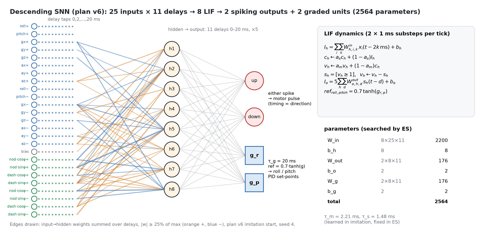

*图 2：下行 SNN 的结构。*
- 每条输入有 11 档延迟（0–20 ms），接入 8 个 LIF 隐层神经元。
- 隐层脉冲再经 11 档延迟，接到 2 个放电输出（up/down）和 2 个分级单元（g_r 给横滚设定值，g_p 给俯仰设定值）。
- 连线只画了 plan v6 种子 4 模仿起点中，按延迟求和后最强的输入→隐层权重。橙色为正，蓝色为负。

**结构**

```
x[25] ─ 每条输入 11 档延迟（0, 2, …, 20 ms）, W_in[8,25,11] ─► 8 个 LIF 隐层神经元
隐层脉冲 ─ 11 档延迟（0..20 ms）, W_out[2,8,11] × 5 ─► 2 个 LIF 输出（up, down）
隐层脉冲 ─ 11 档延迟, W_g[2,8,11] × 5 ─► 2 个分级单元 g_r, g_p（τ_g = 20 ms 漏积分）
```

| 参数 | 形状 | 个数 |
|---|---|---|
| W_in | 8×25×11 | 2200 |
| b_h | 8 | 8 |
| W_out | 2×8×11 | 176 |
| b_o | 2 | 2（初值 −2，默认不放电） |
| W_g | 2×8×11 | 176 |
| b_g | 2 | 2 |
| **合计（ES 搜索维数）** | | **2564** |

膜时间常数 τ_m 与突触时间常数 τ_s 在模仿阶段可学（plan v6 种子 4：τ_m ≈ 2.2 ms，τ_s ≈ 1.5 ms），ES 阶段固定。

**动力学**

每 2 ms 一拍分两个 1 ms 子步，其中 a_m = e^(−1 ms/τ_m)，a_s = e^(−1 ms/τ_s)：

```
I_h   = Σ_i Σ_k W_in[h,i,k] · x_i(t − 2k ms) + b_h
cur_h ← a_s·cur_h + (1 − a_s)·I_h
v_h   ← a_m·v_h  + (1 − a_m)·cur_h
s_h   = [v_h ≥ 1];   v_h ← v_h − s_h                         # 阈值 1，减法复位
I_o   = 5 · Σ_h Σ_d W_out[o,h,d] · s_h(t − d) + b_o  → 同样的 LIF → s_o
I_g   = 5 · Σ_h Σ_d W_g[j,h,d] · s_h(t − d) + b_g[j] ;   g_j ← a_g·g_j + (1 − a_g)·cur_g,j     # j ∈ {roll, pitch}
fire  = 两个子步内 s_up 或 s_down 任一为 1
ref   = 0.7 · tanh(g)  = (ref_roll, ref_pitch)                # ±0.7 rad
```

**输出的含义**

- **up 和 down 执行时是同一个动作**：一次电机脉冲。产生抬头还是低头力矩，完全由放电时刻落在翅拍的哪个相位决定（曲柄约 135° 抬头，约 315° 低头）。两个输出只是方便模仿学习分别学两种放电时机。
- **脉冲只管俯仰**：单电机让两侧翅膀同时变化，左右对称，产生不了横滚力矩。所以横滚方向的机动只能靠设定值 g_r，经 PID 驱动云台完成；对角方向则两种手段都可用到。
- **延迟线**：作用是让网络从 0–20 ms 的 IMU 振荡历史中推断翅拍相位。一个翅拍周期约 37 ms，20 ms 的历史超过半个周期。
- **分级单元**：给出慢速、持续的姿态指令，由 PID 跟踪。

### 2.6 指令门控与经典脉冲律（`descend8.Learned8`，同第 5 轮的 `descend_gated.GatedLearned`）

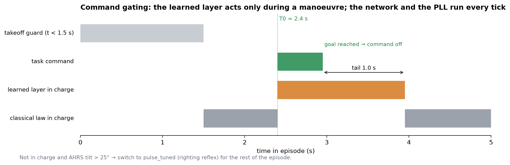

*图 3：指令门控的时间线（与第 5 轮相同）。*
- 学习层只在指令期间及其后 1 s 内负责输出，其余时间由经典律负责。
- 起飞后 1.5 s 内不发脉冲。

**学习层何时在岗**

- **在岗**：任一方向指令非零，或者指令结束后不到 1.0 s（`TAIL_S = 1.0`）。
- **不在岗**：使用经典锁相脉冲律 `law_tuned`，ref = (0, 0)，与经典悬停控制器逐拍相同。
- **翻正反射**：不在岗时，若 AHRS 倾角超过 25°，本回合改用翻正专用律 `pulse_tuned`。

**经典锁相脉冲律**（`pilot.py`）

```
crank = PLL(gy)                                  # 由俯仰陀螺锁相得到的翅拍相位
u     = −(k_θ·pitch + k_q·q_slow)                # q_slow：去掉翅拍振荡的慢俯仰角速度
ψ     = 135°（u > 0）或 315°（u < 0）
fire  = |u| > 阈值 且 |crank − ψ| < 窗宽/2         # 窗内电机保持满转速
```
两组参数：
- `law_tuned`：k_θ = 8.0，k_q = 0.4，阈值 0.5，窗宽 45°（悬停）；
- `pulse_tuned`：k_θ = 3.0，k_q = 0.4，阈值 0.5，窗宽 90°（翻正）。

网络和锁相环每拍都在运行，所以切换时状态是连续的。

**门控的后果**：悬停得分按构造等于经典（比值 1.000）；恢复比值固定为 1.050，因为 25° 之前用 law_tuned，对手全程用 pulse_tuned。对应的生物学类比是：下行神经元调制反射，而不是替代反射。

### 2.7 翅拍不应期

学习层在岗时，若某一拍是新的放电起始，且距上一次**被接受**的起始不足 37 ms（约一个翅拍），就取消这次放电。这样每个翅拍最多一次脉冲，类比果蝇转向肌每翅拍最多放电一次。不应期只作用于学习层。

### 2.8 转向肌层

任一来源放电后，接下来 3 拍（6 ms，`TWITCH = 3`）电机指令为 3807 rad/s，覆盖 PID 给出的 ω。

经过 8.2 ms 平滑后，脉冲到达电机时已被拉宽、削峰，一次脉冲约把转速顶高 692 rad/s。这在翅拍周期内形成前后不对称的升力，从而产生俯仰力矩。

### 2.9 闭环运行实例（第 5 轮，俯仰版本）

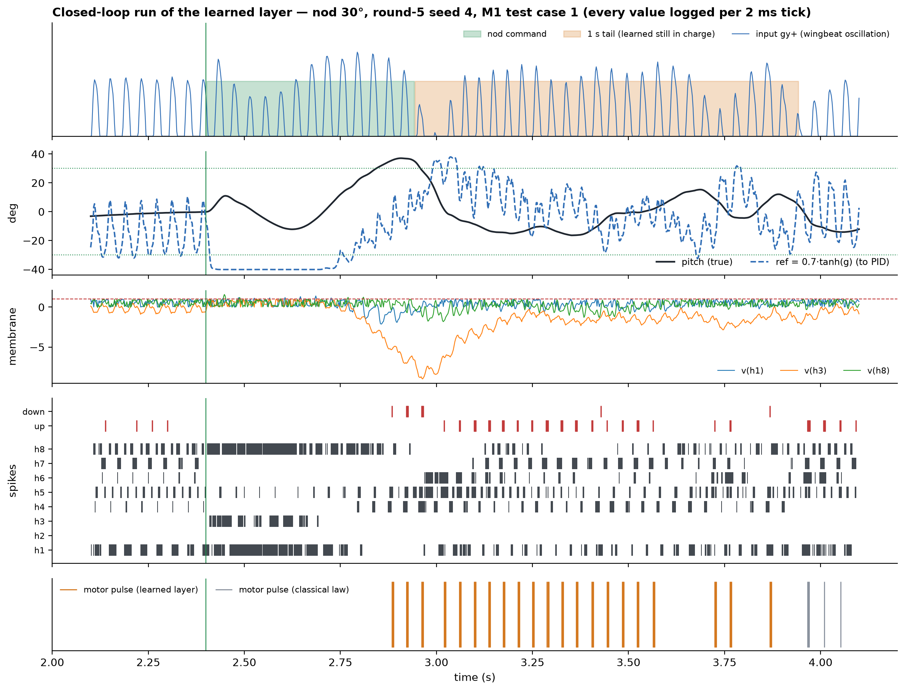

*图 9：第 5 轮控制器一次点头 30° 回合的逐拍记录（种子 4，M1 盲测第 1 个用例；视频版为 `artifacts/spike_steer/videos_v4/r5s4_nod_30deg_network.mp4`）。plan v6 的对应图等训练出结果后补上。*

从上到下五个面板：
1. 指令与门控，以及作为"时钟"的陀螺输入 gy+（翅拍振荡）；
2. 真实俯仰角与网络给出的设定值 ref；
3. 三个隐层神经元的膜电位；
4. 8 个隐层神经元与 up/down 输出的脉冲栅格；
5. 电机脉冲，区分学习层与经典律。

图中可以读出的分工：
- **指令开始后**：h1、h3、h8 高频放电，分级单元把设定值推到上限附近（约 −40°）。机体先低头约 12°，随后反弹抬头，在约 +0.5 s 时越过 30°，点头目标达成，指令结束。
- **目标达成、设定值翻转之后**：直到 1 s 尾巴结束，学习层发出一串约每翅拍一次的电机脉冲。它们落在 37 ms 不应期允许的节拍上，用于制动和回正。
- **门控关闭后**：控制权交还经典律（灰色脉冲）。

---

## 3. 训练

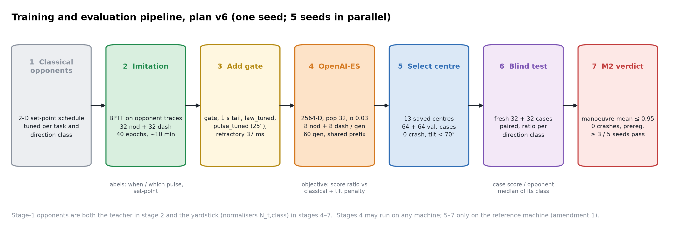

*图 4：plan v6 一个种子从经典对手到判定的完整流程，5 个种子并行。*

经典对手同时承担两个角色：
- 第 2 步模仿的"老师"；
- 第 4–7 步所有比值的分母，即衡量标准。

第 4 步（ES 搜索）可以在任何机器上跑；第 5–7 步（选中心、盲测、判定）只在参考机器 CloudPC-2 上做（预注册修正 1，§4.3）。

### 3.0 经典对手与基准（`bench8.py pilot`、`descend8.py baseline`）

**对手**：2-D 设定值调度（`bench8.Schedule2`），叠加在 PID 反射层和 law_tuned 悬停脉冲律之上。从指令开始：
1. 沿方向 φ 给出幅度 go_ref 的姿态指令，持续 go_beats 拍；若开启门控，目标一达成就提前结束。
2. 再给 brake_ref，持续 brake_beats 拍。
3. 之后回到 0。

**调参**（同预算，pilot 网格）：
- 点头试 180 组参数，冲刺试 108 组；
- 每组飞 16 个调参用例，每个方向 2 个；
- **每个任务、每个方向类各选最好的一组**。学习方也拿到方向输入，所以对手按方向类分别调参才算公平。

| 任务 | 方向类 | 选中的调度（go_ref × go_beats / brake_ref × brake_beats，弧度、拍） |
|---|---|---|
| 点头 | 俯仰 | −0.6 × 9 / +0.2 × 6 |
| 点头 | 横滚 | −0.6 × 9 / 无制动 |
| 冲刺 | 俯仰 | +0.35 × 45 / −0.5 × 6 |
| 冲刺 | 横滚 | +0.35 × 18 / −0.35 × 3 |
| 冲刺 | 对角 | +0.5 × 18 / −0.35 × 12 |

点头的最佳调度在每个方向都是**先朝反方向倾、再借回弹越过 30°**（go_ref 为负），和第 5 轮的经典点头一致。

**基准（归一化分母 N_{t,c}）**：对手在 64 个点头 + 64 个冲刺训练分布用例上的平均得分，按任务和方向类分别计算。

| 任务 | 俯仰类 | 横滚类 | 对角类 |
|---|---|---|---|
| 点头 | 2.17 | 1.23 | — |
| 冲刺 | 5.92 | 1.55 | 5.04 |

各方向难度差别很大：
- 横滚方向冲刺，经典很快到达并停稳；
- 前后方向冲刺到达慢，而且在窗口内停不下来；
- 对角方向到达快，但也停不下来。

基准里对手的点头 64 例中坠落 3 次，冲刺 0 次。pilot 中所有参数组的坠落都只出现在俯仰方向（0°、180°）。

pilot 的视频见 `artifacts/spike_steer/plan_v6/videos/`，每个方向一段。

### 3.1 第一步：模仿经典对手（`descend8.py collect / train`）

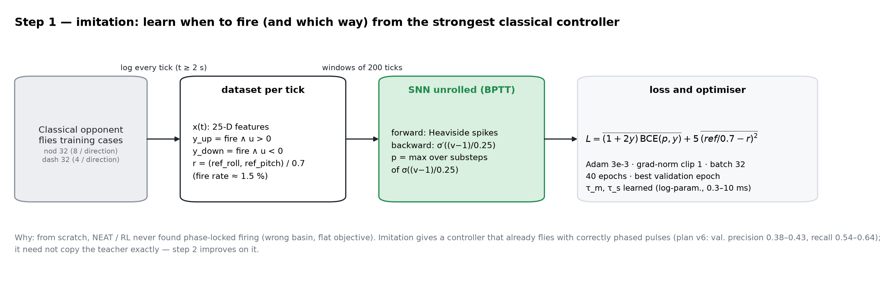

*图 5：模仿阶段，即替代梯度 BPTT 学习"何时、朝哪个方向放电"以及两个设定值。*

**为什么要模仿**：从零开始用 NEAT 或强化学习，都找不到锁相放电解（初始化落在错误的盆地，目标在大片区域上是平的）。模仿能给出会飞、放电相位正确的起点。

**数据**：经典对手（按用例的方向类取对应调度）在训练用例上飞，从 t ≥ 2 s 起逐拍记录 `[x(25), 是否放电, sign(u), ref_roll, ref_pitch]`。
- 训练用例：点头 32（每个方向 8 个）、冲刺 32（每个方向 4 个）；
- 验证用例：各 8 个。

标签：
```
y_up = 放电 且 u > 0      y_down = 放电 且 u < 0      r = (ref_roll, ref_pitch) / 0.7
```
放电率约 1.5%，所以正样本加权。

**损失与优化**

- **替代梯度**：前向用阶跃，反向用 σ((v − 1)/0.25) 的导数。输出放电概率 p 取两个子步内 σ((v − 1)/0.25) 的最大值。
- **损失**（ref 项对横滚和俯仰两个分量取平均）：
  ```
  L = mean[ (1 + 2y) · BCE(p, y) ] + 5 · mean[ (ref/0.7 − r)² ]
  ```
- **批与展开**：窗口 200 拍、步长 100 拍，每批 32 个窗口，BPTT 全展开。
- **优化器**：Adam，学习率 3e-3，梯度范数裁到 1，训练 40 轮，按验证损失选最优一轮。
- **时间常数**：τ_m、τ_s 以 log 参数化参与学习，裁在 0.3–10 ms。

**结果**（5 个种子，第 40 轮）：
- 验证集放电精度 0.38–0.43，召回 0.54–0.64；
- 设定值误差 RMSE ≈ 0.10–0.13（横滚、俯仰）；
- 第 5 轮的对应数字为精度约 0.45、召回 0.65–0.70。

模仿不必完全复刻老师，只要起点会飞、相位基本正确即可。

**起点在 ES 第 0 代的成绩**（种子 4，16 个回合）：
- 点头比值 3.23，远差于经典：模仿没学会"先反倾再回弹"的点头方式；
- 冲刺比值 1.06；
- 0 次坠落。

**加门控**：模仿结果直接带上门控参数：
- gate、tail_s = 1.0；
- base_law = law_tuned、upset_law = pulse_tuned、upset_tilt = 25°；
- refractory_s = 0.037。

起点已归档：`artifacts/spike_steer/plan_v6/imitate_spec_s{1..5}.json`。

### 3.2 第二步：OpenAI-ES 直接优化机动得分（`descend8.py finetune`）

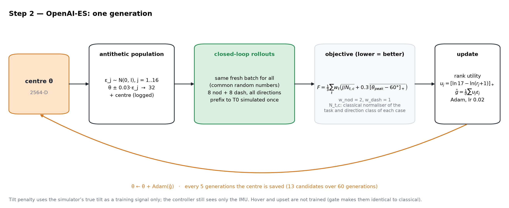

*图 6：OpenAI-ES 的一代。*
- 32 个对称扰动在同一批新用例上闭环飞行，用例覆盖所有方向。
- 按排名效用估计梯度，再用 Adam 更新中心。

**算法**

```
θ = flatten(W_in, b_h, W_out, b_o, W_g, b_g)                   # 2564 维；τ_m、τ_s 固定
for gen = 1 … 60:
    抽 16 个 ε_j ~ N(0, I)，取对称 ±ε_j 得 32 个候选 θ_j = θ ± 0.03·ε_j
    这一代抽一批新的训练用例：点头 8（每个方向 2）+ 冲刺 8（每个方向 1）；所有候选飞同一批（公共随机数）
    F_j = 目标函数(θ_j)  （见下）
    按 F_j 排名（最好排第 0）：u_j = max(0, ln(17) − ln(rank_j + 1))，u ← u/Σu − 1/32
    ĝ = (1/0.03) · Σ_j u_j · ε_j
    θ ← θ + Adam(ĝ)，学习率 0.02，β = (0.9, 0.999)
    每 5 代：保存中心 θ（共 13 个候选）
```

**目标函数**

```
F = Σ_t w_t · ( mean_cases∈t[ J / N_{t,class(case)} ] + 0.3 · mean_cases∈t[ max(0, θ_peak − 60°) ] ) / Σ_t w_t
t ∈ {nod, dash}，w_nod : w_dash = 2 : 1
```
- 每个用例的得分先除以它**所在方向类**的经典分母，再平均。这样横滚类（经典很强）和俯仰类（经典较弱）的用例在目标里分量相当，各方向上的改进同样计数。
- θ_peak：回合内真实倾角的峰值，单位为度，取自仿真真值。倾角惩罚只作训练信号，控制器本身仍只看 IMU。
- 点头权重是冲刺的两倍，与第 5 轮相同。
- 悬停和恢复不参与训练：门控下它们与学习层无关。

**用例与随机流**
- 训练用例：`make_case(2_097_200_000 + 100_000 + 100·gen + i, …, 'stress', i mod 8)`。方向按 `bench8.cases8` 轮换，每 8 个用例为一块，保证方向与扰动类型交叉。
- ES 随机流种子：1000 + seed；断点续跑时用 [1000 + seed, gen] 重播种。每代都存检查点，可以在不同机器间迁移。

### 3.3 选中心（`descend8.py reselect`）

13 个保存的中心各在 64 个点头（每个方向 16 个）+ 64 个冲刺（每个方向 8 个）验证用例上飞（训练生成器偏移 60 000，与 ES 批次和盲测集都不重叠）。

选择规则（同第 5 轮）：
1. 只保留零坠落、且所有回合真实倾角峰值 < 70° 的候选；
2. 其中按带惩罚的目标 F（同 §3.2）取最低者。

为什么用 128 例：第 5 轮的经验是，ES 越往后越冒进，后期中心常出现坠落或倾角过大，见图 7。小样本选出的中心在盲测上偏乐观。

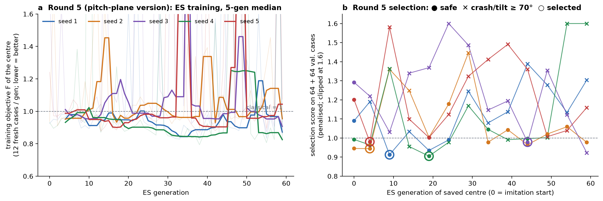

*图 7：第 5 轮（俯仰版本）5 个种子的真实训练记录。plan v6 的对应图等训练出结果后补上。*
- **(a)** 每代中心的训练目标 F。它在每代新抽的用例上计算，噪声很大，偶发坠落会产生尖峰。
- **(b)** 每 5 代保存的中心在 128 个验证用例上的成绩。✕ 表示有坠落或倾角 ≥ 70°，会被排除；圆圈为最终选中的中心。

### 3.4 共享起飞段缓存（`cache8.py`）

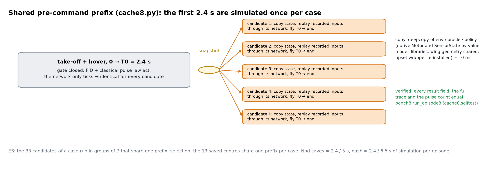

*图 11：每个用例前 2.4 s（起飞和悬停）只仿真一次，所有候选从同一快照接着飞。*

**为什么可以共享**：指令开始（T0）之前门控关闭，机体由 PID 和经典脉冲律控制，网络只在内部计数而不影响输出。所以这一段的物理轨迹与候选网络的权重无关。

**做法**：
1. 第一个候选飞到 T0，保存整个回合状态的快照：环境、真值姿态估计器、策略状态、已记录的输入序列。
2. 每个候选复制一份快照，换上自己的网络。
3. 把记录的输入逐拍"重放"给它的网络，重建 T0 时刻的网络状态。
4. 从 T0 继续飞完。

**快照的技术细节**：
- 原生仿真后端里的电机和传感器状态（ctypes 结构）按字节复制；
- 模型、编译库、机翼几何不变，直接共享；
- 大扰动模块装在环境上的闭包要在副本上重装，否则副本会推动原环境；
- 复制一次约 10 ms。

**验证**：点头、冲刺各取 3 个输出活跃的随机网络，与完整仿真比较，所有结果字段、完整逐拍轨迹和脉冲次数都**逐位相同**（`python -m experiments.algorithms.spike_steer.cache8`）。

**用法**：
- ES：一个用例的 33 个候选按每组 7 个共享一次起飞段；
- 选中心：13 个中心在每个用例上共享一次起飞段。

每回合省去点头约 2.4/5、冲刺约 2.4/6.5 的仿真量。

### 3.5 预算
- 每个种子：模仿 40 轮，加上 ES 60 代 × 33 候选 × 16 回合 ≈ 3.2 万回合，再加选中心 13 × 128 回合。
- 经典对手的调参：每个任务 108–180 组参数 × 16 个用例。

学习方预算远大于经典方，这一点需要在论文中说明。

---

## 4. 评估

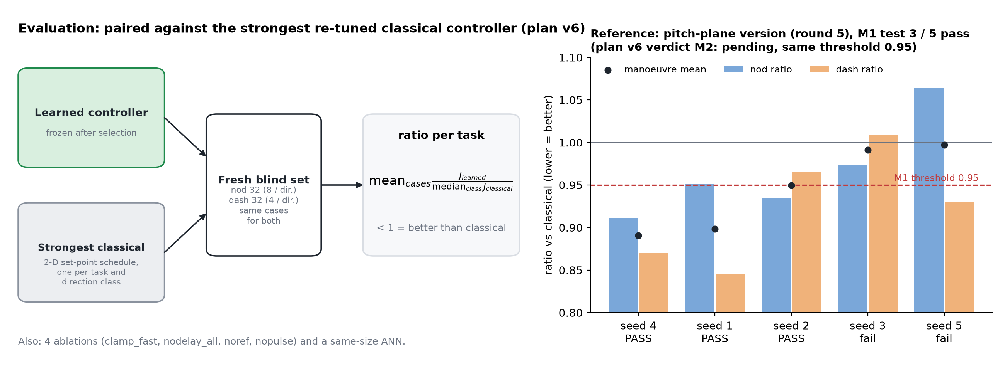

*图 8：评估方式。*
- 左：plan v6 学习方与按方向类调参的经典对手，在全新盲测集上逐例配对。
- 右：作为参照的第 5 轮（俯仰版本）M1 结果，3/5 通过。plan v6 的 M2 判定待出。

### 4.1 对手

见 §3.0：2-D 设定值调度，按任务和方向类各选最好的一组。悬停和大扰动恢复的对手与第 5 轮相同（law_tuned / pulse_tuned）。

与"普通 PID"相比差距很大（第 5 轮点头约 5.16 对 0.85），但这个对比太弱，所以全部结论只对比最强经典方案。

### 4.2 盲测与配对
- 盲测集基数 2_097_100_000，在判定阶段之前没有任何控制器用过。点头 32 例（每个方向 8 个），冲刺 32 例（每个方向 4 个）。学习方与对手在同一批用例上逐例配对。
- **任务比值** = 对每个用例计算"学习方得分 ÷ 对手在该用例所在方向类上的得分中位数"，再对用例取平均。学习方的得分包含坠落罚，这种取法对学习方更严。
- 另外按方向类分别报告比值和逐例胜负数。

### 4.3 主判据 M2（预注册 `artifacts/spike_steer/plan_v6/preregistration_v6.json`，提交 `5d15eb6`）

一个种子"通过"需要同时满足：
- (点头比值 + 冲刺比值)/2 ≤ 0.95；
- 64 个盲测机动回合零坠落。

5 个种子中至少 3 个通过，M2 才成立。

- **悬停和恢复不重测**：学习层在没有指令时从不接管，所以按构造悬停 = 1.000、恢复 = 1.050，与 M1 相同。
- **预注册修正 1**（`848d832`，在任何选中心和盲测之前推送）：ES 可以在任何机器上跑；选中心和盲测只在 CloudPC-2 上做。原因是 GoogleCloud 节点的编译器和系统库不同（g++ 15.2 / Ubuntu 26.04，对比 CloudPC-2 的 g++ 13.3 / Ubuntu 24.04），同一参考回合得分 1.2791 对 1.2886，不能逐位复现。
- **预注册的预测**（写在任何结果之前）：
  - 冲刺的俯仰类和对角类，学习方比值 < 1：经典在这些方向停不下来，而脉冲正好作用在俯仰轴；
  - 冲刺的横滚类，学习方与经典相当：经典已经很快停稳，脉冲又给不了横滚力矩；
  - 点头的横滚类，没有脉冲优势可期，改进只能来自设定值单元。

**参照：第 5 轮的 M1**（俯仰版本，提交 `132b1e2`）
- 判据：(点头 + 冲刺)/2 ≤ 0.95，悬停 ≤ 1.06，恢复 ≤ 1.06，零坠落，≥ 3/5 种子。
- 结果：通过 3/5（种子 4、1、2），种子 2 以 0.9495 刚好过线。
- 原主假设 H1（四项平均 ≤ 0.95）未达到：悬停和恢复按构造分别为 1.000 和 1.050，稀释了机动成绩。

### 4.4 机制消融

| 变体 | 改动 | 检验什么 |
|---|---|---|
| clamp_fast | 陀螺与加速度计的正负两路输入置 0 | 是否靠快通道（翅拍振荡）建立相位 |
| nodelay_all | 每条连接沿延迟轴求和，放到 0 档（总增益不变） | 延迟线是否有功能 |
| noref | W_g = 0、b_g = 0 | 机动是否需要设定值权限 |
| nopulse | b_o = −50（永不放电） | 脉冲转向肌是否必要 |

第 5 轮每个种子在每种消融下综合都恶化至少 38%，四种机制缺一不可。plan v6 计划在盲测时对同样四种变体重做，届时 noref 可再拆成只去掉横滚或只去掉俯仰；descend8 中尚未实现。

### 4.5 ANN 对照（第 5 轮，`descend_ann.py`）
用同样尺寸的 ANN 替换 SNN，训练流程相同。结果：模仿阶段 ANN 与 SNN 相当，ES 阶段三个 ANN 种子都没有超过起点。所以本文**不主张**脉冲载体本身带来性能优势，主张的是分层结构加脉冲定时机制。

---

## 5. 设计取舍：试过、但没有进入最终方法的做法

| 做法 | 结果 | 为什么不用 |
|---|---|---|
| 纯 IMU 端到端 NEAT / PPO 悬停 | 0/192 严格成功 | 没有反射层学不会悬停，保留 PID 反射层 |
| NEAT 进化 LIF 回路（v1–v5c） | 最好与经典持平，不可靠 | 改为模仿起点 + ES |
| PID + SNN 直接给云台加残差 | SNN ≈ ANN，重调 PID 就比残差好；云台快速反馈会引起两体反向响应而坠机 | 快通道改为锁相电机脉冲，慢通道改为设定值 |
| 学习层全程接管、四任务一起优化（第 1 轮） | ES 牺牲悬停换机动（悬停比值 1.37–1.50） | 加指令门控与翻正反射 |
| 倾角惩罚阈值 45°（第 3 轮） | 点头变保守，0/3 过 H1 | 放宽到 60°、系数 0.3，加不应期（第 4 轮起） |
| 每候选 32 例、30 代（第 6 轮） | 种子 4、5 盲测综合 0.978 / 0.981，未达 H1；种子 1–3 未完成即停止 | 主结果用第 5 轮 |
| 每代安全检查回滚（safe ES，种子 1） | 30 代中撤回 11 代，点头未变快 | 探索性，未采用 |
| 奖励上限 + 脉冲惩罚 + 中途扰动（第 7 轮试验，MonoRace 启发） | 明显差于对照组 | 停止，负面结果存档 |
| 只做俯仰平面的机动（第 1–6 轮） | M1 3/5 通过 | 作为机动性测试不完整：横滚方向和对角方向没有测 → plan v6 |

---

## 6. 配置一览（plan v6）

| 类别 | 参数 | 值 |
|---|---|---|
| 时序 | 控制步 / 机动开始 / 起飞保护 | 2 ms / 2.4 s / 1.5 s |
| 任务 | 点头方向 / 冲刺方向 / 目标 | 4 / 8 / 30°、0.15 m |
| 转向肌 | 脉冲 | 3 拍 = 6 ms，3807 rad/s（只有俯仰力矩） |
| 网络 | 输入 / 隐层 / 输出 / 分级 | 25 / 8 LIF / 2 LIF / 2（横滚、俯仰，τ_g = 20 ms） |
| 网络 | 延迟 / spike_scale / ref 上限 / 参数 | 11 档 0–20 ms / 5 / 0.7 rad / 2564 |
| 门控 | 尾巴 / 翻正阈值 / 不应期 | 1.0 s / 25° / 37 ms |
| 对手 | 形式 / 调参 | 2-D 设定值调度 / 按任务 × 方向类，pilot 网格 |
| 模仿 | 用例 / 轮数 / 学习率 / 窗口 / 批 / 正样本权重 / ref 权重 | 32 + 32 / 40 / 3e-3 / 200 拍 / 32 / 3 / 5 |
| ES | 种群 / σ / 学习率 / 代数 | 32（16 对）/ 0.03 / 0.02（Adam）/ 60 |
| ES | 每代用例 / 目标权重 / 倾角惩罚 | 点头 8 + 冲刺 8 / 2:1 / 0.3·max(0, θ_peak − 60°) |
| 选中心 | 用例 / 规则 | 64 + 64 / 零坠落、θ_peak < 70°、目标最低 |
| 盲测 | 基数 / 用例 / 比值 | 2_097_100_000 / 32 + 32 / 除以同方向类对手中位数 |
| M2 | 机动门槛 / 坠落 / 通过数 | 0.95 / 0 / ≥ 3/5 |

---

## 7. 代码对应与复现

| 模块 | 内容 |
|---|---|
| `bench8.py` | 多方向任务、方向约定、得分（`run_episode8`、`score8`）、2-D 经典调度、方向符号测量（`signs`）、经典 pilot（`pilot`） |
| `descend8.py` | `Net8`（NumPy）/ `SNN8`（torch）、`Learned8`（门控 + 不应期 + 翻正反射）、baseline、模仿数据采集与训练、ES、选中心、盲测 |
| `cache8.py` | 共享起飞段缓存及其逐位一致性自测 |
| `render8.py` | plan v6 视频（经典对手各方向） |
| `bench.py` / `pilot.py` | 第 5 轮基准；锁相环、经典锁相脉冲律、转向肌脉冲（两版共用） |
| `descend.py`、`descend_gated.py`、`descend_r4.py`、`descend_r5.py`、`reselect_r3.py`、`confirm_m1.py`、`descend_ann.py` | 第 5 轮及 M1 |
| `render_v4.py` / `render_net.py` | 第 5 轮飞行视频 / 网络运行总览视频 |
| `scripts/setup_v6_node.sh` | 新机器一键部署：固定版本依赖、自测、逐位一致性检查，可选直接启动 ES |
| `docs/figs/make_algorithm_figs.py` | 本文全部图（`--sim` 额外生成图 9） |

**plan v6 复现**（仓库根目录，`OMP_NUM_THREADS=1`）：

```bash
M="python -W ignore -m experiments.algorithms.spike_steer"
$M.descend8 selftest && $M.cache8                      # 自测
$M.bench8 signs --workers 8                            # 方向符号（已归档 signs.json）
$M.bench8 pilot --workers 30                           # 经典 pilot（已归档 pilot_summary.json）
$M.descend8 baseline --workers 30                      # 对手 + 归一化分母
$M.descend8 collect --workers 30
for s in 1 2 3 4 5; do $M.descend8 train --seed $s; done
$M.descend8 finetune --seed <s> --workers 30           # ES，可断点续跑
$M.descend8 reselect --seed <s> --workers 30           # 只在 CloudPC-2
$M.descend8 evaluate --seed <s> --workers 30           # 只在 CloudPC-2
```

归档：`artifacts/spike_steer/plan_v6/` 下有 signs.json、pilot_summary.json、baseline.json、imitate_spec_s*.json、preregistration_v6.json 和 videos/。第 5 轮的复现命令见 [FlapSim_full_report.md §11.3](FlapSim_full_report.md)。

---

## 附录 A：plan v6 与第 5 轮的差别

| | 第 5 轮（俯仰版本） | plan v6（多方向） |
|---|---|---|
| 点头 | 不分方向，\|pitch\| ≥ 30° | 4 个方向，向 φ 倾斜 ≥ 30°（带符号） |
| 冲刺 | 沿航向前进 | 8 个方向，沿 φ 前进并停住 |
| 指令输入 | nod、dash 两个 0/1 开关 | 8 路方向指令（cos φ、sin φ，正负拆分） |
| 输入维数 | 20（含 1 路占位） | 25 |
| 分级单元 | 1 个（俯仰设定值），横滚设定值固定为 0 | 2 个（横滚、俯仰设定值） |
| 参数 | 2035 | 2564 |
| 经典对手 | 俯仰设定值调度，每个任务一组 | 2-D 设定值调度，每个任务 × 方向类一组 |
| 归一化 | 每个任务一个分母 | 每个任务 × 方向类一个分母 |
| ES 每代用例 | 点头 8 + 冲刺 4 | 点头 8 + 冲刺 8 |
| 盲测 | 16 + 16 | 32 + 32 |
| 判据 | M1（含悬停、恢复不劣） | M2（悬停、恢复按构造不变，不重测） |
| 加速 | 无 | 共享起飞段缓存（逐位一致） |
| 门控 / 不应期 / 翻正反射 / 模仿与 ES 超参数 | — | 与第 5 轮相同 |
