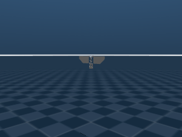

# Gallery

All clips are rendered with `flapsim record` / `flapsim.io.record_video`
(offscreen, OSMesa) and the `ForceArrows` overlay: orange arrows are each
wing's aerodynamic force at its centre of pressure (green dot).

## Example robot, fixed base, 35 Hz, slow motion (20x)

Quasi-steady blade-element forces; passive feathering rides the +/- 45 degree
stops with the trailing edge lagging the stroke. The mean lift at 40 Hz is
0.30 N for the 30 g robot, so it hovers near 40 Hz.

## Example robot, floating base, hover PID (real time)

The cycle-averaged model identified from the fixed-base sweep, driven by the
period-averaged altitude and attitude loops of `controller/hover_pid`.

## Parametric flat-plate flapper, slow motion (20x)

Built in Python by `flat_plate_flapper()` (no CAD): two rectangular plates
with a spar-plate mass model, driven by equal stroke angles on mirrored
axes. Exact left/right force symmetry.

Reproduce: `python examples/render_video.py --output clip.gif --slow 20` or
`flapsim record SingleThrustFlapper --output clip.gif --duration 0.06 --slow 20`.
