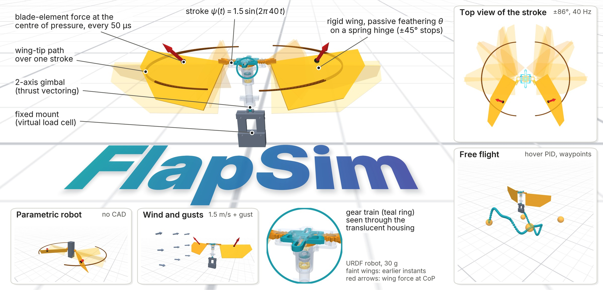
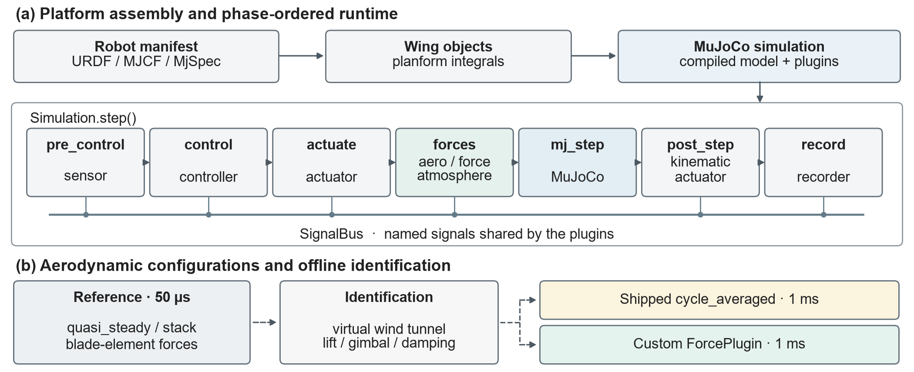
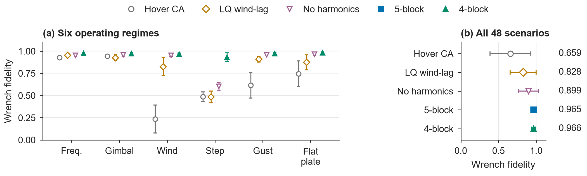
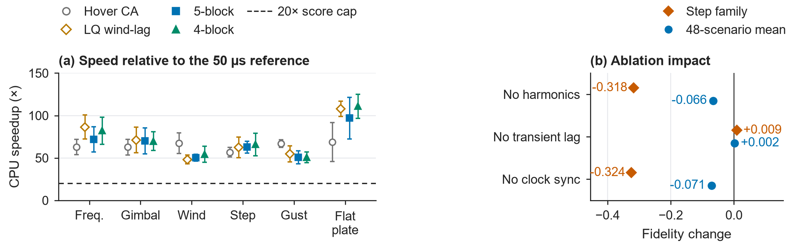
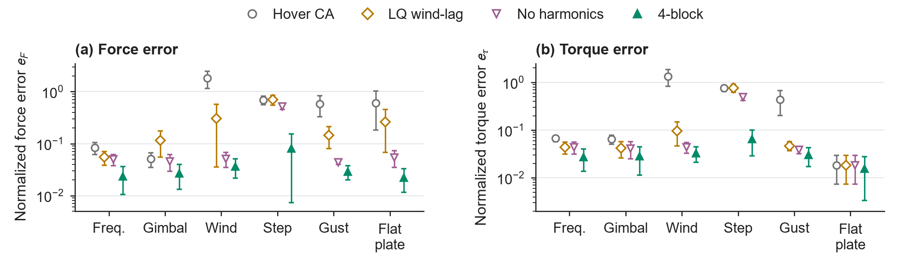
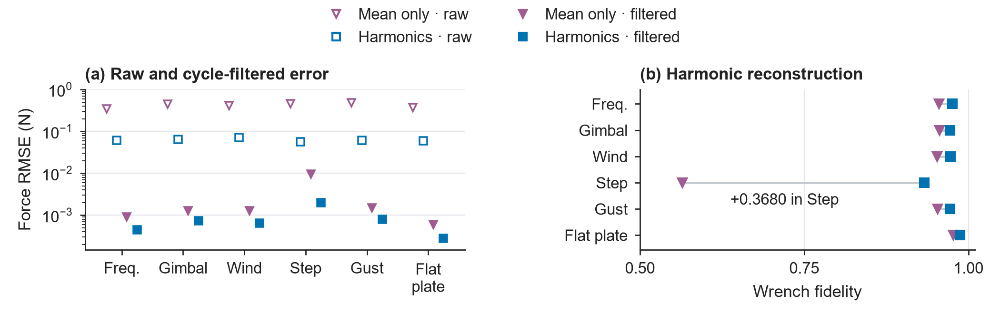
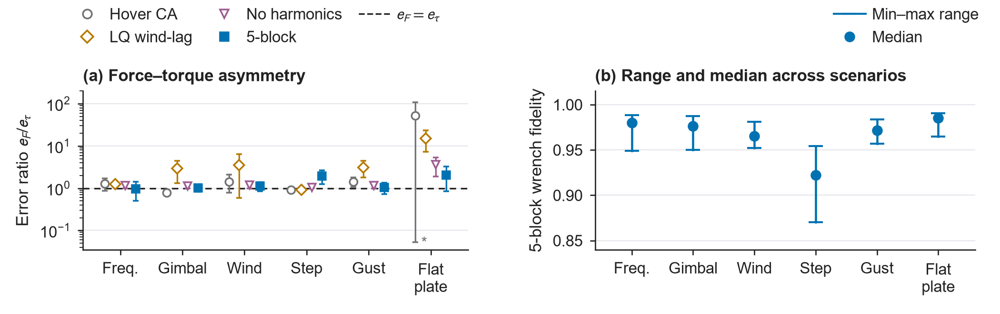
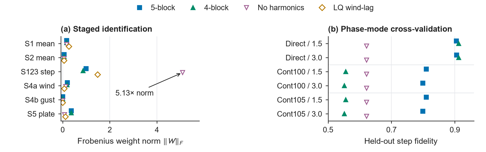

---
hide:
  - navigation
  - toc
---

<div class="fs-hero" markdown>

# FlapSim: A Composable MuJoCo Simulation Platform and Reduced-Order Aerodynamic Model Hierarchy for Flapping-Wing Robotics { .fs-title }

<p class="fs-venue">Open-source platform · paper under review</p>

[:fontawesome-brands-github: Code](https://github.com/MingshanHe/FlapSim){ .md-button .md-button--primary }
[:material-book-open-variant: Documentation](getting_started.md){ .md-button }
[:material-robot-outline: Import your robot](robot_manifest.md){ .md-button }
[:material-file-document-outline: Paper (coming soon)](#citation){ .md-button }

</div>

<figure class="fs-figure fs-teaser" markdown>

<figcaption markdown>
**FlapSim in MuJoCo.** A 30 g flapping-wing robot imported from URDF, flapping at 40 Hz on a fixed mount: translucent wings show earlier instants of the half stroke, brown curves the wing-tip paths, red arrows the blade-element force at each wing's centre of pressure. Cards show the top view of the stroke, waypoint flight with the floating base, the robot in wind and gusts, and a parametric robot built without CAD; the magnifier looks through the translucent housing at the gear train. ([PDF](assets/figure1/figure1.pdf))
</figcaption>
</figure>

## Abstract

Flapping-wing simulation must reconcile high-frequency wingbeat aerodynamics with the slower dynamics relevant to flight control and reinforcement learning. We present FlapSim, a modular open-source MuJoCo simulation platform that combines robot descriptions, wing geometry, and composable aerodynamic models in a deterministic simulation pipeline. Across 48 held-out scenarios spanning frequency, gimbal, wind, frequency-step, gust, and cross-robot flat-plate regimes, we compare five reduced-order configurations operating at 1 ms with a 50 µs quasi-steady blade-element reference. The built-in hover cycle-averaged baseline achieves a 67.51× CPU speedup but only 0.6593 mean wrench fidelity. Combining multirate 21-substep clock synchronization, three-dimensional linear/quadratic inflow and gust coupling, analytical blade-element geometry scaling, and phase-locked 1f–6f harmonics raises mean fidelity to 0.9646 at a 65.19× speedup in a five-block model. A streamlined four-block model without explicit step-transient lag states achieves 0.9662 fidelity at a 67.98× speedup. Controlled ablations show that stroke harmonics are particularly important during frequency transitions, improving held-out frequency-step fidelity by +0.3176. Transfer-function analysis explains this effect: fixed-window cycle averaging retains harmonic contributions when the wingbeat frequency changes, so within-cycle reconstruction also improves the filtered wrench. Once phase alignment and harmonic synthesis are included, explicit transient lag states provide no additional benefit in this benchmark. These results characterize the accuracy–computation tradeoff of the aerodynamic hierarchy and identify timing, inflow, geometry, and harmonic representation as central considerations for reduced-order flapping-wing simulation.

<div class="fs-numbers" markdown>
<div markdown>**0.9662**<br><span>mean wrench fidelity, four-block model</span></div>
<div markdown>**67.98×**<br><span>CPU speedup over the 50 µs reference</span></div>
<div markdown>**48**<br><span>held-out scenarios in six regimes</span></div>
<div markdown>**+0.3176**<br><span>frequency-step fidelity from stroke harmonics</span></div>
</div>

## Contributions

1. **Platform architecture and software characterization.** FlapSim's software architecture, robot manifest and CAD/MJCF/URDF import pipeline, first-class wing planform integral engine, phase-ordered plugin execution loop, Gymnasium learning interfaces and identification tooling.
2. **Quantitative characterization of the reduced-order aerodynamic hierarchy.** Five 1 ms reduced-order configurations benchmarked against the 50 µs per-step blade-element reference across six operating regimes, with controlled ablations and a transfer-function analysis of why within-cycle harmonics matter.

## Platform

<figure class="fs-figure" markdown>

<figcaption markdown>
**Architecture and aerodynamic model hierarchy.** (a) Robot descriptions and wing geometry are assembled into a MuJoCo simulation with a deterministic sequence of sensing, control, actuation, force evaluation, integration, post-step updates and recording; plugins exchange state through a shared signal bus. (b) The hierarchy connects the 50 µs blade-element reference to alternative 1 ms reduced models; dashed connections denote offline identification. ([PDF](assets/paper/flapsim_architecture_overview.pdf))
</figcaption>
</figure>

<div class="grid cards" markdown>

-   :material-robot-outline: **Bring your own robot**

    URDF, MJCF or a programmatic `MjSpec`, plus a small `robot.yaml` that names the wings, their frames, stroke and feathering joints, planform and mass model. [Import your robot →](robot_manifest.md)

-   :material-weather-windy: **Composable aerodynamics**

    Quasi-steady blade-element forces at the centre of pressure, rotational lift, added mass, wake capture, ground effect, wind, gusts and body drag, stacked per wing. [Aerodynamic models →](aero_models.md)

-   :material-puzzle-outline: **Everything is a plugin**

    Actuators, sensors, controllers, atmosphere and recorders share one step pipeline and a signal bus; third-party plugins register through an entry point. [Write a plugin →](plugins.md)

-   :material-brain: **Identification and learning**

    `flapsim sweep` identifies cycle-averaged models from the per-step reference; `SimulationEnv` turns any setup into a Gymnasium environment. [Learning and studies →](rl.md)

</div>

## Results

**Held-out benchmark** of five 1 ms configurations against the 50 µs blade-element reference, mean wrench fidelity over all 48 scenarios (Table III b of the paper):

| Configuration | Mean fidelity | CPU speedup | Training |
|---|---:|---:|---:|
| Hover cycle-averaged (built in) | 0.6593 | 67.51× | 22.5 s |
| LQ wind-lag | 0.8280 | 68.29× | 137.3 s |
| Mean-only (no harmonics) | 0.8987 | 66.25× | 137.8 s |
| Five-block harmonic | 0.9646 | 65.19× | 160.5 s |
| **Four-block harmonic** | **0.9662** | **67.98×** | 165.0 s |

<figure class="fs-figure" markdown>

<figcaption markdown>
**Wrench fidelity across the hierarchy.** (a) Mean fidelity in each flight regime (n = 8 scenarios per regime). (b) Mean fidelity across all 48 scenarios, from 0.6593 for the hover cycle-averaged baseline to 0.9662 for the four-block harmonic model. Error bars: ±1 sample SD across scenarios. ([PDF](assets/paper/per_family_fidelity_comparison.pdf))
</figcaption>
</figure>

<figure class="fs-figure" markdown>

<figcaption markdown>
**Computational speedup and component ablations.** (a) CPU speedup by regime relative to the reference simulator; the dashed line marks the 20× score-saturation threshold. (b) Changes in frequency-step and overall fidelity when removing harmonics, explicit transient states or clock synchronization (frequency-step changes −0.3176, +0.0095 and −0.3243). ([PDF](assets/paper/speedup_fidelity_tradeoff.pdf))
</figcaption>
</figure>

<figure class="fs-figure" markdown>

<figcaption markdown>
**Force and torque errors by regime.** Normalized force error (a) and torque error (b) on logarithmic axes; wind force error falls 50.1× (1.8124 → 0.0362) and flat-plate force error 27.3× (0.6030 → 0.0221). ([PDF](assets/paper/force_torque_error_decomposition.pdf))
</figcaption>
</figure>

<figure class="fs-figure" markdown>

<figcaption markdown>
**Harmonic reconstruction and moving-average filter leakage.** Harmonic synthesis reduces raw force RMSE 6.65× (0.4166 N → 0.0627 N); the frequency-step improvement of +0.3680 is consistent with cancelling the 244.2× increase in fundamental-frequency transmission at the higher wingbeat frequency. ([PDF](assets/paper/posthoc_02_harmonic_forensics.pdf))
</figcaption>
</figure>

??? note "Further analyses: force–torque asymmetry and ridge-regression conditioning"

    <figure class="fs-figure" markdown>
    
    <figcaption markdown>
    **Force–torque asymmetry and fidelity dispersion.** (a) Mean scenario-wise error ratio with ±1 sample SD (n = 8 per regime). (b) Minimum–maximum ranges and medians of the five-block model's fidelity. ([PDF](assets/paper/posthoc_01_wrench_asymmetry.pdf))
    </figcaption>
    </figure>

    <figure class="fs-figure" markdown>
    
    <figcaption markdown>
    **Ridge-regression conditioning and sensitivity to the phase model.** Subtracting the harmonic predictions before the final stage avoids a 5.13× increase in weight norm; cross-validation compares six phase conventions and harmonic weights. ([PDF](assets/paper/posthoc_03_training_forensics.pdf))
    </figcaption>
    </figure>

Benchmark numbers are those reported in the paper, evaluated at revision `19fa57f`. The repository has since gained fixes to the optional rotational-lift and added-mass models (see the [changelog](changelog.md)); the quasi-steady reference and its lift regression are unchanged.

## Quick start

```bash
git clone https://github.com/MingshanHe/FlapSim.git && cd FlapSim
pip install -e ".[dev]"
flapsim run SingleThrustFlapper                    # viewer, fixed base, force arrows
flapsim run SingleThrustFlapper --config hover     # floating base, hover PID
flapsim inspect my_robot.urdf                      # bodies and joints for your manifest
```

```python
from flapsim import Simulation

sim = Simulation("SingleThrustFlapper")
sim.add({"type": "actuator/sinusoidal_stroke", "id": "stroke",
         "joints": ["left_flapping_joint", "right_wing_flapping"],
         "directions": [1, -1], "frequency_hz": 40.0, "amplitude_rad": 1.5})
sim.add({"type": "aero/stack", "models": ["quasi_steady", "rotational_lift"]})
sim.add({"type": "recorder/memory", "signals": ["aero/F_world"], "every": 1e-3})
sim.run(1.0)
print(sim["recorder"]["aero/F_world"][:, 2].mean(), "N mean lift")
```

More in [Getting started](getting_started.md), the [gallery](gallery.md) and the [API reference](api/core.md).

## Citation

The paper is under review; a citation will be added here. To cite the software, use the repository's [`CITATION.cff`](https://github.com/MingshanHe/FlapSim/blob/master/CITATION.cff) (GitHub's "Cite this repository" button).

FlapSim is released under the Apache License 2.0. The quasi-steady aerodynamic model follows Whitney & Wood (2010) as implemented in the FlapX simulator.
