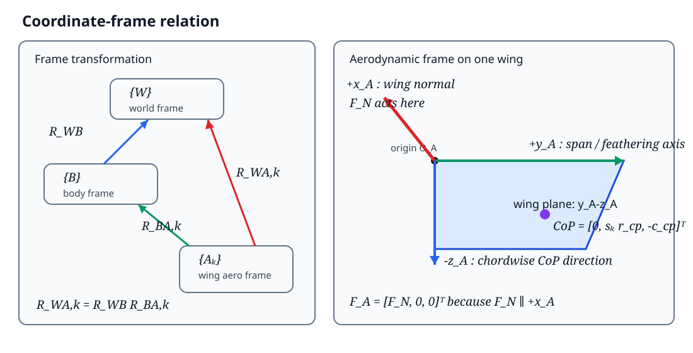

# 理想悬停状态下扑翼机器人的准定常气动力推导

## 摘要

本文针对 FlapSim 中的扑翼气动力模型，给出适用于论文正文的简化推导。研究对象限定为对称悬停状态：机身瞬时平动速度和角速度均为零，扑翼平面角与翼偏离角均为零，翼的主要运动由拍动角和被动羽化角描述。在该条件下，翼面内速度仅保留与展向坐标成正比的拍动速度，因此速度平方多项式中的一次项和常数项均为零，即

$$
a_{U1}=0,\qquad a_{U0}=0.
$$

在此基础上，本文依次推导单翼法向力、气动俯仰矩、压力中心、旋转阻尼矩、世界坐标系下的单翼 wrench，以及左右翼总升力。最后给出周期平均升力与拍动频率平方成正比的条件。

---

## 1. 模型假设

为获得清晰且可用于论文的闭式表达式，采用以下假设。

1. 机身在当前气动计算时刻近似静止：

   $$
   \boldsymbol v_B=\boldsymbol 0,\qquad
   \boldsymbol\omega_B=\boldsymbol 0.
   $$

2. 扑翼平面角和翼偏离角均为零：

   $$
   \Phi=0,\quad\dot\Phi=0,\qquad
   \phi=0,\quad\dot\phi=0.
   $$

3. 左右翼具有相同的几何形状，并采用镜像对称运动。

4. 翼展方向上的瞬时攻角以代表压力中心处的攻角近似，即同一时刻整片翼采用相同的法向力系数。

5. 气动力采用准定常翼素模型，不显式考虑尾迹捕获、附加质量、翼间干扰和动态失速。

6. 推导采用原始未限幅气动力，并取 `lift_scale = moment_scale = 1`。因此压力中心关系 $c_{cp}=-M_{aero}/F_N$ 保持严格成立。

需要强调的是，$a_{U1}=a_{U0}=0$ 不是完整六自由度模型的恒等式。它们仅在上述理想悬停假设下成立。当机身存在平移、转动或扑翼平面偏置运动时，这两项一般不为零。

---

## 2. 坐标系与符号

### 2.1 坐标系

在阅读后续公式之前，必须先区分“向量的分量”和“向量在世界中的实际方向”。本文使用三个层级的坐标系。

| 符号 | 坐标系 | 定义 |
|---|---|---|
| $\{W\}$ | 世界坐标系 | $+z_W$ 竖直向上 |
| $\{B\}$ | 机身坐标系 | 固连于机器人机身 |
| $\{A_k\}$ | 第 $k$ 个翼的气动坐标系 | $+x_A$ 为翼法向，$+y_A$ 为展向/羽化轴，$-z_A$ 指向弦向 CoP |

坐标系之间的关系如图 1 所示。

**图 1　世界坐标系、机身坐标系和翼气动坐标系之间的关系。**

其中 $k\in\{L,R\}$ 分别表示左翼和右翼。定义

$$
R_{WB}\in SO(3)
$$

为机身坐标系到世界坐标系的旋转矩阵，并定义

$$
R_{WA,k}\in SO(3)
$$

为第 $k$ 个翼的气动坐标系到世界坐标系的旋转矩阵。任意翼局部向量 $\boldsymbol q_{A,k}$ 转换到世界坐标系时满足

$$
\boldsymbol q_{W,k}=R_{WA,k}\boldsymbol q_{A,k}.
$$

如果用 $R_{BA,k}$ 表示气动坐标系到机身坐标系的旋转矩阵，则三者满足

$$
\boxed{
R_{WA,k}=R_{WB}R_{BA,k}
}.
$$

因此坐标转换可以分两步理解：

$$
\{A_k\}
\xrightarrow{\ R_{BA,k}\ }
\{B\}
\xrightarrow{\ R_{WB}\ }
\{W\}.
$$

在程序中，$R_{WA,k}$ 由 MuJoCo 翼体姿态和 URDF/STL 到气动坐标系的固定对齐矩阵共同确定。后续推导只需要使用最终的 $R_{WA,k}$。

### 2.2 为什么 $F_N$ 写在第一个分量

列向量

$$
\boldsymbol F_{A,k}
=
\begin{bmatrix}
F_{N,k}\\
0\\
0
\end{bmatrix}
$$

表示的是“力在气动坐标系 $\{A_k\}$ 中的三个分量”，排列顺序固定为

$$
\begin{bmatrix}
x_A\text{ 方向分量}\\
y_A\text{ 方向分量}\\
z_A\text{ 方向分量}
\end{bmatrix}.
$$

因此，$F_N$ 位于第一个位置并不是因为它沿世界坐标系的第一个方向，也不是因为它是某个矩阵的“第一行”。原因只有一个：

$$
\boxed{
\text{本模型把翼面法向定义为气动坐标系的 }+x_A\text{ 轴}
}.
$$

法向力只沿 $+x_A$，所以它在 $\{A_k\}$ 中的坐标必然是

$$
\boldsymbol F_{A,k}
=F_{N,k}\boldsymbol e_{x_A}
=F_{N,k}
\begin{bmatrix}
1\\0\\0
\end{bmatrix}.
$$

$F_N$ 是带符号的标量：$F_N>0$ 表示力沿 $+x_A$，$F_N<0$ 表示力沿 $-x_A$。因此无需为两个方向分别定义新的力向量。

这个局部向量转换到世界坐标系后才得到实际空间方向：

$$
\boldsymbol F_{W,k}
=R_{WA,k}\boldsymbol F_{A,k}.
$$

将旋转矩阵按列写成

$$
R_{WA,k}
=
\begin{bmatrix}
\vert&\vert&\vert\\
\boldsymbol e_{x_A}^{W}
&\boldsymbol e_{y_A}^{W}
&\boldsymbol e_{z_A}^{W}\\
\vert&\vert&\vert
\end{bmatrix},
$$

其中 $\boldsymbol e_{x_A}^{W}$ 表示“翼局部 $+x_A$ 单位轴在世界坐标系中的表示”。于是

$$
\begin{aligned}
\boldsymbol F_{W,k}
&=
\begin{bmatrix}
\vert&\vert&\vert\\
\boldsymbol e_{x_A}^{W}
&\boldsymbol e_{y_A}^{W}
&\boldsymbol e_{z_A}^{W}\\
\vert&\vert&\vert
\end{bmatrix}
\begin{bmatrix}
F_{N,k}\\0\\0
\end{bmatrix}\\
&=F_{N,k}\boldsymbol e_{x_A}^{W}.
\end{aligned}
$$

该式说明，乘以 $[F_N,0,0]^T$ 的效果就是取 $R_{WA,k}$ 的第一列，再乘以 $F_N$。所以：

- 在翼气动坐标系中，$F_N$ 永远位于第一个分量；
- 在世界坐标系中，$F_N$ 可以同时具有 $x_W$、$y_W$ 和 $z_W$ 三个分量；
- 翼姿态的变化通过 $R_{WA,k}$ 改变力的世界方向，不需要改变局部力向量的写法。

例如，若某一时刻

$$
\boldsymbol e_{x_A}^{W}
=
\begin{bmatrix}
0\\0\\-1
\end{bmatrix},
$$

则

$$
\boldsymbol F_{W,k}
=
\begin{bmatrix}
0\\0\\-F_{N,k}
\end{bmatrix}.
$$

虽然 $F_N$ 在局部坐标中是第一个分量，但它在世界坐标中完全沿 $-z_W$。当前适配器随后还会根据 STL 法向约定翻转力的符号，因此实际施加力为 $-\boldsymbol F_{W,k}$。

### 2.3 左右翼和压力中心方向

本文为左右翼使用统一的气动坐标约定，并用

$$
s_L=+1,\qquad s_R=-1
$$

处理镜像关系。因此压力中心的局部坐标为

$$
\boxed{
\boldsymbol r_{cp,A,k}
=
\begin{bmatrix}
0\\
s_kr_{cp}\\
-c_{cp,k}
\end{bmatrix}
}.
$$

三个分量依次表示：

1. 压力中心位于翼面内，所以法向坐标为 $0$；
2. 左右翼的展向位置分别由 $+r_{cp}$ 和 $-r_{cp}$ 表示；
3. 弦向压力中心沿本文定义的 $-z_A$ 方向，因此写成 $-c_{cp}$。

### 2.4 主要符号

| 符号 | 含义 | 单位 |
|---|---|---|
| $R$ | 单翼翼展 | m |
| $r$ | 翼展向坐标，$0\le r\le R$ | m |
| $c(r)$ | 局部弦长 | m |
| $\bar c$ | 平均弦长 | m |
| $\rho$ | 空气密度 | kg/m³ |
| $\psi$、$\dot\psi$ | 拍动角及拍动角速度 | rad, rad/s |
| $\theta$、$\dot\theta$ | 羽化角及羽化角速度 | rad, rad/s |
| $U_i$ | 翼面内相对速度 | m/s |
| $U_o$ | 翼面外相对速度 | m/s |
| $\alpha$ | 瞬时攻角 | rad |
| $C_N$ | 法向力系数 | — |
| $F_N$ | 单翼局部法向力 | N |
| $M_{aero}$ | 压力分布产生的气动俯仰矩 | N·m |
| $M_{rd}$ | 羽化旋转阻尼矩 | N·m |
| $r_{cp}$ | 展向压力中心位置 | m |
| $c_{cp}$ | 弦向压力中心距离 | m |
| $s_k$ | 左右翼符号，$s_L=+1,\ s_R=-1$ | — |

当前矩形翼参数为

$$
R=0.07\ \mathrm m,\qquad
\bar c=0.02\ \mathrm m,\qquad
\rho=1.225\ \mathrm{kg/m^3}.
$$

---

## 3. 翼几何矩

定义无量纲展向坐标与无量纲弦长：

$$
\hat r=\frac{r}{R},\qquad
\hat c(\hat r)=\frac{c(R\hat r)}{\bar c}.
$$

平均弦长满足

$$
\bar c=\frac{1}{R}\int_0^R c(r)\,dr.
$$

法向力积分所需的径向几何矩定义为

$$
r_{kk}=\int_0^1\hat c(\hat r)\hat r^k\,d\hat r.
$$

本文主要使用

$$
r_{22}=\int_0^1\hat c(\hat r)\hat r^2\,d\hat r,
\qquad
r_{33}=\int_0^1\hat c(\hat r)\hat r^3\,d\hat r.
$$

气动俯仰矩还需要弦长平方加权矩：

$$
z_{cp,2}=
\int_0^1\hat c^2(\hat r)\hat r^2\,d\hat r.
$$

对于矩形翼，$\hat c(\hat r)=1$，因此

$$
r_{22}=\frac13,\qquad
r_{33}=\frac14,\qquad
z_{cp,2}=\frac13.
$$

---

## 4. 理想悬停下的局部速度

### 4.1 一般的速度多项式

完整模型将翼面内速度和翼面外速度写成展向坐标的一次函数：

$$
U_i(r)=U_{i1}r+U_{i0},
\qquad
U_o(r)=U_{o1}r+U_{o0}.
$$

因此局部速度平方可以写成

$$
U^2(r)=U_i^2(r)+U_o^2(r)
=a_{U2}r^2+a_{U1}r+a_{U0},
$$

其中

$$
\begin{aligned}
a_{U2}&=U_{i1}^2+U_{o1}^2,\\
a_{U1}&=2(U_{i1}U_{i0}+U_{o1}U_{o0}),\\
a_{U0}&=U_{i0}^2+U_{o0}^2.
\end{aligned}
$$

### 4.2 悬停假设下的简化

机身速度、机身角速度、扑翼平面运动和偏离运动均为零时，翼上任意位置的主要速度仅由拍动产生：

$$
U_i(r)=\dot\psi r,\qquad
U_o(r)=0.
$$

与一般形式对比可得

$$
U_{i1}=\dot\psi,\qquad
U_{i0}=0,\qquad
U_{o1}=0,\qquad
U_{o0}=0.
$$

因此

$$
\boxed{
a_{U2}=\dot\psi^2,\qquad
a_{U1}=0,\qquad
a_{U0}=0
}.
$$

最终速度平方退化为

$$
\boxed{
U^2(r)=\dot\psi^2r^2
}.
$$

该式是后续所有简化公式的运动学基础。

---

## 5. 攻角与气动力系数

### 5.1 展向代表点

纯拍动状态下，局部动压与 $r^2$ 成正比，因此展向合力作用点为

$$
r_{cp}
=\frac{\displaystyle\int_0^R r\,c(r)r^2\,dr}
{\displaystyle\int_0^R c(r)r^2\,dr}
=R\frac{r_{33}}{r_{22}}.
$$

对于矩形翼，

$$
\boxed{
r_{cp}=\frac34R=0.0525\ \mathrm m
}.
$$

### 5.2 瞬时攻角

在展向代表点处，

$$
U_i(r_{cp})=\dot\psi r_{cp},\qquad
U_o(r_{cp})=0.
$$

因此来流偏转角为零，攻角简化为

$$
\boxed{
\alpha
=\theta+\operatorname{sgn}(\dot\psi)\frac{\pi}{2}
}.
$$

程序采用的法向力系数为

$$
C_N(\alpha)
=1.8\sin(2\alpha)\cos\alpha
+1.95\sin\alpha
-1.5\cos(2\alpha)\sin\alpha.
$$

弦向压力中心比例为

$$
d_{cp}(\alpha)
=0.46-0.332\cos\alpha
-0.037\cos(3\alpha)
-0.013\cos(5\alpha).
$$

上述两个关系属于经验气动模型。本文对其直接采用，不再从流体力学第一性原理推导。正式投稿时，应在此处补充这些经验系数的原始实验或模型来源；本文不虚构尚未核实的参考文献。

---

## 6. 单翼法向力

展向微元 $dr$ 上的准定常法向力为

$$
dF_N
=\frac12\rho C_N(\alpha)c(r)U^2(r)\,dr.
$$

代入

$$
U^2(r)=\dot\psi^2r^2
$$

得到

$$
dF_N
=\frac12\rho C_N(\alpha)c(r)\dot\psi^2r^2\,dr.
$$

沿翼展积分：

$$
\begin{aligned}
F_N
&=\frac12\rho C_N(\alpha)\dot\psi^2
\int_0^R c(r)r^2\,dr\\
&=\frac12\rho\bar c C_N(\alpha)
\dot\psi^2R^3r_{22}.
\end{aligned}
$$

因此，理想悬停状态下的单翼法向力为

$$
\boxed{
F_N
=\frac12\rho\bar c R^3r_{22}
C_N(\alpha)\dot\psi^2
}.
$$

对于当前矩形翼，$r_{22}=1/3$，故

$$
F_N
=\frac16\rho\bar c R^3
C_N(\alpha)\dot\psi^2.
$$

---

## 7. 气动俯仰矩与弦向压力中心

### 7.1 气动俯仰矩

设局部压力中心到参考边的距离为 $d_{cp}(\alpha)c(r)$。微元法向力产生的俯仰矩为

$$
dM_{aero}
=-d_{cp}(\alpha)c(r)\,dF_N.
$$

代入微元法向力并沿翼展积分：

$$
\begin{aligned}
M_{aero}
&=-\frac12\rho C_N(\alpha)d_{cp}(\alpha)\dot\psi^2
\int_0^R c^2(r)r^2\,dr\\
&=-\frac12\rho\bar c^2R^3z_{cp,2}
C_N(\alpha)d_{cp}(\alpha)\dot\psi^2.
\end{aligned}
$$

因此

$$
\boxed{
M_{aero}
=-\frac12\rho\bar c^2R^3z_{cp,2}
C_N(\alpha)d_{cp}(\alpha)\dot\psi^2
}.
$$

### 7.2 等效弦向压力中心

模型不把 $M_{aero}$ 作为独立力矩重复施加，而是将其转换为法向力的弦向作用位置：

$$
c_{cp}=-\frac{M_{aero}}{F_N}.
$$

将前述 $F_N$ 和 $M_{aero}$ 代入：

$$
\boxed{
c_{cp}
=\bar c\,d_{cp}(\alpha)
\frac{z_{cp,2}}{r_{22}}
}.
$$

对于矩形翼，

$$
z_{cp,2}=r_{22}=\frac13,
$$

因此进一步得到

$$
\boxed{
c_{cp}=\bar c\,d_{cp}(\alpha)
}.
$$

该结果表明，在矩形翼和理想悬停假设下，弦向压力中心正好等于局部弦长乘以经验压力中心比例。

---

## 8. 羽化旋转阻尼

被动羽化运动产生与羽化角速度方向相反的阻尼矩：

$$
\boxed{
M_{rd}
=-\frac58\rho R\bar c^4z_{rd}
|\dot\theta|\dot\theta
}.
$$

对于当前矩形翼，$z_{rd}=1$。由于

$$
M_{rd}\dot\theta
=-\frac58\rho R\bar c^4z_{rd}
|\dot\theta|\dot\theta^2
\le0,
$$

旋转阻尼始终耗散机械能。

$M_{aero}$ 与 $M_{rd}$ 的物理作用不同：

- $M_{aero}$ 通过弦向压力中心 $c_{cp}$ 隐式实现；
- $M_{rd}$ 作为绕羽化轴的独立纯力矩施加。

---

## 9. 单翼气动力到世界坐标系

### 9.1 气动坐标系中的力与压力中心

第 $k$ 个翼在气动坐标系中的法向力为

$$
\boldsymbol F_{A,k}
=
\begin{bmatrix}
F_{N,k}\\
0\\
0
\end{bmatrix}.
$$

压力中心相对翼体原点的位置为

$$
\boldsymbol r_{cp,A,k}
=
\begin{bmatrix}
0\\
s_kr_{cp}\\
-c_{cp,k}
\end{bmatrix}.
$$

其世界坐标为

$$
\boldsymbol x_{cp,W,k}
=\boldsymbol x_{body,W,k}
+R_{WA,k}\boldsymbol r_{cp,A,k}.
$$

### 9.2 世界坐标系中的力

单翼法向力转换到世界坐标系：

$$
\boxed{
\boldsymbol F_{W,k}
=R_{WA,k}
\begin{bmatrix}
F_{N,k}\\
0\\
0
\end{bmatrix}
}.
$$

### 9.3 关于翼质心的力矩

压力中心相对翼质心的世界系力臂为

$$
\boldsymbol\ell_{W,k}
=\boldsymbol x_{cp,W,k}-\boldsymbol x_{com,W,k}.
$$

压力中心法向力产生的力矩为

$$
\boldsymbol\tau_{F,W,k}
=\boldsymbol\ell_{W,k}\times\boldsymbol F_{W,k}.
$$

旋转阻尼矩转换到世界坐标系：

$$
\boldsymbol\tau_{rd,W,k}
=R_{WA,k}
\begin{bmatrix}
0\\
M_{rd,k}\\
0
\end{bmatrix}.
$$

因此单翼总力矩为

$$
\boxed{
\boldsymbol\tau_{W,k}
=\boldsymbol\tau_{F,W,k}
+\boldsymbol\tau_{rd,W,k}
}.
$$

单翼完整 wrench 为

$$
\boxed{
\boldsymbol w_k
=
\begin{bmatrix}
\boldsymbol F_{W,k}\\
\boldsymbol\tau_{W,k}
\end{bmatrix}
}.
$$

---

## 10. 左右翼总升力

### 10.1 法向修正

当前 STL 翼法向与气动模型的有向法向相反，因此适配器对世界系气动力进行一次符号修正：

$$
\boldsymbol F_{applied,k}=-\boldsymbol F_{W,k}.
$$

该符号修正属于当前 URDF/STL 坐标约定，不属于准定常气动力理论本身。

### 10.2 双翼世界系合力

左右翼施加到机器人上的总气动力为

$$
\boxed{
\boldsymbol F_{total}
=\boldsymbol F_{applied,L}
+\boldsymbol F_{applied,R}
}.
$$

代入单翼表达式：

$$
\boldsymbol F_{total}
=-
R_{WA,L}
\begin{bmatrix}
F_{N,L}\\0\\0
\end{bmatrix}
-
R_{WA,R}
\begin{bmatrix}
F_{N,R}\\0\\0
\end{bmatrix}.
$$

定义世界坐标系竖直单位向量

$$
\boldsymbol e_z=
\begin{bmatrix}
0\\0\\1
\end{bmatrix},
$$

则瞬时总升力为

$$
\boxed{
F_{\mathrm{lift}}
=\boldsymbol e_z^T\boldsymbol F_{total}
}.
$$

进一步定义第 $k$ 个翼法向在世界竖直方向上的投影

$$
\gamma_k
=\boldsymbol e_z^TR_{WA,k}
\begin{bmatrix}
1\\0\\0
\end{bmatrix},
$$

可得

$$
\boxed{
F_{\mathrm{lift}}
=-\gamma_LF_{N,L}
-\gamma_RF_{N,R}
}.
$$

在完全对称状态下，

$$
F_{N,L}=F_{N,R}=F_N,\qquad
\gamma_L=\gamma_R=\gamma,
$$

因此

$$
\boxed{
F_{\mathrm{lift}}=-2\gamma F_N
}.
$$

若当前坐标约定使翼的气动法向指向世界系 $-z_W$，则 $\gamma=-1$，从而

$$
\boxed{
F_{\mathrm{lift}}=2F_N
}.
$$

这一步完成了从局部单翼法向力到双翼总升力的坐标转换。

---

## 11. 周期平均升力与频率平方律

设拍动角为

$$
\psi(t)=A\sin(2\pi ft),
$$

则

$$
\dot\psi(t)=2\pi fA\cos(2\pi ft).
$$

代入单翼法向力：

$$
F_N(t)
=\frac12\rho\bar cR^3r_{22}
C_N[\alpha(t)]
(2\pi fA)^2\cos^2(2\pi ft).
$$

双翼周期平均升力定义为

$$
\bar F_{\mathrm{lift}}
=\frac{1}{T}
\int_0^T
F_{\mathrm{lift}}(t)\,dt,
\qquad T=\frac1f.
$$

令无量纲相位

$$
\xi=2\pi ft,
$$

则

$$
\bar F_{\mathrm{lift}}
=K_f f^2,
$$

其中

$$
\boxed{
K_f
=-\frac{1}{2\pi}
\int_0^{2\pi}
\sum_{k\in\{L,R\}}
\gamma_k(\xi)
\frac12\rho\bar cR^3r_{22}
C_N[\alpha_k(\xi)]
(2\pi A)^2\cos^2\xi
\,d\xi
}.
$$

因此，只要以下无量纲周期运动不随频率显著变化：

$$
\theta_k(\xi),\qquad
\gamma_k(\xi),\qquad
C_N[\alpha_k(\xi)],
$$

周期平均升力就满足

$$
\boxed{
\bar F_{\mathrm{lift}}\propto f^2
}.
$$

FlapSim 的周期平均悬停模型采用

$$
\bar F_{\mathrm{lift}}=k_f f^2,
$$

其中 $k_f$ 由完整固定基座扑翼仿真辨识，而不是仅由上述常系数近似直接指定。

---

## 12. 推导结果汇总

理想悬停条件下，气动力推导可以归纳为以下七步。

1. 局部速度：

   $$
   U_i(r)=\dot\psi r,\qquad U_o(r)=0.
   $$

2. 速度平方系数：

   $$
   a_{U2}=\dot\psi^2,\qquad
   a_{U1}=a_{U0}=0.
   $$

3. 单翼法向力：

   $$
   F_N
   =\frac12\rho\bar cR^3r_{22}
   C_N(\alpha)\dot\psi^2.
   $$

4. 气动俯仰矩：

   $$
   M_{aero}
   =-\frac12\rho\bar c^2R^3z_{cp,2}
   C_N(\alpha)d_{cp}(\alpha)\dot\psi^2.
   $$

5. 压力中心：

   $$
   r_{cp}=R\frac{r_{33}}{r_{22}},
   \qquad
   c_{cp}
   =\bar c\,d_{cp}\frac{z_{cp,2}}{r_{22}}.
   $$

6. 世界系单翼力：

   $$
   \boldsymbol F_{applied,k}
   =-R_{WA,k}
   \begin{bmatrix}F_{N,k}\\0\\0\end{bmatrix}.
   $$

7. 双翼总升力：

   $$
   F_{\mathrm{lift}}
   =-\gamma_LF_{N,L}-\gamma_RF_{N,R}.
   $$

在对称且翼法向竖直的理想状态下：

$$
\boxed{
F_{\mathrm{lift}}=2F_N
}.
$$

---

## 13. 适用范围

本文公式用于论文中的理想悬停理论推导。以下情况应恢复完整速度模型，此时 $a_{U1}$ 和 $a_{U0}$ 一般不再为零：

1. 机身存在明显平移速度；
2. 机身存在滚转、俯仰或偏航角速度；
3. 扑翼平面角或翼偏离角不为零；
4. 肩部偏置速度对局部来流不可忽略；
5. 研究快速机动、强耦合姿态变化或大范围自由飞行。

因此，本文简化模型适合作为论文的“悬停状态气动力建模”章节；完整 FlapSim 实现则适合用于数值仿真和非理想状态验证。
