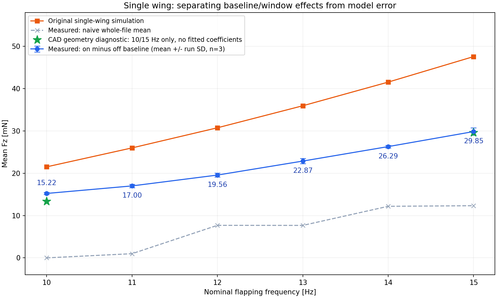
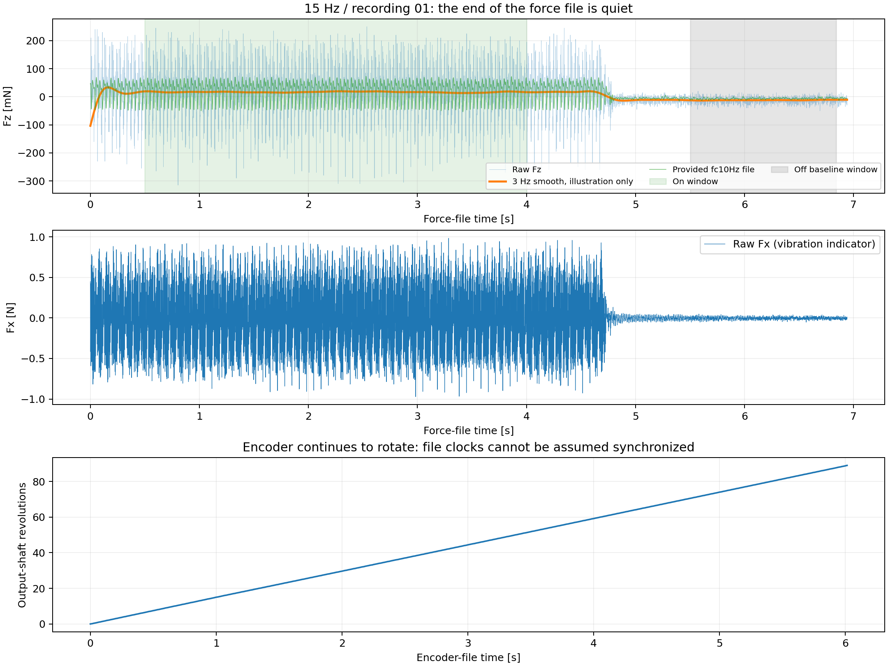
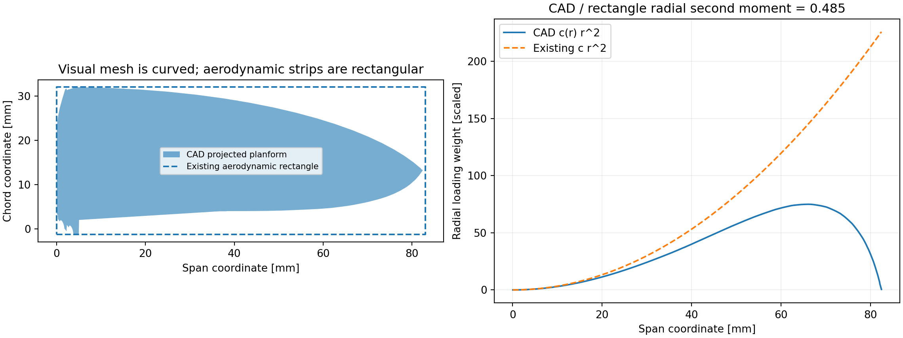
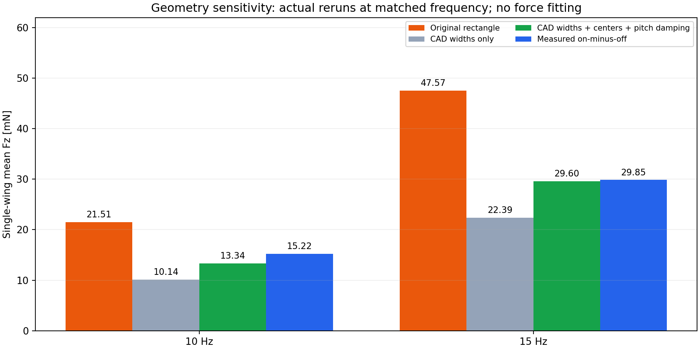

## Material Passport

- Origin Skill: academic-research-suite / experiment-agent
- Origin Mode: validate
- Origin Date: 2026-09-21
- Verification Status: ANALYZED（完成数据重算与诊断仿真；未重新开展物理实验）
- Version Label: single_wing_real_comparison_v1

## 结论

**后续参数更正：用户明确纠正羽化限位为 ±26.1°。本报告仿真和几何诊断均采用历史 ±50°，
不再作为正确实物条件下的验证结论。新结果见 `experiments/fixbase/results_single_wing_26p1deg_10_15hz/report.md`。**

差异由两部分组成：实测文件的运行/停机区间及非零基线放大了表面差距；原气动模型使用了矩形翼面积和统一作用点，导致真实曲线翼的气动几何不匹配。
用户已确认编码器记录减速输出轴，每转一圈对应一次扑翼周期；实物与 CAD 同尺寸，扑翼幅度和羽化限位相同。
当前统计仍有一个明确前提：**把力记录末段低振动区视为同装配状态的停机基线，且 Fz 正向与升力同向**。力传感器清零方式、两种力文件的生成方式尚未得到确认，以下实测升力据此解释。

原仿真在 10 Hz 给出 21.51 mN，实测基线校正后约 15.22 mN；15 Hz 分别为 47.57 与 29.85 mN。
所以不能继续把原仿真数值当作已经验证的升力预测。此前采用最大翼弦作为整翼弦长，是模型实现中的几何简化问题。

## 1. 实测记录与统计口径

读取 18 组原始六维力数据、18 组 `fc10Hz` 数据、18 组编码器和 18 组功率记录。
`Zone.Identifier` 旁文件没有纳入。力文件为 CP932 编码，表头明确单位为 N 与 Nm，采样率 1200 Hz；不是克力或毫牛。
三个目录 01、02、03 视为重复记录，不能据此推断是三个独立翼样品。

- 运行窗口统一使用力文件时间 **0.5–4.0 s**，避开首端和停机过渡。
- 基线统一使用 **5.5 s 至文件末尾前 0.1 s**。
- 每次记录先计算 `平均 Fz(运行) − 平均 Fz(末段)`，再对三个记录求均值和 SD。
- 与仿真相同，比较的是时间平均力；真实窗口不保证严格整数周期，已用多种窗口检查敏感性。
- 采样点、同一记录的周期没有当作独立样本；图中误差棒为三次记录之间的 SD，不是模型误差或置信区间。

| 频率 Hz | 实测基线校正 Fz / mN（均值 ± 记录间 SD） | 原仿真 / mN | 仿真偏高 | 编码器实测 Hz |
|---:|---:|---:|---:|---:|
| 10 | 15.22 ± 0.22 | 21.51 | 41.3% | 10.122 |
| 11 | 17.00 ± 0.39 | 25.98 | 52.8% | 11.137 |
| 12 | 19.56 ± 0.48 | 30.74 | 57.1% | 12.059 |
| 13 | 22.87 ± 0.63 | 35.95 | 57.2% | 13.034 |
| 14 | 26.29 ± 0.30 | 41.54 | 58.0% | 14.005 |
| 15 | 29.85 ± 0.87 | 47.57 | 59.4% | 14.951 |

## 2. 为什么不能直接平均整个 CSV

以 15 Hz / 01 为例，前段有明显周期振动，约 4.7 s 后 Fx/Fy 振动快速下降，末段 Fz 仍约 −12 mN。
若直接平均全文件，会混入约 2 s 低振动区及非零偏置。所有记录都出现相似的状态切换。
10 Hz 三次原始全文件均值甚至接近 0 mN；15 Hz 全文件平均约 12.32 mN，而运行减停机基线后约 29.85 mN。
**这个校正成立的条件是：末段确为停机，且拆装/重力载荷/传感器参考在同一文件内没有变化。**
仅有后段基线、没有前后两次静态基线，不能排除传感器漂移、整流误差或静态载荷改变。

原始和提供的 `fc10Hz` 文件全段均值约差 6 mN，但分别扣除各自末段基线后，六组汇总只差约 0.05–0.41 mN。
因此，滤波文件的 DC 基线和窗口口径值得核对，但它们不能解释校正后仍存在的 41–59% 仿真偏高。
文件名不能证明具体滤波器阶数和实现；这里只使用提供文件进行交叉核对，没有把它当作已知传递函数。

编码器在自己的约 6 s 记录中持续旋转，而力文件约 4.7 s 后明显安静；两套 `t=0` 不能直接视为同步。
这不妨碍分别求稳定段平均频率和升力，但当前数据不足以做可靠的编码器—六维力逐相位对齐。

## 3. 已确认的气动几何错误

`flapsim/config/settings.py` 将 span 设为 83 mm、chord 设为 33.25 mm。
`flapsim/fluid/blade_element.py:39` 使用 `span * chord / strips` 给每个条带相同面积；
第 18–20 行为全部条带使用同一个 chord_offset；第 45 行旋转阻尼使用 `span * chord**4`。
因此渲染显示真实曲线 STL，气动力计算实际仍使用矩形翼。可视外形正确不代表气动几何正确。

直接读取同一 CAD STL，按翼展切片，对前后表面及重叠三角片投影取并集，避免把双面重复计面积：

- 矩形面积：**27.60 cm²**。
- CAD 投影面积：**18.68 cm²**，仅为矩形的 **67.7%**。
- 展向二阶面积矩 `∫c(r)r²dr`：CAD / 矩形约 **0.485**。
- 1200 与 2400 个几何切片所得面积与二阶矩差异均小于 0.1%。

扑翼速度随力臂增加，翼尖的多算面积比翼根更影响力，因此仅按面积比乘一个修正系数不充分。
上述二阶矩用于说明展向加权差异，不等于可以直接乘到最终升力上的精确比例：翼根偏置、被动羽化、阻尼与力矩都会耦合改变运动。
几何投影含 CAD 框架轮廓，尚未单独区分翼膜和翼框的气动贡献。

## 4. 控制变量诊断：没有使用实测力拟合系数

另外在 10、15 Hz 运行两种诊断模型，保留原电机、机械结构、质量、限位、气动系数、12 条带、5 µs 步长。
每次重新调速，实测频率误差小于 0.01 Hz；每次运行 2 s，对 0.6 s 后完整周期积分。

1. **仅条带面积**：按 CAD 的 `c(r)` 改变条带面积，沿用旧作用点和旧旋转阻尼。
2. **完整平面轮廓**：同时按 CAD 更新条带弦向中心；旋转阻尼由 `span * chord⁴` 改为 `∫c(r)⁴dr`。
   原旋转阻尼系数 5.0 保持不变，仍是待验证的经验系数。

下表单位均为 mN：

| Hz | 原矩形模型 | 仅替换条带面积 | CAD 面积、作用点和旋转阻尼 | 实测基线校正 |
|---:|---:|---:|---:|---:|
| 10 | 21.51 | 10.14 | 13.34 | 15.22 |
| 15 | 47.57 | 22.39 | 29.60 | 29.85 |

结果表明气动几何近似是一个有实验证据支持的重要误差来源；面积、作用点和羽化阻尼必须一致处理。
这两个端点诊断不能证明新模型在所有频率、所有相位都正确。剩余偏差不能仅凭当前数据唯一归因。
诊断实现保存在 `geometry_sensitivity.py` 和 `analysis/geometry_sensitivity/`，未据实测数据调整主包气动系数。

## 5. 已排查与仍不能确认的因素

| 因素 | 证据与判断 |
|---|---|
| 单翼/双翼数量 | 当前对照为实际拆除右翼板、保留两侧传动的单翼仿真；没有把双翼结果直接除以二。 |
| N / mN / 克力 | 表头明确 N；统一乘 1000 转 mN，未发现单位倍数错误。 |
| 减速比与频率 | 用户确认输出轴每圈一次扑翼；编码器均值为 10.122–14.951 Hz，平均频率偏差约 1.3% 以内，不足以解释 41–59% 力差。 |
| 几何尺寸、角度限位 | 用户确认一致，仿真扑翼约 ±79.33°、羽化 ±50°；但角度范围一致不保证羽化时间历程、相位和周期内角速度一致。 |
| 仿真力与实测支架力 | 仿真曲线是空气作用力；传感器还含重力/偏置和惯性反力。周期稳定且窗口合理时惯性项时间均值趋近零，但瞬时波形不能直接当作纯气动力。 |
| 数值积分 | 原扫描及诊断没有 MuJoCo 数值警告。几何诊断沿用原步长，尚未做完整网格/步长收敛研究。 |
| 电机参数 | 仿真 R、Kt、反电动势常数等尚未用实物电压/电流辨识；已用实际频率比较，但周期内运动仍可能不同。 |
| 羽化相位及柔性 | 编码器只给输出轴，不提供实际羽化角。相同限位不能验证自动翻转的时序；当前刚体模型不能据此确认实物膜变形。 |
| 瞬时气动 | 当前自定义 BladeElement 为简化准定常模型，旋转项仅为阻尼力矩，没有显式附加质量力、尾迹历史或旋转升力项；这些影响方向和大小不能凭本数据断言。 |
| 传感器与滤波 | 尚缺静止清零、Fz 方向、安装坐标、两类文件生成方式及滤波实现；需确认后才能把基线校正视为最终标定值。 |

合理的下一步是先将 CAD 变弦长和条带作用点正式接入气动模型，再对 10–15 Hz 全部频率验证；
同时用同一触发采集输出轴、实际扑翼/羽化角与六维力，记录启动前和停机后的静态基线。
在这些口径统一前，不宜简单将某个气动系数乘一个常数以强行贴合六个均值。

## 6. 外部物理依据

准定常翼模型的平移、旋转与附加质量是不同贡献；当前代码缺少显式旋转升力和附加质量项，只能作为剩余误差的候选因素。
参见 Sane & Dickinson (2002), [The aerodynamic effects of wing rotation and a revised quasi-steady model of flapping flight](https://pubmed.ncbi.nlm.nih.gov/11919268/)。
MuJoCo 本身也将内置流体力定位为简化模型，而非 CFD：[MuJoCo fluid forces](https://mujoco.readthedocs.io/en/3.1.1/computation/fluid.html)。
本次实际使用自定义 BladeElement；以上文献没有被用来替代本地数据证据，也不能证明某个未测因素是本次唯一原因。

## 7. 统计与因果检查（11/11）

| 检查项 | 结果 |
|---|---|
| Simpson 悖论 | 按 01/02/03 分组保留数据，三组校正后的力随频率总体增加，未用汇总掩盖相反趋势。 |
| 生态谬误 | 仅讨论当前翼及这批记录，不外推不同个体/翼型。 |
| Berkson 选择偏差 | 纳入全部 18 次力记录，未按力值挑选成功样本；仍不代表所有工况。 |
| 碰撞变量偏差 | 没有控制由升力与频率共同决定的后果变量进行因果回归。 |
| 基率忽视 | 没有诊断概率或分类性能声明，不适用。 |
| 回归均值 | 未按极端升力挑选组或宣称干预提升。 |
| 幸存者偏差 | 所给 18 组均纳入；不能获知未提供或失败的物理实验。 |
| 多重搜寻 | 无显著性检验或挑选 p 值；诊断端点在结果前指定为 10/15 Hz。 |
| 分析路径选择 | 属探索性分析；公开全部窗口与窗口敏感性、原始/滤波口径、四组几何诊断。 |
| 相关当因果 | 数据本身只能显示偏差；仅对实际改变几何并重跑的模型内效应作受控解释。 |
| 反向因果 | 没有从相关性推断未知物理因果；剩余差异保留不确定性。 |

## 文件与复现

- `analysis/run_statistics.csv`：18 次原始/滤波基线统计、窗口敏感性、编码器和功率信息。
- `analysis/comparison.csv`：6 个频率对照；`analysis/analysis.json`：参数、几何审计及 72 个原始文件的 SHA256。
- `analysis/geometry_sensitivity/`：诊断模型每次调速的 NPZ、频率、逐周期均值。
- `analysis/CAD_planform.npz`：CAD 弦长和弦向中心。
- 原始实验文件没有改写；主仿真包没有改动。

复现分析：`python experiments/fixbase_curved_real/analyze_comparison.py`。
复现诊断：`python experiments/fixbase_curved_real/geometry_sensitivity.py`。
生成报告及执行 notebook：`python experiments/fixbase_curved_real/write_report.py`。
