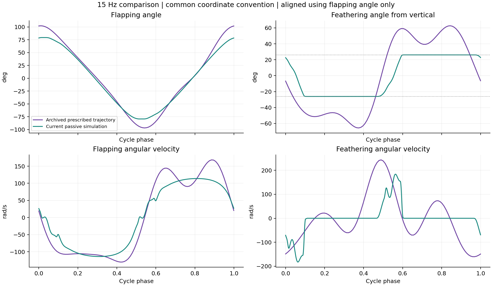
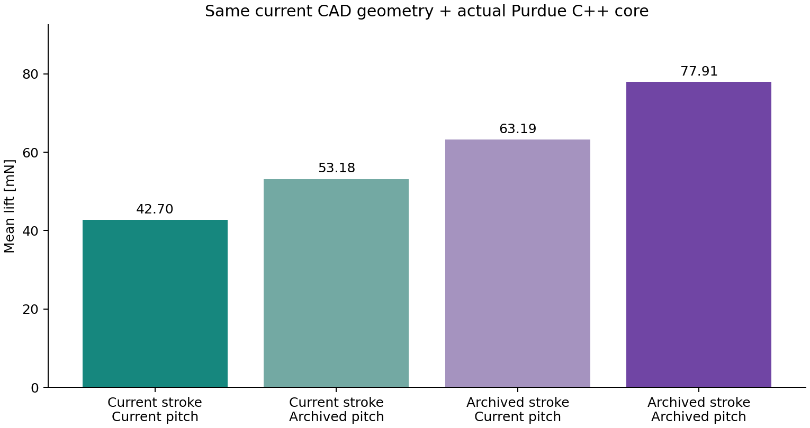
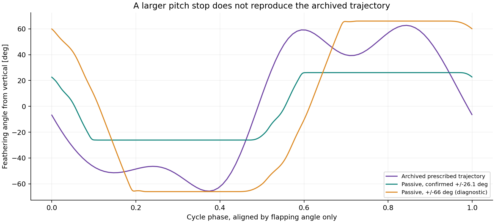

# 旧 Flappy baseline 与当前 IST 的运动轨迹核对

本报告更新此前气动力核对的归因。**先前把用户旧结果归因于 Flappy 默认 ±45° 的判断不适用于这组 baseline，已撤回。** 找到的旧代码直接向原版 C++ 输入规定角度和角速度，不读取机器人默认关节限位，也不求解被动羽化。实际输入来自 `FSI-Model/V7/data/rectangle_kapton_periodic_kinematics.csv` 的标称 20 Hz 周期，按频率缩放角速度/加速度后用于 10–15 Hz。

## 结论与量级

**运动轨迹是关键差异，扑翼和羽化两者都有影响，不能全部归因于气动力公式或 feathering 求解错误。** 原版 C++ 使用旧几何和原始 96 点轨迹，可以重现旧 Flappy 的全部六档结果；15 Hz 为 **60.143936 mN**，与用户图表一致。

|15 Hz，统一坐标定义|旧 baseline 规定轨迹|当前被动仿真轨迹|
|---|---|---|
|扑翼角范围|-96.76°～102.25°|约 −79.33°～79.33°|
|羽化角范围，从竖直量起|-65.61°～62.65°|约 −26.1°～26.1°|
|扑翼角速度 RMS|110.14 rad/s|89.90 rad/s|
|羽化过零相对本侧扑翼换向|提前 1.44、3.42 ms|滞后 1.28、1.25 ms|

角速度统一归一至 15 Hz。叠加图只用扑翼角确定一个整体相位平移，没有独立拟合羽化或升力相位。该对齐下羽化角 RMSE 为 28.16°、相关系数 0.881；这是两条轨迹的差异量，不是真实翼根角的测量误差。



当前羽化角约 77.4% 的周期处于限位幅度的 98% 以上；旧轨迹约 84.8% 的周期超出 ±26.1°（另留 0.2° 数值容差）。因此，两者不可能在同一严格翼根限位下被直接视为同一种关节运动。

## 分别替换扑翼与羽化轨迹

以下全部使用 **当前 CAD 几何 + 同一个 Purdue C++ 气动力核心 + 1.225 kg/m³ + 15 Hz**，逐点重放运动；只替换表中指定的运动变量。

|扑翼轨迹|羽化轨迹|平均升力 mN|
|---|---|---:|
|当前|当前|42.70|
|当前|旧 baseline|53.18|
|旧 baseline|当前|63.19|
|旧 baseline|旧 baseline|77.91|

单换羽化轨迹增加 10.49 mN；单换扑翼轨迹增加 20.49 mN。两项有交互作用，不能简单相加。扑翼角速度 RMS 增加约 22.5%，其平方增幅约 50.1%，符合准定常力对角速度平方的敏感性。



42.70 mN 是在原模型保存的运动轨迹上重算、统一 15 Hz 并做周期对齐后的力；此前 43.28 mN 是 Purdue 核心与机构重新耦合后的结果，轨迹略有变化。这两种检查回答不同问题，不能混用。

旧 baseline 的几何也不同：理想 **80 × 28 mm**，展向从扑翼轴起算，没有当前 CAD 的膜根位置和 7 mm 安装偏移。二阶展向面积矩为 4.77864844e-06 m⁴，当前 CAD 为 6.19546621e-06 m⁴。使用旧几何后，“旧扑翼 + 旧羽化”的 77.91 mN 变为 60.09 mN；原始 96 点直接执行为 60.143936 mN。60.09 与 60.14 的约 0.053 mN 差别来自为叠加/交叉替换使用的周期线性插值，而非重新拟合系数。

## 是否是当前模型把羽化算错了

已证实 **当前模型没有重现旧输入羽化波形**：幅度较小、翻转较晚、长期贴限位，旧输入还包含半行程内回摆。但旧 Flappy baseline 的羽化是外部输入，不能用它本身证明被动关节模型的正确性。

当前模型 `left_feathering_joint` 明确设置 `range=±0.455530934771 rad`，即用户确认的 ±26.1°；弹簧刚度 0、黏性阻尼 1e-8 N·m·s/rad、摩擦损失 0。它把整片翼视为刚体，用单个翼根转角代表所有翼段。硬限位决定幅度，惯性、气动力矩和碰撞决定翻转时机。若真实膜/翼架在根部限位之外仍有扭转，当前刚体角无法表示这种局部翼面运动；这是待验证的结构近似，不是已经找到的确定程序错误。

代码坐标检查表明，两边的 `theta=0` 都对应翼弦与升力轴平行，即竖直翼面。IST 采用 `phi=-q_flap, theta=-q_pitch` 映射到旧 baseline，不能再随意作 `90°-theta` 来让数值接近。旧 CSV 的三视角重建角是否代表翼根轴、整体拟合翼面，或含有安装/重建偏差，现有输入记录不足以独立确认；旧报告也注明视频运动向力实验迁移尚未验证。

为了检查“只要放开限位就能得到旧轨迹”这一可能性，另跑了 **±66° 诊断**：当前机构、质量和 Purdue 气动力都保持一致，频率校准到 14.98868 Hz。实际转角达到约 ±66°，平均升力仅 **43.47 mN**，羽化波形相对旧轨迹 RMSE 仍为 42.38°。因此仅改限位不能修复旧波形差异，正式 URDF 保留 ±26.1°。



把旧羽化波形整体缩小至 ±26.1°，保留其相位/形状并使用当前扑翼，升力反而为 34.12 mN。这也表明“旧相位一定更好”不成立；幅度、相位和停留时间必须一起比较。

**可执行的判断：** 先取得与本次力采集相对应、能区分翼根和翼面扭转的真实轨迹。若翼根确实保持 ±26.1°，就应保留关节限位，检查柔性翼面角及翻转动力学；若旧视频重建值被当成翼根角使用，则需要先核对它为何达到 ±65°、扑翼为何接近 ±100°。不能仅凭旧均值更接近实验就调关节或气动力系数。

## 同一批原始数据，但均值处理不同

矩形和曲边 Kapton 共 36 个原始力文件逐一 SHA-256 匹配，确实是同一批数据。两个 baseline 为 Sane–Dickinson 几何适配版和 Purdue Flappy 气动力核，另有 U1；本次没有改动它们的数据或源文件。

旧图用 1–4 s 内完整力信号周期的 **raw Fz**，未扣尾段零偏；本次用 0.5–4 s 平均再扣 5.5 s 至末尾前 0.1 s 的尾段均值。

|Hz|旧 raw 周期均值 mN|改平均窗口的影响 mN|减尾段零偏的影响 mN|当前均值 mN|
|---|---:|---:|---:|---:|
|10|20.832|+0.057|+5.045|25.934|
|11|27.344|-0.036|+4.368|31.676|
|12|28.459|+0.128|+7.571|36.157|
|13|37.070|-0.039|+7.370|44.401|
|14|44.554|+0.001|+6.762|51.317|
|15|55.522|-0.076|+3.869|59.315|

15 Hz 的 55.522 → 59.315 mN 差别几乎全部来自减去 −3.869 mN 尾段均值，窗口影响只有 −0.076 mN。这是统计口径差异，不是原始数据不同。这里只分解差异；没有额外空载标定，不能据此宣称任一零偏处理绝对正确。

## 证据、复现与限制

- [用户提供的矩形 Kapton 图表数据](C:/Users/hemin/OneDrive/Desktop/DataSet/RA-L/force_experiment_analysis_20260915/extracted/Rect_K_trend.csv)
- [旧 baseline 生成代码](C:/Users/hemin/OneDrive/Desktop/DataSet/FSI-Model/V_final/unsteady/literature_baselines.py)，`compute()` 调用规定运动并编译 C++；没有机器人关节积分。
- [旧运动输入函数](C:/Users/hemin/OneDrive/Desktop/DataSet/FSI-Model/V_final/unsteady/unsteady_aerodynamics.py)，`kinematics()` 读 V7 周期文件并按 f/20 缩放。
- [实际输入给 C++ 的归档轨迹](C:/Users/hemin/OneDrive/Desktop/DataSet/FSI-Model/V_final/unsteady/baseline_sources/flappy_inputs.csv)
- [旧实验处理协议](C:/Users/hemin/OneDrive/Desktop/DataSet/force%20experiment/six_wing_unsteady_physics_validation/figure_manifest.json)
- 本目录 `baseline_reproduction.json`、`raw_file_identity.json`、`force_processing_comparison.csv`、`factorial_lift.csv`、`aligned_trajectories.csv`、`reversal_timing.json` 可核对全部量值。`source_manifest.json` 保存输入哈希。

```bash
python experiments/fixbase_curved_real/historical_trajectory_audit.py
```

脚本断言六档旧 baseline 重现、36 份力文件哈希一致、旧周期均值重算一致、新均值等于原始窗口减尾段零偏，并生成图表。源文件只读，没有启动会改写旧实验输出的原生成脚本。原始 baseline 是规定运动模型；本报告的轨迹交叉替换也是诊断，不是新被动动力学仿真。±66° 案例是单独重新耦合的动力学诊断，已保存频率校准和原始轨迹，不能当成实际硬件设置。

状态：ANALYZED。已明确旧结果与本次结果的运动、几何和统计差异；尚不能独立判定哪条视频轨迹等于本次实物翼根运动。
