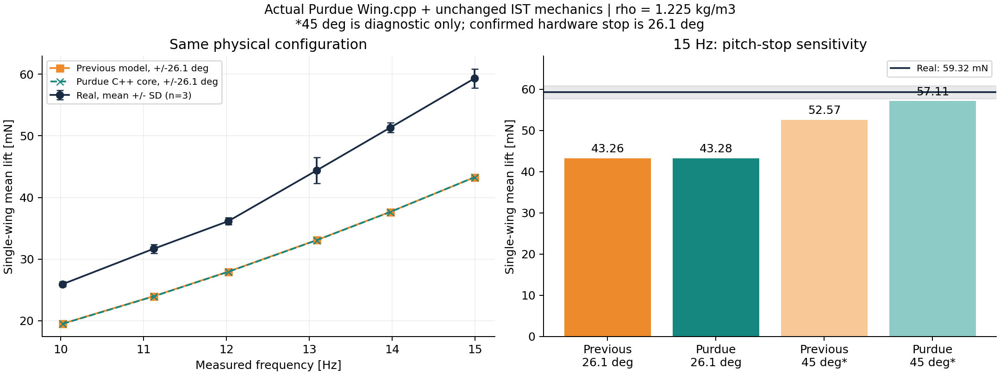
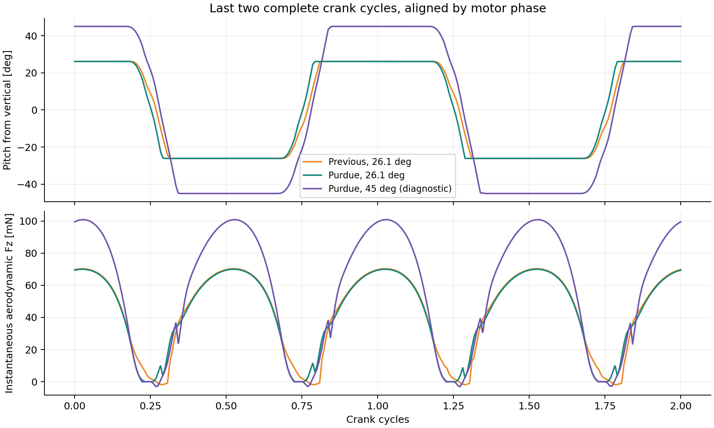

# Purdue Flappy 气动力核对与矩形翼升力差距诊断

**归因更新：** 后续找到用户旧 baseline 的实际输入，使用的是约 ±65° 羽化、约 ±100° 扑翼的规定视频轨迹，而非默认 ±45° 关节动力学。此前“默认限位解释旧结果”的判断已撤回。最新证据、轨迹叠加和分别替换试验见 [历史轨迹核对报告](historical_trajectory/report.md)。本页保留气动力实现核对及限位敏感性结果。

仍成立的实现核对结论：实际调用 Purdue C++ 核心，保持本项目的矩形翼、材料、传动、限位与频率后，10–15 Hz 升力与原模型的最大差异为 0.203%。

15 Hz：原模型 43.264 mN；Purdue 核心同条件 43.279 mN；仅将 Purdue 对照限位改成 ±45° 得到 57.107 mN；实测 59.315 ± 1.544 mN。45° 只作诊断，不是实物参数修正，也不是验证通过的条件。

**仍未解决的部分：** 正确 ±26.1° 条件下，两个刚性翼准定常模型都低于实测。此次排除了“当前气动力公式移植错了，换成 Flappy 就能补回 27%”这一解释；没有唯一确定剩余实物误差的物理原因。

## 来源和执行范围

- 使用用户指定 `/home/robot/rl/flappy`，commit `80399e1b773d15c125bd9f1dc7b416e8a7a18398`。对照源码与工作副本忽略 CRLF 后一致，见 `reference_manifest.json`。
- [Purdue Wing.cpp 原始代码](https://github.com/purdue-biorobotics/flappy/blob/80399e1b773d15c125bd9f1dc7b416e8a7a18398/flappy/envs/Wing.cpp) 经薄 C ABI 包装编译执行，没有将核心公式改写成另一个 Python 实现。源码及 MIT LICENSE 保存在 `reference/`。
- 执行的是 **原版气动力核心 + 本项目 MuJoCo 的 IST 机构**，不是将 Purdue 的整套 DART 蜂鸟机器人当成 IST。该设计用来隔离气动力差异。
- 主对照统一空气密度 1.225 kg/m³；另跑原版 1.18009482370369 kg/m³。所有几何矩由实际矩形翼轮廓重算，不套用蜂鸟默认值。
- 单左翼、保留两侧传动、固定基座；PET 翼架/翼根、10 μm Kapton 膜、PEEK 机构保持原材料模型。原 URDF、原始实验数据均未改动。
- 每次 2 s，步长 5 μs，初始 0.15 s 渐入，0.6 s 后完整曲柄周期平均；电机指令仅按编码器频率校准，容差 0.01 Hz，无升力系数拟合。

## 全频段复核

|名义 Hz|Purdue 实际 Hz|实测 mN，均值 ± SD|原模型 mN|Purdue mN|Purdue 对原模型|Purdue 对实测|
|---|---|---|---|---|---|---|
|10|10.0267|25.93 ± 0.42|19.53|19.49|-0.20%|-24.84%|
|11|11.1258|31.68 ± 0.73|23.98|23.95|-0.14%|-24.40%|
|12|12.0268|36.16 ± 0.57|27.97|27.94|-0.12%|-22.74%|
|13|13.0945|44.40 ± 2.09|33.10|33.06|-0.10%|-25.54%|
|14|13.9796|51.32 ± 0.79|37.66|37.64|-0.06%|-26.66%|
|15|14.9981|59.32 ± 1.54|43.26|43.28|+0.03%|-27.04%|

实测各频率 n=3；SD 是重复实验离散程度，不含传感器标定等系统不确定度。原实验稳态窗口和尾部零偏处理保持不变。



## 分开检查公式和被动羽化反馈

先将原 15 Hz 仿真的每一个 qpos/qvel 原样重放，只替换气动力计算；其后重跑机构动力学，允许气动力矩改变被动羽化。前者衡量直接力差，后者包含反馈。

|同一运动轨迹|平均升力 mN|对原模型变化|
|---|---|---|
|baseline|43.264|+0.000%|
|pressure_only|43.264|+0.000%|
|no_pitch_velocity|43.310|+0.106%|
|flappy_strip|43.740|+1.099%|
|flappy_cpp|42.666|-1.383%|
|flappy_native_density|41.102|-4.998%|

`pressure_only` 只改作用点，所以轨迹固定时净力不变。`no_pitch_velocity` 只从平移气动力中扣去羽化速度。`flappy_strip` 同时采用动态压力中心、扣除羽化速度、移除附加弦向阻力，但仍用原 12 条带。

|重新耦合动力学|实测仿真 Hz|平均升力 mN|对原模型变化|
|---|---|---|---|
|pressure_only|14.98240|43.466|+0.47%|
|no_pitch_velocity|14.98576|43.737|+1.09%|
|flappy_cpp|14.99812|43.279|+0.03%|
|flappy_native_density|14.99194|41.736|-3.53%|
|baseline_45deg|14.99138|52.568|+21.50%|
|flappy_cpp_45deg|14.99150|57.107|+32.00%|

10 Hz 的 ±45° Purdue 诊断也得到 25.727 mN，实测 25.934 mN。这仅是限位敏感性，不能用于解释后来找到的旧规定运动 baseline。



## 具体代码核对

1. **法向力系数一致。** 两边均使用 `CN = 1.8 sin(2α) cosα + 1.95 sinα - 1.5 cos(2α) sinα`，未找到符号、度/弧度、面积单位或单/双翼倍数错误。
2. **坐标映射已检验。** Purdue 局部 `(x,y,z)` 对应 IST `(-x,+y,-z)`；输入 `stroke=-IST_flap`、`pitch=IST_pitch`，法向力反号后转世界坐标。必须计入翼根距扑翼轴 7 mm。速度函数对 MuJoCo 点雅可比最大误差为 8.88e-16 m/s。2400 个相同 CAD 条带与 C++ 的完整力/力矩积分在回归测试容差内一致。
3. **原模型不是完整复刻 Flappy。** 原模型在条带弦中点施力，Purdue 使用随迎角变化的压力中心 `dcp=0.46-0.332 cosα-0.037 cos3α-0.013 cos5α`；原模型点速度包含羽化速度并另加转动阻尼，Purdue 平移力不包含该项；原模型另加 0.08 弦向阻力。26.1° 下这些差异对平均升力很小，但在 45° 下原模型与 Purdue 可差约 8.6%，不能声称两种实现普遍等价。
4. **力矩没有重复加。** Purdue `GetMoment()` 实际只返回转动阻尼；`fwmav.py` 把法向力施加在 CoP，已产生平移气动力矩。包装沿用该方式。
5. **不要误归因于遗漏 Flappy 的附加质量/转动环量。** 所检查版本的活动 `Wing.cpp` 没有单独的这些力项；它们不是两套当前实现间的缺项差异。
6. **几何离散有次要差异。** 原 12 条带插值跨越有尖角的轮廓，且 `np.interp` 在膜根范围外延伸端点。原面积积分偏差约 4.7%，但主要在近根低速度区，不能直接按面积比例推断升力偏差。C++ 对照使用实际 2400 个 CAD 区间。既有 24 条带与半步长收敛检查中，原平均升力分别变化约 0.048%、0.0038%。本次没有把这些小误差当成 27% 的原因。

## 为什么角度影响这么大，为什么实测差距仍存在

θ 从竖直翼面量起；忽略局部反转瞬态时，升力投影系数是 `CN(π/2-θ) sinθ`。26.1° 对应主要迎角约 63.9°，并不是迎角 26.1°。该投影系数从 26.1° 的 1.408897 增至 45° 的 1.875，增加约 33.1%。实际耦合结果从 43.28 增至 57.11 mN，变化与这一机制一致。

更严格地，对原 15 Hz 扑翼速度逐时刻允许 θ 在 ±26.1° 内任意选择、瞬时完成最优翻转，Purdue 法向力公式给出的理想平均升力上界只有 **43.18 mN**。这是原扑翼轨迹上的条件上界，未包含软限位微小越界，不能作为所有运动/柔性翼的普适上界。它说明仅调整该轨迹上的羽化相位，不足以达到 59.32 mN。

在同一波形和几何下，升力随扑翼角速度平方变化；从该上界到实测需有效角速度约增加 17.2%。当前扑翼幅度约 ±79.33°，Purdue nominal 默认的扑翼限位为 ±93.39°，这也是旧 Flappy 配置比较时必须核对的独立差异。此处仅指出默认限位，不把它当成旧运行的实际运动幅度。

下一步应使用实物同步拍摄得到的扑翼角速度和沿翼展羽化/扭转角，与仿真时间历程对照。若真实运动确实满足当前刚性翼轨迹和限位，再检查柔性翼形变、准定常力系数适用性以及传感器轴向/零偏。当前只有电机编码器频率和力数据，不能从平均升力唯一反推出这些因素。用户确认角度从竖直量起，故不应改成水平角定义，也不应将正式模型限位改为 45° 来贴合数据。

仿真输出口径为单翼空气作用力世界 +Z。载荷传感器的瞬时信号还包含结构惯性反力；有限采样下的 `fixture_dynamic` 冲击均值不可直接替代气动力均值。本次始终使用与旧比较一致的 `aero_Fz`。

## 复现与证据边界

在项目根目录、具有 numpy/mujoco/scipy/matplotlib/trimesh 的 Python 环境中运行（需 g++）：

```bash
python experiments/fixbase_curved_real/flappy_audit_experiment.py --build --capture --offline --coupled --sweep
python -m pytest tests/test_flappy_audit.py tests/test_rect_material_model.py tests/test_ist_materials.py -q
python experiments/fixbase_curved_real/flappy_audit_report.py
```

`same_motion_forces.npz`、`coupled/*/*/run_*.npz`、频率校准记录和源码清单均已保存。报告生成脚本重新积分每一个最终结果，检查频率容差和数值警告。该审查状态是 **ANALYZED**：验证了实现与条件差异，没有宣称完成真实机器人气动力模型的实验验证。

研究完整性检查（11 项）：相关性未冒充唯一因果；未将一次实现复核推广到所有气动工况；未用 45° 错配参数宣称拟合成功；未合并单/双翼口径；未调系数迎合结果；保留全频段而非挑选 15 Hz；三次重复不伪作独立时间样本；不使用显著性检验替代物理量级判断；不把测量 SD 当全部误差；分开源码一致性与实物有效性；旧运行输入的新证据和归因更正单独记录于历史轨迹报告。材料来源与用户确认记于 `material_passport.json`，沿用已有材料报告。
