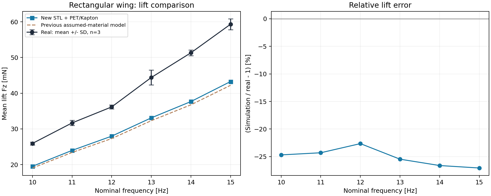
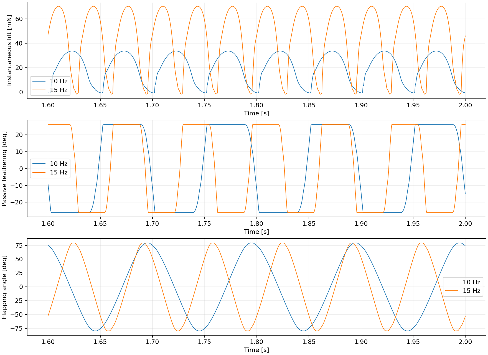

# 新矩形 STL：PET / Kapton 升力实验

## Material Passport
- 模式：run + 描述性 validate；Verification Status: ANALYZED。
- 输入：用户新增 Rectangular.STL，PEEK 传动、PET frame/翼根、10 μm Kapton；矩形翼 18 次实测记录。
- 状态：六档仿真实际完成，原始测量未改动；本报告不是气动模型已被验证的声明。

## 升力结果

|档位 Hz|编码器 Hz|仿真 Hz|实测均值 ± SD (mN)|本次仿真 (mN)|误差|旧仿真 (mN)|
|---:|---:|---:|---:|---:|---:|---:|
|10|10.0240|10.0236|25.93 ± 0.42|19.53|-24.7%|19.05|
|11|11.1224|11.1216|31.68 ± 0.73|23.98|-24.3%|23.40|
|12|12.0228|12.0218|36.16 ± 0.57|27.97|-22.6%|27.30|
|13|13.0897|13.0883|44.40 ± 2.09|33.10|-25.5%|32.30|
|14|13.9742|13.9723|51.32 ± 0.79|37.66|-26.6%|36.75|
|15|14.9920|14.9890|59.32 ± 1.54|43.26|-27.1%|42.22|



## 模型与质量
- 新增双翼模型 `flapsim/robot/IST_robot/urdf/IST_robot_rectangular.urdf` 与配套 XML；实验使用从它派生的单左翼 XML，两侧传动均保留。
- base_link 和 PEEK 传动参数继承上次材料修正，羽化限位 ±26.1°、弹簧刚度 0；阻尼和电机参数保持原设置。
- 新 STL 为毫米单位，含薄膜实体；通过共同的 2 × 2 mm 根部特征对齐旧装配坐标，再保留用户确认的 PET 翼根连接件。安装对应关系未由实测坐标再次标定。
- frame **248.816 mg**，原翼根 **79.425 mg**，Kapton **29.555 mg**，单翼总质量 **357.796 mg**。
- 直接对新封闭 STL 计算体积、质心和惯性。先按 PET 积分整体，再把已包含的 10 μm 暴露膜层修正为 Kapton 密度；没有重复叠加膜质量。被翼骨覆盖的膜层无法从融合网格独立识别，归入剩余 PET 实体，胶层未建模。
- 膜面积 **20.81356 cm²**，气动轮廓直接取新 STL 的膜面，包括根部偏移与小缺口，不再假设完整 80 × 26 mm 矩形。旧仿真列同时使用了旧几何/质量假设，差异不能全归因于材料。
- PET 1390、Kapton 1420、PEEK 1300 kg/m³，沿用已记录的厂家典型密度；采购牌号与真实总质量仍未测定。来源在机器人目录的 materials.json。

## 实验和比较口径
- 每档 2 s；步长 5 μs；12 叶素；记录 2 kHz；0.15 s 电机速度渐升。剔除前 0.6 s，以完整输出轴周期积分世界 +Z 气动力。
- 各档目标频率是同档三次实测编码器平均频率；电机指令只补偿负载造成的转速下降，最终频率误差均 <0.01 Hz。没有按实测升力调整气动系数或乘力倍率。
- 实测沿用旧流程：0.5–4.0 s 力均值，减去 5.5 s 至记录末尾前 0.1 s 的尾段均值。该尾段是静态基线的假设仍适用；若实际未停机，需重新定义去皮口径。
- 三次独立记录的样本 SD 用作误差棒；不是 95% CI，也不是模拟的置信区间。保留全部 18 次矩形翼记录。编码器和力记录无共同时间基准，本次只比周期均值，不逐点对齐。
- 保存六维气动力、动态支座反力、总线动量、扑翼/羽化角、完整周期统计及每次转速校准。主升力使用周期平均气动力；直接采样的支座反力受尖峰采样影响，不当作相同精度的均值。
- 固定基座位移误差为 0，所有最终运行有限数检查通过，MuJoCo 无数值警告。零数值警告不代表物理模型已验证。

## 数值检查
- 15 Hz：24 叶素、步长 5 μs，实际 14.9846 Hz，升力 43.285 mN（相对主实验 +0.05%）。
- 15 Hz：12 叶素、步长 2.5 μs，实际 14.9889 Hz，升力 43.266 mN（相对主实验 +0.00%）。



## 统计解释检查（11/11）
1. Simpson：逐频率比较，不混合翼型汇总回归。
2. 生态谬误：统计单位为三次记录，不把采样点当独立重复。
3. Berkson：未按匹配程度筛选实测。
4. Collider：未按残差控制或删除样本。
5. 基率：不涉及诊断概率。
6. 均值回归：未挑选极端频率或重复。
7. 幸存者：全部 18 次矩形实测与六档最终仿真均报告，校准过程保留。
8. 多处寻找：无显著性检验，报告所有指定频率。
9. 分析路径：去皮、窗口、材料、安装与离散化明示；沿用既有实验口径。
10. 相关与因果：升力残差不能单独证明膜柔性、阻尼或某个气动机制是原因。
11. 反向因果：不从力匹配反推唯一运动规律，不按实测力拟合参数。

## 复现
```bash
python experiments/fixbase_curved_real/rect_material_experiment.py --prepare --run --convergence --report
```
依赖 NumPy、MuJoCo、SciPy、Matplotlib、trimesh。`source_manifest.json` 保存原始数据哈希，`model_assumptions.json` 保存几何与材料输入哈希，`simulation_summary.json` 保存最终模型和气动轮廓哈希。历史 rect_validation 结果保持原样。
