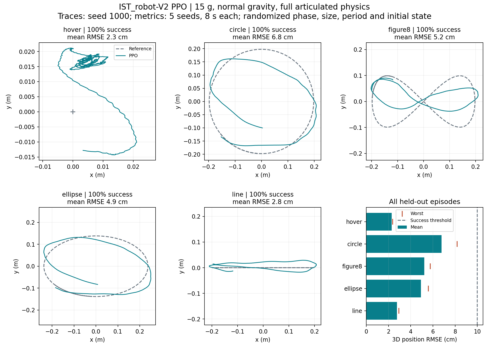
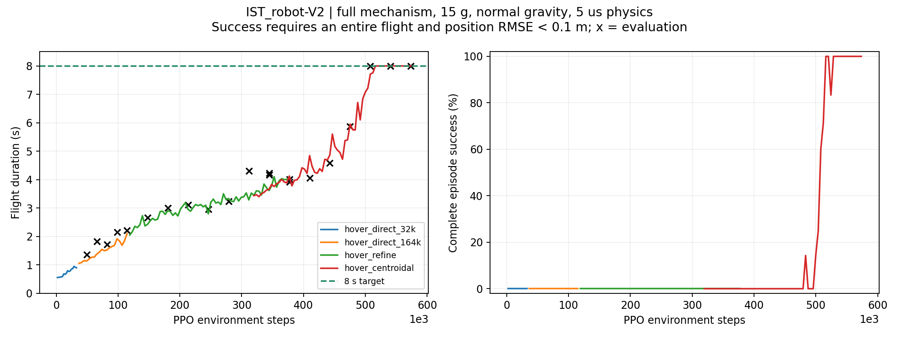

# IST_robot-V2 PPO：训练与验证记录

2026-10-04。代码基于远端 `v1` 的 `855b816b95828f9eeffd7238adf1f451f0f52c99`。
本次工作目录为 `/home/robot/rl/FlapSim-ppo-v2`，结果发布在 `v2` 分支。
原 `/home/robot/rl/FlapSim` 中已有大量未提交修改，因此在独立目录完成升级和训练。

## 模型和任务

使用新版 IST_robot-V2 的完整 MuJoCo 闭链机构、DC 电机、两个有限力矩云台伺服、
被动羽化关节和叶素气动力。机器人 XML SHA-256 为
`c3fcec3057491e3c1d91545d19ef8a436b7536d30aec954a91ce7b02152f7751`。
整机 15 g，重力 9.81 m/s²，最大电压 4.2 V，物理步长 5 μs，控制周期 10 ms。
策略直接输出电机目标转速和 pitch/roll 目标角度，保留原来的执行器限幅和动作平滑。

初始状态在悬空参考点附近、已有扑翼转速，并以参考速度开始；本次任务是悬停和
连续轨迹跟踪，不包含地面起飞、着陆或大姿态恢复。训练随机化初始位置、姿态、
速度（标准差 0.01 SI 单位）、起始相位、半径和周期（±20%）。
轨迹中心为 `(0, 0, 0.8) m`；最终课程半径参数 0.20 m、周期 8 s、垂直幅度 0.10 m。
椭圆半轴为 1.2r 和 0.7r，helix 和 lissajous 的具体频率见轨迹定义。
这些是仿真结果，尚未用实机或实测气动标定验证。

成功指标：完整飞行至指定时限，且全程三维位置 RMSE < 0.10 m。
提前失稳的短回合不会作为成功。评估冻结归一化统计，使用确定性 PPO 动作。

## master 能迁移什么

检查的旧 master 为 `de36cf3`。其飞行环境采用周期平均动力学，并以稳定 PD 为基线，
PPO 只输出比例为 20% 的残差。旧策略与 V2 的观测和动作物理含义不同，不能直接加载。
在旧环境里对相同种子 1000–1002 的复核如下；这是旧环境内部的对照，不能当作
与 V2 的同条件性能排名。

| 旧任务 | PD、零残差 RMSE | PD + PPO RMSE | 完整时长 |
| --- | ---: | ---: | ---: |
| 悬停 | 6.78 cm | 6.52 cm | 6 s |
| 圆 | 3.13 cm | 3.85 cm | 16 s |
| 八字 | 3.18 cm | 3.64 cm | 16 s |
| 椭圆 | 3.10 cm | 3.79 cm | 16 s |

旧训练的稳定表现很大程度来自 PD 和平均动力学。此次保留小幅探索和分阶段训练的
思路，在 V2 完整动力学上重新训练 PPO；没有把旧权重伪装成 V2 的控制策略。
旧环境原始结果见 [master 对照](../../artifacts/ppo_v2/evaluation/master_comparison.json)。

## 已验证的悬停策略

文件：[hover 策略目录](../../artifacts/ppo_v2/hover/)。冻结检查点的 PPO 计数为 540,848 步。

| 独立评估 | 成功/回合 | 平均 RMSE | 最差 RMSE |
| --- | ---: | ---: | ---: |
| 8 s，种子 1000–1009 | 10/10 | 4.09 cm | 5.05 cm |
| 16 s，原物理步进顺序，种子 2000–2003 | 4/4 | 4.97 cm | 5.19 cm |
| 16 s 演示，种子 3000 | 1/1 | 5.05 cm | 5.05 cm |

原始汇总：[8 s](../../artifacts/ppo_v2/evaluation/hover_8s.json)、
[16 s 原顺序](../../artifacts/ppo_v2/evaluation/hover_16s_original.json)。
演示：[视频](../../artifacts/ppo_v2/evaluation/hover_16s.mp4)。

同一 V2 环境的零动作配平对照在种子 1000–1002 上全部因倾斜超限终止，平均仅
0.537 s，成功率 0/3。此对照只有固定配平转速，没有 PD；它与上面的旧 master
“零残差 + PD”对照含义不同。[原始对照](../../artifacts/ppo_v2/evaluation/zero_trim/summary.json)。

## 标准轨迹策略

推荐交付：[tracking 策略目录](../../artifacts/ppo_v2/tracking/)，一个 PPO 同时控制
悬停、圆、八字、椭圆和往返直线。标准轨迹阶段追加 262,144 步后冻结。
以下为名义周期 8 s、半径参数 0.20 m 的随机化独立评估；尺寸和周期仍有 ±20% 扰动。

| 任务 | 8 s 成功/回合 | 8 s 平均 RMSE | 16 s 原顺序成功/回合 | 16 s 平均 RMSE |
| --- | ---: | ---: | ---: | ---: |
| 悬停 | 5/5 | 2.28 cm | 3/3 | 2.28 cm |
| 圆 | 5/5 | 6.78 cm | 3/3 | 6.51 cm |
| 八字 | 5/5 | 5.22 cm | 3/3 | 5.19 cm |
| 椭圆 | 5/5 | 4.92 cm | 3/3 | 4.77 cm |
| 往返直线 | 5/5 | 2.75 cm | 3/3 | 2.77 cm |

8 s 使用种子 1000–1004；16 s 使用 2000–2002，并恢复原物理步进顺序。
核心任务所有回合均达到时限和 RMSE 阈值；这不代表所有扰动、速度或持续时间下的保证。
[8 s 原始汇总](../../artifacts/ppo_v2/evaluation/tracking_8s.json)、
[16 s 原始汇总](../../artifacts/ppo_v2/evaluation/tracking_16s_original.json)。

冻结策略后又使用未参与任何调参的种子 4000–4004 复核核心四项任务，共 20/20 回合
成功，悬停/圆/八字/椭圆平均 RMSE 分别为 2.33/6.75/5.15/4.86 cm。
合并两组 8 s 检查，这四项任务各有 10/10 回合成功。
[最终复核](../../artifacts/ppo_v2/evaluation/core_final_audit.json)。



### 附加三维轨迹的限制

同一策略在周期 8 s 的快速三维任务上尚未达到稳定标准，不能把二维结果外推到这些任务：

| 任务 | 8 s 成功/回合 | 8 s 完成/回合 | 16 s 原顺序成功/回合 |
| --- | ---: | ---: | ---: |
| helix | 3/5 | 4/5 | 2/3 |
| lissajous | 2/5 | 5/5 | 1/3 |

螺旋的个别随机起始状态会因倾斜失稳；两类快速三维任务还有明显的 y 方向跟踪误差。
这些失败也完整保存在上面的原始汇总中。额外细化课程降低学习率并增加三维任务采样，
虽然固定训练评估曾达到 7/7 成功，32,768 步检查点的独立复核仍只有 3/5、2/5 成功。
因此交付说明按独立结果限定可用范围，不用训练评估的单次成功代替验证。
该细化阶段完成后，最佳检查点位于 98,304 步；对原问题种子 1000–1004 的复核仍为
helix 3/5、lissajous 2/5 成功。误差有所降低，但没有消除失败模式，所以只保留为
后续研究检查点。[最终实验复核](../../artifacts/ppo_v2/evaluation/spatial_refinement_final.json)。

额外的低速探索使用另一组种子 5000–5002、名义周期 16 s、飞行时长 16 s、原步进顺序。
helix 成功 2/3（最差 RMSE 10.15 cm），lissajous 成功 3/3（最差接近 10.00 cm）。
该探索没有足够的误差余量，也未验证多周期，因此不升级为已收敛的三维任务。
[单独记录的低速结果](../../artifacts/ppo_v2/evaluation/spatial_period16_exploratory.json)。

## 训练过程与关键修复

1. 先扫描实际升力。3400 rad/s 的输入轴命令对应实际约 2633 rad/s、26.19 Hz、
   15.18 gf 升力；最大命令 5000 rad/s 对应约 2911 rad/s、28.95 Hz、17.99 gf。
   最大推重比约 1.20。增大物理步长会改变推力，因此保留 5 μs。
2. 使用 128×128 的独立 actor/critic MLP、PPO、初始 `log_std=-2`、零熵奖励、
   `gamma=.995`（初始试训为 .99）、GAE .95、clip .2、target KL .03。
   主要阶段使用 16 个环境，rollout 256 步，batch 256，学习率后期降至 1e-4。
3. 追加整机角动量对应的等效角速度、机构轴方向 6 个特征，帮助处理内部机构运动
   与机身角速度的耦合。新增输入权重置零，保持迁移瞬间的策略输出，重建 Adam。
4. 悬停转轨迹时，参考加速度原来恒为零，归一化方差已塌缩。初始化其方差并清零
   对应输入权重，避免新参考一进入网络就饱和。然后依次训练 0.10 m 和 0.20 m 课程。
5. 每条训练轨迹各占一个固定种子的评估环境。最佳策略和其当时的归一化统计成对保存。
   最终交付使用独立导出文件，记录策略、归一化、机器人模型和环境实现的哈希。

悬停阶段本地运行依次为 `hover_direct_32k`、`hover_direct_164k`、`hover_refine`、
`hover_centroidal`。最后一阶段从 311,472 步的最佳策略迁移，冻结悬停在 540,848 步。
小半径阶段 `tracking_small` 从悬停阶段最佳策略开始，追加 131,072 步。
标准阶段 `tracking_full` 追加 262,144 步。另一个实验阶段 `tracking_refine` 追加
131,072 步、学习率 5e-5，helix/lissajous 各重复列入采样池三次，提高快速转向样本占比。
该阶段单独保存在 `experimental_spatial/`，不替换已经独立验证的交付策略。
`warm-start` 会重置 PPO 步数计数，因此最终轨迹策略的计数不等于所有阶段的总样本数。



各阶段参数、训练 CSV、评估历史和检查点哈希保存在
[训练档案](../../artifacts/ppo_v2/training/)。

## 物理加速的核验

C++ 循环复用相同电机和叶素力公式；split-step 消除重复动力学计算。
固定支座 40,000 步与原 native 顺序的 qpos/qvel 差为 0。
自由机构 10,000 步与 NumPy 原实现的最大差为 qpos `5.71e-12`、qvel `1.87e-9`。
该短基准耗时由 2.26 s 降为 0.174 s，约 13 倍；不代表所有训练任务都能达到该倍数。
另外在原先的非 split 步进顺序上验证了长时间飞行。
[基准原始数据](../../artifacts/ppo_v2/evaluation/freeflight_benchmark.json)。

回归检查：`python -m pytest -q tests`，13 项通过。包含固定/自由机构、完整扑翼周期、环境质量和
重力、随机种子、回合时限、特征迁移保持输出、轨迹参考的解析导数和兼容性。
另已构建 wheel 并在独立安装目录加载导出策略，验证 C++ 源文件和机器人资源随包提供；
打包检查中的极短回合只验证软件接线，不计入上述飞行成绩。

## 使用交付策略

在本目录对应的仓库根目录，使用 MuJoCo 3.8.0 和 CPU PPO。确切版本见
[requirements.txt](requirements.txt)，本次 Python 为 3.11.11，Linux/WSL 需要 `g++`。

```bash
python -m pip install -e '.[rl,video,test]'
python -m flapsim.rl.evaluate --run artifacts/ppo_v2/hover --trajectories hover \
  --episodes 3 --randomize --seconds 16 --plot --output runs/my_hover_check
python -m flapsim.rl.evaluate --run artifacts/ppo_v2/tracking \
  --trajectories hover circle figure8 ellipse line --episodes 3 --randomize \
  --seconds 16 --reference-physics --plot --output runs/my_tracking_check
```

源代码中的默认 CPU 路径仍可独立使用。已训练策略记录了 native/split/特征选项，
评估会自动恢复；`--reference-physics` 改用原 native 步进顺序。
全量使用、继续训练和导出方式见 [RL 说明](../../flapsim/rl/README.md)。

八字 16 s 演示：[视频](../../artifacts/ppo_v2/evaluation/figure8_16s.mp4)，
种子 3003，RMSE 5.41 cm。视频和图均由实际仿真轨迹生成。
