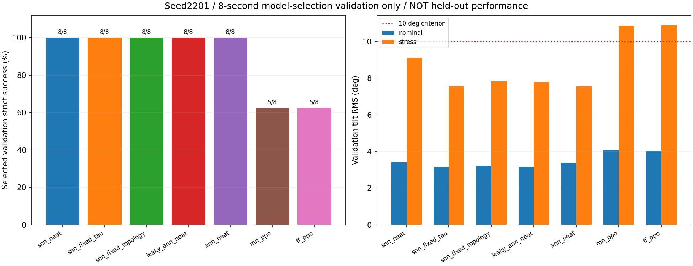
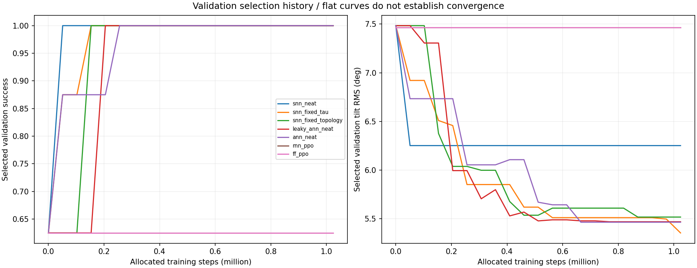
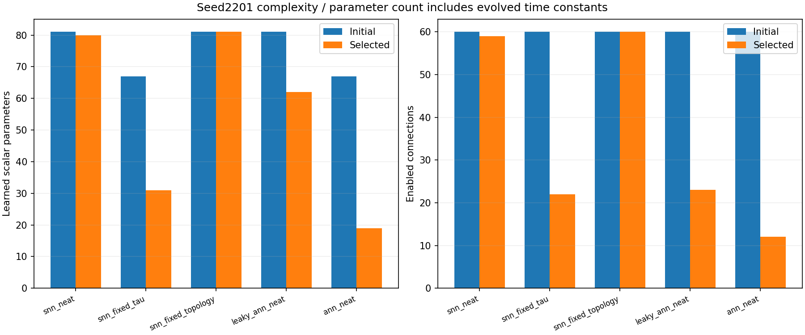
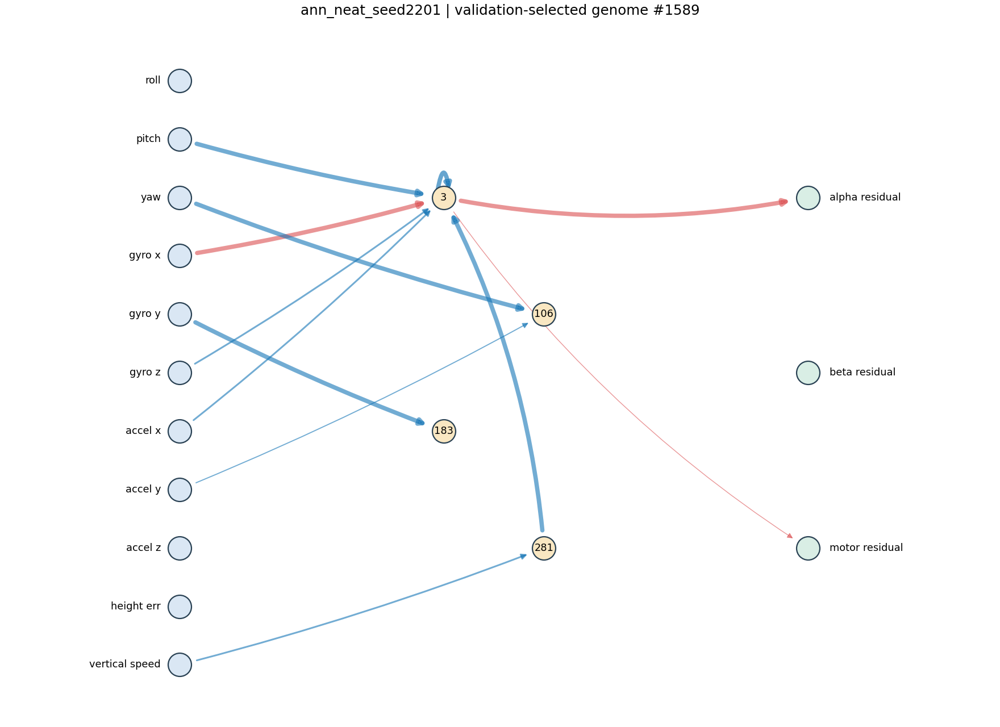
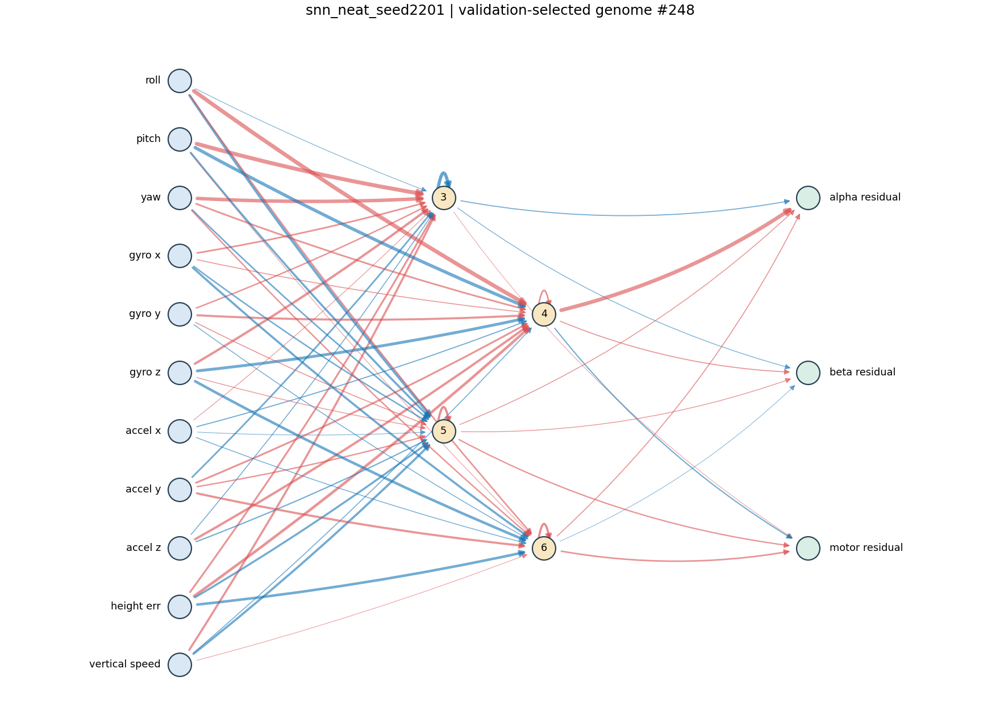
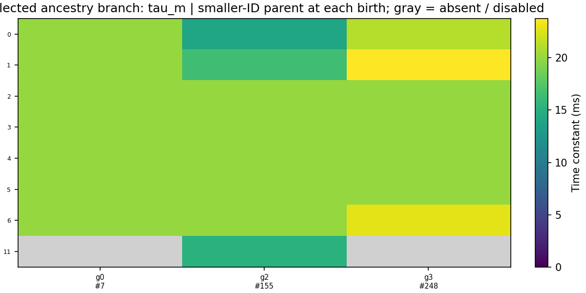
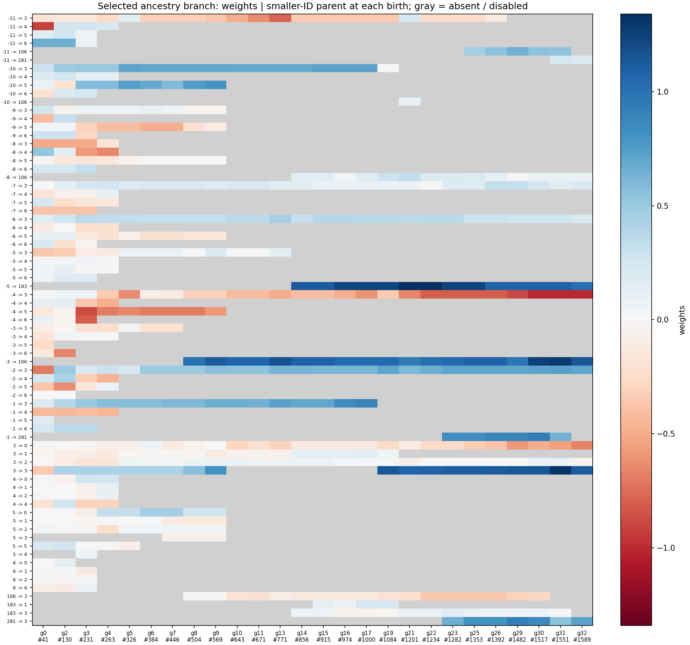

# 阶段性研究报告：seed 2201 的 NEAT、SNN 与 PPO

**这是阶段性报告，不是 report_final.md。七种方法各完成一个训练种子；本报告只分析训练中已经使用的8秒验证场景，尚未执行正式独立测试。**

暂停状态：已在 snn_neat_seed2202 完成后暂停；共完成8/35次训练，剩余27次。 2202 的结果只用于保存续跑边界，不混入本页的2201算法比较。

[迁移与续跑 exec.md](exec.md) · [冻结协议](artifacts/snn_hover_20261009/protocol.json) · [原始阶段分析](artifacts/snn_hover_20261009/interim_2201/analysis.json) · [全部已生成演化浏览器](artifacts/snn_hover_20261009/evolution_index.html)

## 当前能支持的研究结果

五个演化组的验证选中策略均通过8/8回合；两个PPO组均为5/8。其中常规场景所有方法都为4/4，扰动场景演化组为4/4、PPO为1/4。这说明当前进化实现能在固定PID基础上改善这组短时验证场景的姿态控制；不能由一个种子和重复选模场景推导出泛化优势。

**当前较清晰的候选贡献是稀疏控制图的规模收益，证据仍是阶段性的。** ANN-NEAT选中模型从60条连接减至12条、学习参数从67减至19，分别减少80.0%和71.6%，仍通过8/8验证回合，倾角RMS为5.47°。固定时间常数SNN为31个学习参数、22条连接，也通过8/8，倾角RMS为5.36°。二者值得在后续独立场景验证，但当前不能证明删边本身造成改善或性能非劣。

**联合演化时间常数暂未体现额外优势。** 联合SNN通过8/8，但倾角RMS为6.25°、80个学习参数、59条连接；固定时间常数SNN在同组验证上的RMS更低且更小。联合SNN相对固定拓扑SNN仅少1条连接，不能据此主张明显拓扑压缩，更不能称SNN优于ANN。

**PPO的“选中模型”是训练前初始化模型。** 两组都实际完成1,024,000步训练，但按预先规定的验证排序，没有后续检查点优于初始策略。因此不能把5/8描述为PPO学到的提升，也不能把这个配置的一次失败归结为PPO算法普遍无效。

## 同一输入、输出和物理条件

上部7 g、下部8 g；base_link提供姿态、角速度、加速度9维，另加测高误差和估计垂直速度，共11维。各方法输出α、β、电机转速的有符号残差，加到同一个固定PID。残差幅度0.035 rad、0.035 rad、100 rad/s；最终角度±0.3 rad，电机3115.224–3807.496 rad/s。内环500 Hz、策略100 Hz；SNN每次策略决策内部积分10个1 ms步骤。

严格成功需飞满、几何间隙>3 cm、稳定段倾角RMS<10°、高度RMS<15 cm及晚段高度波动和斜率达标。yaw与水平位置不闭环；当前结论不是纯IMU定高或水平定点悬停证明。

## 2201 已完成结果

| 方法 | 常规/扰动通过 | 总通过 | 倾角RMS | 高度RMS | 最小间隙 | 参数/连接 |
|---|---|---|---|---|---|---|
| SNN 联合演化 | 4/4；4/4 | 8/8 | 6.252° | 6.348 cm | 50.52 cm | 80 / 59 |
| SNN 固定时间常数 | 4/4；4/4 | 8/8 | 5.356° | 6.570 cm | 50.00 cm | 31 / 22 |
| SNN 固定拓扑 | 4/4；4/4 | 8/8 | 5.518° | 6.427 cm | 50.68 cm | 81 / 60 |
| Leaky ANN-NEAT | 4/4；4/4 | 8/8 | 5.470° | 6.438 cm | 50.32 cm | 62 / 23 |
| ANN-NEAT | 4/4；4/4 | 8/8 | 5.465° | 6.411 cm | 50.38 cm | 19 / 12 |
| RNN-PPO | 4/4；1/4 | 5/8 | 7.465° | 6.306 cm | 50.85 cm | 211 / 200 |
| FF-PPO | 4/4；1/4 | 5/8 | 7.463° | 6.303 cm | 50.85 cm | 1539 / 1472 |

倾角与高度列是8个回合各自RMS的均值，最小间隙取全部回合的最小值。成功率属于反复用于选模的验证集；不计算跨训练种子置信区间。

## 学习过程与收敛判断

联合SNN的最终选中策略来自第3代、51,200个分配训练步；继续训练到预算结束没有替换它。最后一代冠军本身只通过5/8，说明保留验证最佳模型很重要，也说明“最佳曲线不再变化”不能解释为种群已经稳健收敛。

| 方法 | 选中代/更新 | 选中时分配步 | 初始→选中→最后候选通过 | 实际训练步 | 训练耗时 |
|---|---|---|---|---|---|
| SNN 联合演化 | 3 | 51200 | 5/8 → 8/8 → 5/8 | 1023957 | 59.7 min |
| SNN 固定时间常数 | 39 | 1024000 | 5/8 → 8/8 → 8/8 | 1024000 | 59.1 min |
| SNN 固定拓扑 | 36 | 870400 | 5/8 → 8/8 → 8/8 | 1022307 | 59.4 min |
| Leaky ANN-NEAT | 34 | 768000 | 5/8 → 8/8 → 8/8 | 1023076 | 58.6 min |
| ANN-NEAT | 32 | 665600 | 5/8 → 8/8 → 8/8 | 1024000 | 58.1 min |
| RNN-PPO | update 0 | 0 | 5/8 → 5/8 → 5/8 | 1024000 | 69.7 min |
| FF-PPO | update 0 | 0 | 5/8 → 5/8 → 5/8 | 1024000 | 69.8 min |

2201合计实际训练 **7,165,340** 步、反复验证 **940,800** 步。分配预算为7×1,024,000步；提前失败会使演化实际步数略少。停止依据是预先预算，不是证明全局收敛。

## 结构、权重与时间常数

选中模型不一定是最后一代冠军。以下浏览器保存每个演化组40代×64个体、双亲、出生变异、权重、偏置与时间常数；结构动画展示每代冠军，不冒充单条祖先链。家谱保留双亲，热图沿编号较小父代的确定分支。

| 方法 | 选中隐藏节点 | 本次搜索最多隐藏节点 | 启用连接 | 有效连接 | 模型/演化 |
|---|---|---|---|---|---|
| SNN 联合演化 | 4 | 9 | 59 | 59 | [模型](artifacts/snn_hover_20261009/training/snn_neat_seed2201/best_policy.json) · [浏览器](artifacts/snn_hover_20261009/training/snn_neat_seed2201/visuals/explorer.html) |
| SNN 固定时间常数 | 6 | 15 | 22 | 20 | [模型](artifacts/snn_hover_20261009/training/snn_fixed_tau_seed2201/best_policy.json) · [浏览器](artifacts/snn_hover_20261009/training/snn_fixed_tau_seed2201/visuals/explorer.html) |
| SNN 固定拓扑 | 4 | 4 | 60 | 60 | [模型](artifacts/snn_hover_20261009/training/snn_fixed_topology_seed2201/best_policy.json) · [浏览器](artifacts/snn_hover_20261009/training/snn_fixed_topology_seed2201/visuals/explorer.html) |
| Leaky ANN-NEAT | 10 | 15 | 23 | 18 | [模型](artifacts/snn_hover_20261009/training/leaky_ann_neat_seed2201/best_policy.json) · [浏览器](artifacts/snn_hover_20261009/training/leaky_ann_neat_seed2201/visuals/explorer.html) |
| ANN-NEAT | 4 | 12 | 12 | 9 | [模型](artifacts/snn_hover_20261009/training/ann_neat_seed2201/best_policy.json) · [浏览器](artifacts/snn_hover_20261009/training/ann_neat_seed2201/visuals/explorer.html) |

ANN选中图的隐藏节点为3、106、183、281，初图为3–6；因此最终虽仍有4个隐藏节点，内部节点和连接确实经历了新增、替换与删除，并非只调整了相同图的权重。可通到输出的有效隐藏节点为3、281；另两支仍存于导出图中，所以报告保守计入全部19个参数，没有把未经部署简化的14参数图当作实测结果。

从有向图可达性看，ANN的动态学习残差只依赖pitch、gyro_x、gyro_z、accel_x和估计垂直速度；β残差只有一个常数偏置。固定PID仍动态控制全部执行器，不能据此说整个机器人的β固定不动，也不能说这些输入在其他扰动下已被证明足够。该结构提供了后续可验证的简化线索。

联合SNN选中模型仅4个时间常数偏离20/10 ms初值，其中3个属于连续读出、1个属于隐藏神经元；其选中隐藏节点仍为初始3–6。这不足以支撑“演化找到了丰富的脉冲时间尺度”的表述。

SNN的学习参数包括可变时间常数；固定τ不计为学习参数但仍需存储。ANN节点中的τ字段仅为公共导出格式，ANN运行时不用这些连续时间常数。CPU推理计时暂不作为本阶段结论，因为不同任务运行时的机器负载不相同，最终流程会空闲重测。

[档案核查](artifacts/snn_hover_20261009/interim_2201/archive_verification.json)逐代验证了五个演化组的40代、12,800次个体评估、真实父代、基因变异记录、选择模型和可加载检查点。迁移用的两个已有验证场景另重放1,600步，未加入本表成绩或训练预算。

## 目前不能得出的结论与后续计划

尚未运行20秒独立测试、60秒持续测试、大角度恢复、单因素扰动和时间常数/记忆干预，因此不能确认长期hovering可用、SNN时间尺度有益、拓扑具有因果优势或某算法稳健优于其他算法。没有根据验证均值调整冻结参数，也没有提前读取保留测试集。

后续从 snn_fixed_tau_seed2202 开始完成剩余27次训练，保持原协议、种群64、16个环境/工作进程、同一预算、同一输入输出及选模规则。所有训练完成后再执行冻结的11,888回合测试和正式分析。若要改变PPO超参数或SNN机制，须另列新实验版本，不能覆盖当前比较集。

物理依据仍来自此前单翼测力辨识；10–15 Hz的实测约束不等于已经验证双翼约26.7 Hz自由飞行。地面判断为保守几何间隙，模型未启用真实接触动力学；SNN放电稀疏度也不是硬件能耗证据。

## 暂停与迁移文件

[exec.md](exec.md)给出依赖、绝对网格路径处理、迁移哈希检查、已用验证场景回放一致性检查、显式续跑命令和最终收尾步骤。暂停在完整训练运行边界，保留全部导出模型、预算检查点、种群和日志；不要求恢复某个回合中途的神经状态。

本阶段报告不替代最终报告；完整比较结束并检查通过后才生成 report_final.md。
